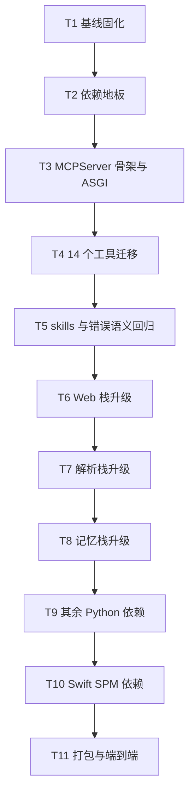

# MCP SDK v2（MCPServer）与全量依赖升级 实施计划

**目标：** 把 agent-gateway 的 mcp 从 1.28.1 升到 2.3.0，服务端从低层 `Server` 迁到 `MCPServer`，14 个工具改为函数注册，其余 Python 与 Swift 依赖升到当前最新兼容版本，打包与首启安装链路可用。
**背景：** v2 移除了 `@server.list_tools()` / `@server.call_tool()`，`pyproject.toml:58` 的 `<2` 上界只是临时挡板；开发 `.venv` 已是 2.3.0，任何重建依赖的流程都会让服务导入即失败。用户要求用上 v2 的 `MCPServer` API，并全量升级依赖。
**架构：** `MCPServer` 持有工具表与协议处理，ASGI 由 `streamable_http_app(streamable_http_path="/", json_response=True, stateless_http=True)` 生成，保持客户端现有根路径 URL 与 JSON 响应格式；14 个工具改成 `@mcp.tool()` 函数，schema 由 `Annotated` + `Field` 生成，默认值仍取 `arg_default()`；`/health` 用 `custom_route`，`/api/*` 由外层 Starlette 组合。其余依赖按 Web 栈、解析栈、记忆栈、其余四组串行升级。
**技术栈：** Python 3.12、mcp 2.3.0、pydantic 2.14.2、anyio 4.16.0、starlette 1.10.0、uvicorn 0.54.0；Swift 6、Yams 6.2.2、GRDB 7.12.0、SwiftTerm 1.99.2。
**计划状态：** 已批准并执行（2026-11-04）
**依据：** 官方迁移指南 https://py.sdk.modelcontextprotocol.io/v2/migration/ 、What's new https://py.sdk.modelcontextprotocol.io/v2/whats-new/ 、本地 mcp 2.3.0 introspection（2026-11-04）、PyPI `pip index versions`（2026-11-04）、本仓 `pyproject.toml`、`src/agent_gateway/services/mcp/`、utility 仓 `Package.swift`、`Sources/MCP/GatewayInstaller.swift`、`scripts/package-utility.sh`。

## 非目标

- 不启用 `Resolve` / `Elicit` 交互式参数。依据：现有 14 个工具全部是请求-响应型，`HANDLERS` 中没有任何调用中途向用户提问的分支（`server.py:254-600`）。
- 不把 2026-07-28 协议作为硬性验收。依据：用户 2026-11-04 明确「实测后再定」。
- 不改 token proxy、LLM client 的业务逻辑。依据：与 MCP 传输层无依赖关系，`token-proxy.md` 与 `llm-and-prompts.md` 未涉及 SDK 传输。
- 不升级 Python 解释器版本，`requires-python = ">=3.12"` 保持不变。依据：用户未提出解释器升级需求。
- 不迁移或重建 Qdrant 数据。依据：SDK 升级不改嵌入模型与集合结构，`EMBEDDER_DIMS` 在 T8 会单独校验。
- 不做与升级无关的重构，不调整工具语义、提示词与配置键。依据：升级批次原则见 `.claude/skills/upgrade/SKILL.md`。

## 全局约束

- 依赖一次只升一组，上一组测试不通过不得叠加下一组。
- schema 的 `default` 与 handler 兜底必须同源，统一取 `core/tool_defaults.arg_default()`。
- 工具描述固定英文，重复文案走 `TOOL_DESCRIPTIONS` 常量；参数描述只做 `inputSchema.description`，来源 `tool_text.param_text()`。
- 工具失败语义保持 `isError: true`，模型必须能读到失败原因。
- 所有解析结果必须能在干净 venv 复现；现有 `.venv` 已是 2.3.0，不能作为声明正确性的证据。
- 测试与静态检查全绿才能进入打包。
- 生产 venv（`~/.config/utility/mcp-venv`）是打包时 constraints 快照的来源，必须先重建生产 venv 再打包。
- MCP 客户端入口路径保持 `http://127.0.0.1:<MCP_PORT>`，不新增 `/mcp` 后缀。
- 代码内注释、日志、测试名一律英文。
- 不提交、不推送，除非用户明确要求。

## 复杂度追踪

| 违反项 | 为什么必须 | 更简单方案为何不行 |
|---|---|---|
| MCP 层参数描述只做 `inputSchema.description`、固定英文 | `MCPServer` 的 schema 由函数类型注解生成，描述只能写进 `Annotated[..., Field(description=param_text(...))]` | 继续手写 schema 就只能留在低层 `Server`；用户 2026-11-04 明确选择迁 `MCPServer` |
| schema `default` 与 handler 兜底同源（`arg_default`） | 类型注解里也要用 `Field(default=arg_default(...))`，不能写字面量 | 两处字面量漂移正是该规则要防的问题，字面量写法会被本计划的一致性测试判失败 |

## 假设

- 假设 A：Claude Code 连接的是根路径 `/`；`streamable_http_path="/"` 能匹配。若不成立，改用 `/mcp` 并同步 `~/.claude.json` 的 URL，再重跑 T11。
- 假设 B：`stateless_http=True` + `json_response=True` 与现有 `StreamableHTTPServerTransport(mcp_session_id=None, is_json_response_enabled=True)` 行为等价。若不成立，按 T3 实测结果调整参数，并在 `decisions.md` 记录对照数据。
- 假设 C：`MCPServer` 对工具内未捕获异常仍返回 `isError: true`。官方 What's new 写明高级 API 保留该行为；若实测不成立，工具函数内显式 `try/except` 返回 `CallToolResult(is_error=True)`。
- 假设 D：`streamable_http_app()` 返回的 Starlette 自带 `lifespan`，挂到外层后仍会执行。若 Mount 不传递子 app lifespan，改为「外层 app 只挂 `/api/*`，`/health` 用 `custom_route`」，把 MCP app 作为顶层。
- 假设 E：`mcp-types` 与 `opentelemetry-api` 由 `mcp` 精确锁定，不需要在 `pyproject.toml` 单独声明。若不成立，解析结果会缺失，T2 的干净 venv 安装会暴露。

## 取舍

| 决策 | 代价 | 什么证据会让我改主意 |
|---|---|---|
| 服务端迁 `MCPServer` | 14 个工具签名重写；schema 从手写 dict 改为类型注解生成；未知工具从「返回错误文本」变成协议错误 | 若工具 schema 一致性测试无法在注解方式下复现现有 required/properties，退到低层 `Server` 的 `on_*` |
| 保留 `/health` 与 `/api/*` | 外层 Starlette 组合两个 app，lifespan 传递需要专门验证 | 若组合后 lifespan 无法只跑一次，改为把 REST 路由挂进 `custom_route` |
| 入口路径保持 `/` | 与 SDK 默认 `/mcp` 不同，文档与示例不直接适用 | 若 Claude Code 实际请求子路径，改配置并同步文档 |
| 全量升级其余依赖 | 单次改动面大，失败归因需要按组二分 | 任一组连续两次失败，拆出该组单独计划，其余按结果保留 |

## 交付分档

| 阶段 | 范围 | 交付标准 |
|---|---|---|
| MVP | T1-T5 | mcp 2.3.0 下服务可启动，14 个工具与 skills 可列出、可调用，旧协议客户端可连接 |
| 完整版 | T1-T11 | 其余依赖全部到达目标版本，打包、首启安装、真实客户端调用全通过 |
| 增强 | 后续 | 2026-07-28 客户端实测结论落地；按需启用 `Resolve` / `Elicit` |

## 存储与迁移

| 场景 | 行为 |
|---|---|
| 首次运行（无数据文件） | 不变：Qdrant 集合与 `graph.sqlite` 由现有初始化逻辑创建 |
| 有旧格式数据 | 不变：本次升级不触碰 Qdrant 集合结构与 `graph.sqlite` schema |
| 数据文件解码失败 | 不变：沿用现有 `logger.error` + 冷层禁用策略 |
| 旧版本程序写回 | 不适用：无新增持久化字段 |
| 旧版本读到新数据 | 不适用：无新增持久化字段；回滚只涉及 wheel 与 venv |
| 打包快照 | `Sources/Gateway/constraints.txt` 重新生成，含 `mcp==2.3.0`、`mcp-types==2.3.0`、`opentelemetry-api`、`httpx2` |

## 性能与资源预算

| 项 | 上限 | 超限行为 | 验收基线 |
|---|---|---|---|
| MCP 请求体 | 4 MiB（SDK 默认，不调） | 返回协议错误，不读取完整 body | T3 用 5 MiB 请求验证被拒 |
| `project_notes` 工具调用 | `PROJECT_NOTES_TIMEOUT_SECONDS`（沿用现有常量） | 返回空结果与超时标记 | 现有测试保持通过 |
| streamable HTTP 会话 | `stateless_http=True`，不建会话 | 无会话可超限 | 10 个并发工具调用结果不串 |
| 工具注册数量 | 14 个静态 + skills 动态数 | 重名由 `warn_on_duplicate_tools` 告警并保留首个 | 启动日志无重名告警 |

## 文件结构

| 文件 | 动作 | 职责 |
|---|---|---|
| `pyproject.toml` | 修改 | `server` extra 升到 `mcp>=2,<3`，其余依赖下限按目标版本表调整 |
| `src/agent_gateway/services/mcp/server.py` | 修改 | 创建 `MCPServer`，装配 ASGI，保留 `serve()` 与 `main()` |
| `src/agent_gateway/services/mcp/server_tools.py` | 新建 | 14 个 `@mcp.tool()` 函数与参数注解，内部转调现有 handler |
| `src/agent_gateway/services/mcp/server_tool_schema.py` | 修改 | `build_tools()` 保留为一致性测试的旧基线；新增 schema 对比函数 |
| `src/agent_gateway/services/mcp/server_skills.py` | 修改 | 新增 `register_skill_tools(mcp)` 动态注册 |
| `tests/test_mcp_tool_schema_parity.py` | 新建 | 注解生成的 schema 与 `build_tools()` 逐工具对比 |
| `tests/test_mcp_server_wiring.py` | 新建 | 工具调用、错误语义、skills、未知工具 |
| `tests/test_mcp_http_surface.py` | 新建 | 根路径 MCP、`/health`、`/api/*` 三条入口 |
| `Package.swift` | 修改 | Yams 声明升到 6 |
| `Package.resolved` | 重新生成 | 锁定解析结果 |
| `Sources/Gateway/constraints.txt` | 重新生成 | 打包依赖快照 |

## 依赖图

## 任务

### T1：基线固化

**文件**

- 新建：`/Users/yuanyxh/Documents/selfdata/projects/agent-gateway/.agent/plans/2026-11-04-mcp-sdk-v2-upgrade/baseline.md`
- 只读：`pyproject.toml`、`.venv`

**接口**

- 消费：无
- 产出：基线记录（测试数、静态检查结果、两套 venv 版本、两仓未提交改动清单、回滚补丁路径）

**验收**

- [ ] `baseline.md` 记录 522 测试通过、ruff format/check 全绿
- [ ] 记录 gateway 与 utility 两仓 `git status`，确认升级叠加在当前工作区
- [ ] 记录回滚文件 `/tmp/gateway-pre-upgrade.patch` 与 `/tmp/utility-pre-upgrade.patch`

**验证**

- 命令：`cd /Users/yuanyxh/Documents/selfdata/projects/agent-gateway && PYTHONPATH=src .venv/bin/python -m unittest discover -s tests -t .`
- 期望：`Ran 522 tests ... OK`

**依赖 / 规模**：无 / XS

- [ ] 步骤 1：跑 unittest 与 `ruff format --check src tests scripts && ruff check src tests scripts`，写入 `baseline.md`
- [ ] 步骤 2：`git -C /Users/yuanyxh/Documents/selfdata/projects/agent-gateway diff > /tmp/gateway-pre-upgrade.patch`；utility 仓同样保存
- [ ] 步骤 3：记录两仓 `pip list` 与 `Package.resolved`

### T2：依赖地板

**文件**

- 修改：`pyproject.toml:54-63`

**接口**

- 消费：T1 基线
- 产出：`server` extra 改为 `mcp>=2,<3`，其余下限：`uvicorn>=0.54`、`starlette>=1.10`、`anyio>=4.16`、`trafilatura>=2.3`

**验收**

- [ ] 干净 venv 用 `.[proxy,memory,server]` 解析成功
- [ ] `pip list` 中 `mcp` 与 `mcp-types` 同为 2.3.0，`httpx2`、`opentelemetry-api` 存在
- [ ] 旧 `<2` 上界删除，注释同步改成 v2 说明

**验证**

- 命令：`python3 -m venv /tmp/gw-clean && /tmp/gw-clean/bin/pip install -e "/Users/yuanyxh/Documents/selfdata/projects/agent-gateway[proxy,memory,server]"`
- 命令：`/tmp/gw-clean/bin/pip list --format=freeze | rg "^mcp"`
- 期望：两行 2.3.0

**依赖 / 规模**：T1 / S

- [ ] 步骤 1：改 `pyproject.toml` 的 `server` extra 与注释
- [ ] 步骤 2：干净 venv 安装并记录解析结果
- [ ] 步骤 3：`PYTHONPATH=src /tmp/gw-clean/bin/python -c "from agent_gateway.services.mcp.server import main"`，记录失败点作为 T3 起点

### T3：MCPServer 骨架与 ASGI 装配

**文件**

- 修改：`src/agent_gateway/services/mcp/server.py:37-48,246-251,603-1051`
- 新建：`tests/test_mcp_http_surface.py`

**接口**

- 消费：`MCPServer(name, version=...)`、`MCPServer.custom_route(path, methods)`、`MCPServer.streamable_http_app(*, streamable_http_path, json_response, stateless_http, host)`
- 产出：模块级 `mcp = MCPServer(SERVER_NAME, version=SERVER_VERSION)`；`def build_asgi() -> Starlette`；`async def serve()` 不变

**验收**

- [ ] 根路径 `/` 的 MCP 初始化请求成功，响应为 JSON 而非 SSE
- [ ] `/health` 返回 `{"status": "ok", "service": "mino-brain"}`
- [ ] `/api/*` 至少一条只读路由可访问；5 MiB 请求体被拒

**验证**

- 命令：`PYTHONPATH=src .venv/bin/python -m unittest tests.test_mcp_http_surface -v`
- 命令：启动服务后 `curl -s http://127.0.0.1:9001/health`
- 期望：三条入口全部通过

**依赖 / 规模**：T2 / M

- [ ] 步骤 1：写 `tests/test_mcp_http_surface.py`，用 `starlette.testclient` 断言三条入口
- [ ] 步骤 2：运行确认失败（当前导入即报 `list_tools`）
- [ ] 步骤 3：建 `mcp = MCPServer(...)`，用 `custom_route` 注册 `/health`
- [ ] 步骤 4：`build_asgi()` 组合 MCP app 与 `rest_app`，lifespan 只保留一份
- [ ] 步骤 5：`serve()` 改为启动 `build_asgi()`，删除手工 `StreamableHTTPServerTransport` 与 `anyio.create_task_group`
- [ ] 步骤 6：跑测试确认通过，记录 `stateless_http` 与 `json_response` 对照结果

### T4：14 个工具迁移

**文件**

- 新建：`src/agent_gateway/services/mcp/server_tools.py`
- 修改：`src/agent_gateway/services/mcp/server.py:254-600`（handler 实现移入或转调）
- 新建：`tests/test_mcp_tool_schema_parity.py`

**接口**

- 消费：现有 `HANDLERS`、`arg_default()`、`param_text()`、`TOOL_DESCRIPTIONS`
- 产出：14 个 `@mcp.tool(name=..., description=TOOL_DESCRIPTIONS[...])` 函数；每个参数为 `Annotated[T, Field(description=param_text(...), default=arg_default(...))]`；函数体构造 `arguments` dict 后调用现有实现

**验收**

- [ ] `mcp.list_tools()` 返回 14 个工具，名称与 `build_tools()` 完全一致
- [ ] 每个工具的 `required`、`properties` 键、`default`、`description` 与旧 schema 逐项相等
- [ ] 14 个工具各调用一次，返回非空文本且 `isError` 为 false

**验证**

- 命令：`PYTHONPATH=src .venv/bin/python -m unittest tests.test_mcp_tool_schema_parity tests.test_mcp_server_wiring -v`
- 期望：schema 对比 14/14 通过，调用 14/14 通过

**依赖 / 规模**：T3 / L

- [ ] 步骤 1：写 parity 测试，先把 `build_tools()` 作为期望值
- [ ] 步骤 2：按工具分组（记忆、图、检索、Web 四组）逐个改函数
- [ ] 步骤 3：每改一组跑 parity 测试，确认该组一致
- [ ] 步骤 4：全部改完跑全量测试

### T5：skills 与错误语义回归

**文件**

- 修改：`src/agent_gateway/services/mcp/server_skills.py`
- 修改：`tests/test_mcp_server_wiring.py`
- 修改：`src/agent_gateway/services/mcp/server_tool_schema.py:540-547`

**接口**

- 消费：`scan_skills() -> dict[str, dict]`、`MCPServer.add_tool(fn, name=..., description=...)`
- 产出：`def register_skill_tools(mcp: MCPServer) -> None`，启动时注册每个 skill 为无参工具

**验收**

- [ ] 启动后 `mcp.list_tools()` 数量 = 14 + skills 数量
- [ ] 调用任意 skill 工具返回其 Markdown 内容
- [ ] 工具内抛异常与未知工具名都返回 `isError: true` 且含错误文本（2026-11-04 实测，MCPServer 协议层统一包装）

**验证**

- 命令：`PYTHONPATH=src .venv/bin/python -m unittest tests.test_mcp_server_wiring -v`
- 命令：`PYTHONPATH=src .venv/bin/python -m unittest discover -s tests -t .`
- 期望：全绿，测试数不低于 522

**依赖 / 规模**：T4 / S

- [ ] 步骤 1：写 skills 注册与错误语义测试
- [ ] 步骤 2：实现 `register_skill_tools()` 并在 `serve()` 启动阶段调用
- [ ] 步骤 3：删除 `handle_call_tool` 里的 skills 回退分支
- [ ] 步骤 4：跑全量测试与 `ruff format --check` / `ruff check`

### T6：Web 栈升级

**文件**

- 修改：`pyproject.toml:57-63`

**接口**

- 消费：T5 全绿
- 产出：`starlette>=1.10`、`uvicorn>=0.54`、`anyio>=4.16`

**验收**

- [ ] 干净 venv 安装后 `starlette`、`uvicorn` 可导入且版本匹配
- [ ] 全量测试通过，`/api/*` 抽样路由可用

**验证**

- 命令：`PYTHONPATH=src .venv/bin/python -m unittest discover -s tests -t .`
- 命令：启动服务后 `curl -s http://127.0.0.1:9001/api/retrieval/stats`

**依赖 / 规模**：T5 / S

- [ ] 步骤 1：只改 Web 栈下限
- [ ] 步骤 2：干净 venv 安装 + 全量测试
- [ ] 步骤 3：失败则回退本组并单独排查

### T7：解析栈升级

**文件**

- 修改：`pyproject.toml:29-36`

**接口**

- 消费：Web 栈全绿
- 产出：`tree-sitter>=0.26,<0.27` 与语言包最新版本（若 ABI 不兼容则保持 `<0.26`）

**验收**

- [ ] 每个语言包能加载并解析一份样例文件
- [ ] graph indexer 对 Swift 与 Python 文件产出非空节点

**验证**

- 命令：`PYTHONPATH=src .venv/bin/python -c "import tree_sitter, tree_sitter_swift, tree_sitter_python; print(tree_sitter.__version__)"`
- 命令：`PYTHONPATH=src .venv/bin/python -m unittest tests.graph.test_indexer tests.graph.test_graph_tools`

**依赖 / 规模**：T6 / M

- [ ] 步骤 1：干净 venv 试装 `tree-sitter==0.26.0` 与全部语言包，记录解析结果
- [ ] 步骤 2：解析失败则保持 `<0.26`，在 `.agent/decisions.md` 记录阻塞原因
- [ ] 步骤 3：解析成功再改 pin 并跑图索引测试

### T8：记忆栈升级

**文件**

- 修改：`pyproject.toml:46-52`

**接口**

- 消费：解析栈全绿
- 产出：`mem0ai>=2.2,<3`、`fastembed>=0.9`、`qdrant-client>=1.20`、`numpy>=2.5`

**验收**

- [ ] `embedder_session` 加载模型并返回 `EMBEDDER_DIMS` 维度
- [ ] 记忆写入与召回测试通过

**验证**

- 命令：`PYTHONPATH=src .venv/bin/python -m unittest tests.test_memory_* tests.test_embed_*`
- 命令：`PYTHONPATH=src .venv/bin/python -c "from agent_gateway.services.mcp.server_embed import EMBEDDER_DIMS; print(EMBEDDER_DIMS)"`

**依赖 / 规模**：T7 / M

- [ ] 步骤 1：只改记忆栈下限
- [ ] 步骤 2：干净 venv 安装，跑记忆与嵌入测试
- [ ] 步骤 3：失败则逐包二分并回退

### T9：其余 Python 依赖

**文件**

- 修改：`pyproject.toml:26-27,41-45`

**接口**

- 消费：记忆栈全绿
- 产出：`aiohttp>=3.14`、`Brotli>=1.2`、`pathspec>=1.1`、`PyYAML>=6.0.3`

**验收**

- [ ] 全量测试通过
- [ ] proxy extra 的 `aiohttp`、`Brotli` 可导入

**验证**

- 命令：`PYTHONPATH=src .venv/bin/python -m unittest discover -s tests -t .`
- 命令：`.venv/bin/python -c "import aiohttp, brotli, pathspec, yaml; print('ok')"`

**依赖 / 规模**：T8 / S

- [ ] 步骤 1：改下限
- [ ] 步骤 2：干净 venv 安装 + 全量测试
- [ ] 步骤 3：在 `.agent/decisions.md` 记录最终版本表

### T10：Swift SPM 依赖

**文件**

- 修改：`/Users/yuanyxh/Documents/selfdata/projects/utility/Package.swift:8-11`
- 重新生成：`/Users/yuanyxh/Documents/selfdata/projects/utility/Package.resolved`

**接口**

- 消费：Python 侧全绿
- 产出：Yams 声明 `from: "6.2.2"`，其余依赖由 `swift package update` 解析到最新

**验收**

- [ ] `swift build` 通过，无新增警告
- [ ] `Package.resolved` 中 GRDB 7.12.0、SwiftTerm 1.99.2、Yams 6.2.2
- [ ] 配置加载与终端面板相关测试通过

**验证**

- 命令：`cd /Users/yuanyxh/Documents/selfdata/projects/utility && swift package update && swift build`
- 命令：`bash scripts/run-tests.sh`

**依赖 / 规模**：T9 / M

- [ ] 步骤 1：先跑 `swift package update` 升 GRDB/SwiftTerm/AP，验证编译
- [ ] 步骤 2：再改 `Package.swift` 的 Yams 声明到 6，重新解析
- [ ] 步骤 3：编译失败则只回退 Yams，其余保留
- [ ] 步骤 4：跑 `scripts/run-tests.sh`

### T11：打包与端到端

**文件**

- 重新生成：`/Users/yuanyxh/Documents/selfdata/projects/utility/Sources/Gateway/constraints.txt`
- 记录：`.agent/decisions.md` 的 2026-07-28 实测结论

**接口**

- 消费：T10 全绿、生产 venv 新依赖树
- 产出：可安装 wheel、constraints、可连接的 MCP 服务、协议版本实测记录

**验收**

- [ ] 生产 venv 与干净 venv 的 mcp 版本一致（2.3.0）
- [ ] `constraints.txt` 含 `mcp==2.3.0`、`mcp-types==2.3.0`
- [ ] Claude Code 能列出全部工具，`remember` / `recall` 各成功一次
- [ ] 记录 Claude Code 是否发送 `server/discover`，结论写入 `decisions.md`
- [ ] Utility.app 首启安装不产生 `.agent-gateway-broken`

**验证**

- 命令：`cd /Users/yuanyxh/Documents/selfdata/projects/utility && SIGNING_IDENTITY=<本机签名> scripts/package-utility.sh`
- 命令：`rg "^mcp" Sources/Gateway/constraints.txt`
- 手工：启动 app，`~/.config/utility/mcp-venv/bin/python -c "import mcp;print(mcp.__version__)"`，再调 `memory_graph`
- 手工：抓取服务日志中的 `server/discover` 请求记录

**依赖 / 规模**：T10 / M

- [ ] 步骤 1：构建 wheel，强制装进生产 venv，再装 extras
- [ ] 步骤 2：启动 MCP 服务，健康检查通过
- [ ] 步骤 3：跑 `package-utility.sh`，确认 constraints 重新生成
- [ ] 步骤 4：部署并重启 app，确认首启安装无 broken
- [ ] 步骤 5：Claude Code 实测工具列表与两次调用
- [ ] 步骤 6：记录 2026-07-28 实测结论；回滚准备为恢复 `pyproject.toml` 与 `Package.swift`、重装旧 wheel、重打 constraints

## 检查点

### 检查点 A（T1-T5 后）

- [ ] 522+ 测试全绿，ruff 全绿
- [ ] 14 个工具 schema 与旧 `build_tools()` 逐项一致
- [ ] 根路径 MCP、`/health`、`/api/*` 三条入口通过

### 检查点 B（T6-T10 后）

- [ ] Python 依赖全部到达目标版本
- [ ] `swift build` 与 `scripts/run-tests.sh` 通过

### 检查点 C（T11 后）

- [ ] Utility.app 首启安装成功，Claude Code 工具面可用
- [ ] 协议版本实测结论已记录

## 未覆盖输入类

| 输入或条件 | 期望行为 | 对应测试任务 |
|---|---|---|
| 未知工具名 | 返回 `-32602` 协议错误，不崩溃 | T5 |
| 工具 handler 抛异常 | `isError: true`，文本含错误原因 | T5 |
| `arguments` 为 None | 工具函数按默认值处理，不崩溃 | T4 |
| 旧协议客户端连接 | 完成 initialize 握手并列出工具 | T3、T11 |
| 5 MiB 请求体 | 请求被拒，服务不崩 | T3 |
| skills 目录为空 | 只注册 14 个静态工具 | T5 |
| 语言包不支持 tree-sitter 0.26 | 保持 0.25 并记录 | T7 |
| Yams 6 API 不兼容 | 只回退 Yams 到 5.4.0 | T10 |

## 风险与回滚

| 风险 | 影响 | 缓解 | 回滚 |
|---|---|---|---|
| 根路径与客户端不匹配 | 高，工具全不可用 | T3 用 TestClient 断言根路径 | 改 `streamable_http_path="/mcp"` 并同步 `~/.claude.json` |
| `stateless_http=True` 语义不等价 | 中，并发请求串结果 | T3 做 10 并发调用 | 改回 `stateless_http=False`，按会话模式运行 |
| 工具 schema 注解生成与旧版不一致 | 高，模型调用参数错误 | T4 parity 测试逐项对比 | 回退该工具到显式 `CallToolResult` 包装，保留旧 schema |
| `MCPServer` 不再自动转 `isError` | 中，失败被当成功 | T5 显式异常测试 | 工具内 `try/except` 返回 `CallToolResult(is_error=True)` |
| 外层 Mount 不执行 MCP lifespan | 高，服务启动即失败 | T3 启动冒烟测试 | 改为 MCP app 作顶层，`/api/*` 用 `custom_route` 挂载 |
| 生产 venv 与 constraints 顺序错误 | 高，坏包 | 先重建生产 venv 再打包 | 重装旧 wheel 重打 constraints |
| tree-sitter 0.26 与语言包 ABI 不兼容 | 低，图索引降级 | T7 先试装 | 保持 `<0.26` |
| 记忆栈升级改嵌入维度 | 高，召回失效 | 先比对 `EMBEDDER_DIMS` | 恢复旧版本并重建缓存 |
| Yams 6 Sendable 变更 | 低，编译错误 | T10 单独提交 Yams | 回退 `Package.swift` 的 Yams 声明 |
| 工作区已有未提交改动 | 中，失败难归因 | T1 保存补丁与基线 | 按 `/tmp/*-pre-upgrade.patch` 恢复 |

## 开放问题

- 无。服务端 API、协议范围、计划覆盖范围三项已由用户 2026-11-04 拍板。

## 批准记录

- 状态：已批准并执行完成（含 Claude Code 侧重连验证）
- 批准人：用户
- 批准时间：2026-11-04
- 执行记录：`baseline.md`；测试数 553 → 566；打包版本 1.1.52
