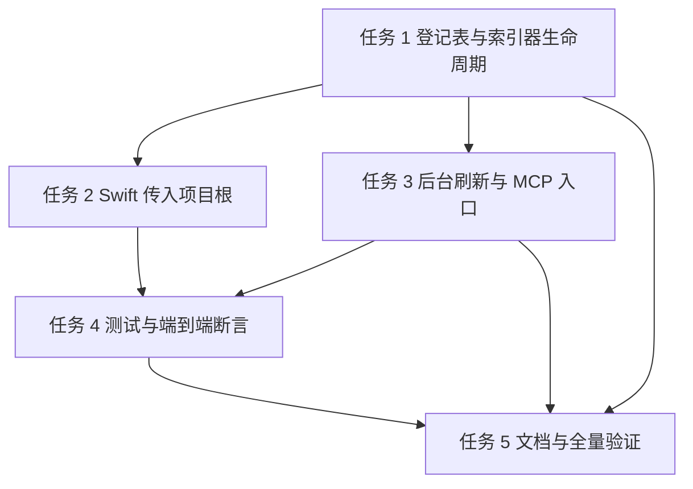

# 项目图库异步刷新 实施计划

**目标：** `project_lookup` / `project_impact` 读到旧图库时，在后台重建，下一次查询得到新结果。
**背景：** 现在只有 `utility -a` 启动的索引器会写图库；索引器退出后，项目文件再变化，`project_*` 仍会一直返回旧结果。用户已经确认要走「查询触发、后台全量重建」这条路。
**架构：** 索引器启动时在项目 `.agent-gateway/indexer.json` 登记自己（PID + 进程启动时间）；`project_*` 先看登记表，有活索引器就直接返回；没有就安排一个 30 秒后执行的后台任务，任务再确认一次没有索引器，然后调用现有的 `project_scan.sync()` 重扫项目。查询本身不等待扫描，所以第一次仍是旧结果，下一次查询才是新结果。
**技术栈：** Python 3.12 标准库（`threading`、`fcntl`、`subprocess`、`json`）、现有 SQLite `graph.sqlite`、Swift 5.9 / Foundation。
**计划状态：** 已批准（2026-11-04），代码、测试与 1.1.50 部署复验完成；提交未授权
**依据：** 2026-11-04 对话对齐；`src/agent_gateway/services/mcp/server.py:275-339`；`src/agent_gateway/services/graph/indexer.py:406-415`；`Sources/Scanner/Graph/GraphIndexerClient.swift:367-433`。

## 非目标

- 不改图库表结构和 `contracts/graph.json`。
- 不新增用户配置项、不新增环境变量。
- 不做文件系统实时监听；实时增量仍由 `utility -a` 的 watcher 负责。
- 不在查询请求里同步扫描项目。
- 不自动修复损坏的 `graph.sqlite`；损坏时只记录错误，保留文件供人工恢复。
- 不提交、不推送、不部署，直到用户明确批准。

## 全局约束

- `project_lookup` / `project_impact` 的返回 JSON 字段和错误语义保持不变。
- 同一个项目在任意时刻最多只有一个待执行的后台刷新任务。
- 后台任务延迟固定 30 秒；首次查询返回旧结果，不等待任务完成。
- 查询路径只读一个不超过 4 KB 的登记文件；不遍历项目目录。
- 登记表按进程清理；不删除登记文件本身，避免违反「删除操作移废纸篓」。
- 图库只写 `.agent-gateway/graph.sqlite`；不得回写 `.utility`。
- 新代码注释、日志、异常文本用英文；测试名用英文。
- 不引入第三方依赖。

## 复杂度追踪

无。

## 假设

- `utility -a` 当前每个项目启动一个索引器；同一项目可能因为多个会话同时存在多个索引器，所以登记表按 PID 存列表，不存单个 PID。
- 索引器进程能收到 `SIGTERM` / `SIGINT`；收到后走正常退出，从登记表移除自己。被 `SIGKILL` 时留下条目，由下一次 `project_*` 清理。
- macOS 和 Linux 都有 `ps -p <pid> -o stat= -o lstart=`；命令不存在或超时时，退化为「PID 存活即视为索引器活着」，宁可少刷新，不与索引器抢写。
- `project_*` 和后台任务在同一个 gateway MCP 进程内执行；跨进程的重复任务不在本次范围。
- 用户可以接受最多 30 秒的刷新延迟。

## 取舍

| 决策 | 代价 | 什么证据会让我改主意 |
|---|---|---|
| 查询触发后延迟 30 秒再扫描 | 文件刚改完的第一次查询仍可能是旧结果 | 用户反馈等待不可接受，或实测陈旧结果持续超过一次查询 |
| 查询只检查索引器，不在请求里判断陈旧 | 图库已最新时也会在 30 秒后跑一次 `sync`；它会在读元数据后立即返回 | 大项目实测发现 30 秒空跑明显增加磁盘 IO |
| 登记表存索引器列表 | 比单个 PID 多一次列表读写 | 多会话场景被确认不存在，可退回单 PID |
| 用 `ps` 取进程启动时间 | 每次查询多一次短命令调用 | `ps` 在某些环境不可用且误差不可接受 |
| 后台任务直接调用 `project_scan.sync()` | 不新增「只检查不写入」的重复逻辑；代价是任务里会先读一次元数据 | `sync` 的提前返回路径出现副作用或明显变慢 |
| 刷新不持有跨进程图库写锁 | 刷新开始的一瞬间如果索引器刚好启动，两者可能同时写 | 实测出现图库损坏或反复全量重建 |

## 交付分档

| 阶段 | 范围 | 交付标准 |
|---|---|---|
| MVP | 任务 1-3 | 索引器能登记；`project_*` 能安排后台刷新；单元测试通过 |
| 完整版 | 任务 1-5 | 多索引器、死进程清理、真实项目重建、两仓构建与既有测试通过 |
| 增强 | 后续 | 可配置延迟、刷新进度日志、按文件增量刷新；不阻塞本次验收 |

## 存储与迁移

只新增运行态登记文件，不改图库 schema，不需要数据迁移。

| 场景 | 行为 |
|---|---|
| 首次运行（无登记文件） | 视为空列表、没有索引器；`project_*` 照常安排刷新 |
| 有旧格式数据 | 没有旧格式；登记文件是本次新增，旧版本不会创建 |
| 登记文件解码失败 | 按空列表处理并记 warning；下一次索引器启动时覆盖为合法 JSON |
| 旧版本程序写回 | 旧版本不读写登记文件；旧索引器启动时不会登记，新 gateway 可能误判没有索引器并安排刷新，因此两仓需要同批发布 |
| 旧版本读到新数据 | 旧版本忽略登记文件；`graph.sqlite` schema 未变，读写不受影响；回滚只需换回旧 wheel / 旧 app，登记文件可保留 |
| 索引器正常退出 | 从列表移除自己的 PID；登记文件保留 |
| 索引器崩溃 | 条目留在列表；下一次 `project_*` 用 PID 与进程启动时间判定死亡并移除 |
| 图库损坏 | 刷新任务记录异常并退出；不删除、不覆盖损坏文件；下一次查询会重新安排任务 |

## 性能与资源预算

| 项 | 上限 | 超限行为 | 验收基线 |
|---|---|---|---|
| 查询额外读文件 | 4 KB | 读取失败按无索引器处理 | 查询不遍历项目目录 |
| `ps` 单次调用 | 2 秒 | 超时视为索引器活着，跳过本轮刷新 | 1 个索引器时查询仍正常返回 |
| 查询路径检查索引器 | 每个登记 PID 一次 `ps` | 超时按活着处理 | 有活索引器时查询不安排任务 |
| 后台任务延迟 | 30 秒 | 固定值，不随查询次数累加 | 重复查询只保留一个待执行任务 |
| 后台任务并发 | 每项目 1 个 | 已存在任务时直接返回 | 两次连续查询只调用一次 `sync` |
| 刷新写锁 | 每项目 1 个持有者 | 拿不到 `refresh.lock` 直接结束 | 两个进程不同时调用 `sync` |
| 全量扫描 | 无新增超时；沿用现有同步耗时 | 失败写 error 日志，不重试 | 1000 文件测试项目任务完成后图库可查 |
| 登记条目数 | 每个活索引器 1 条 | 死条目在查询时清理 | 结束索引器后条目数回到 0 |

## 文件结构

| 文件 | 动作 | 职责 |
|---|---|---|
| `src/agent_gateway/services/graph/indexer_marker.py` | 新建 | 登记索引器 PID 与启动时间，判断是否还有活索引器 |
| `src/agent_gateway/services/graph/refresh.py` | 新建 | 按项目安排一次延迟后台刷新，调用全量对账 |
| `src/agent_gateway/services/graph/indexer.py` | 修改 | `main()` 接收项目根、登记/注销自己、处理退出信号 |
| `src/agent_gateway/services/mcp/server.py` | 修改 | `project_lookup` / `project_impact` 入口安排刷新 |
| `tests/graph/test_indexer_marker.py` | 新建 | 登记、注销、死进程清理、损坏文件回退 |
| `tests/graph/test_refresh.py` | 新建 | 去重、索引器存活跳过、真实小项目重建、失败不抛出 |
| `Sources/Scanner/Graph/GraphIndexerClient.swift` | 修改 | 启动索引器时把项目根作为参数传入 |
| `scripts/e2e-isolated.sh` | 修改 | 断言索引器启动后有登记、退出后无活条目 |
| `.claude/docs/architecture/project-graph.md` | 修改 | 记录登记文件、30 秒刷新和首次旧结果语义 |

## 依赖图

## 任务

### 任务 1：登记索引器并支持多会话

**文件**

- 新建：`src/agent_gateway/services/graph/indexer_marker.py`
- 修改：`src/agent_gateway/services/graph/indexer.py:406-415`
- 测试：`tests/graph/test_indexer_marker.py`

**接口**

- 消费：`project_paths.project_state_dir(root) -> Path`
- 产出：
  - `register(root: str, pid: int | None = None) -> None`
  - `unregister(root: str, pid: int | None = None) -> None`
  - `active_pids(root: str) -> list[int]`
  - `has_active(root: str) -> bool`
- 登记文件：`<root>/.agent-gateway/indexer.json`，内容 `{"indexers": [{"pid": 123, "started_at": "Tue Nov 4 14:00:00 2026", "root": "/abs/project"}]}`。
- 协调文件：`<root>/.agent-gateway/indexer.lock`。`register` / `unregister` / `active_pids` 在 `fcntl.flock` 内读写登记文件；登记文件用临时文件加 `os.replace` 原子替换，锁加在不会被替换的 `indexer.lock` 上，避免替换 inode 后锁失效。
- `active_pids` 对每条记录做三件事：`os.kill(pid, 0)` 判断 PID 是否还在；`ps -p <pid> -o stat= -o lstart=` 取进程状态和启动时间；状态以 `Z` 开头视为死亡，启动时间与记录不一致视为 PID 被复用。死亡、复用或 `root` 不匹配的条目从列表移除。
- `indexer.main()`：`root = sys.argv[1] if len(sys.argv) > 1 else ""`；根目录存在才登记。注册 `SIGTERM` / `SIGINT` 为抛 `SystemExit`，在 `finally` 里 `unregister`。

**验收**

- [ ] 用当前进程 PID 登记后，`active_pids` 返回该 PID。
- [ ] 登记一个不存在的 PID，`active_pids` 返回空并移除该条。
- [ ] 登记文件内容为非法 JSON 时，`active_pids` 返回空且不抛异常。
- [ ] 同一登记文件里属于另一个项目根的条目，不会被算作本项目的活索引器。
- [ ] `main()` 没有项目根参数时不创建登记文件。
- [ ] 正常退出后，登记列表不再包含该 PID。

**验证**

- 命令：`cd /Users/yuanyxh/Documents/selfdata/projects/agent-gateway && PYTHONPATH=src python -m unittest tests.graph.test_indexer_marker -v`
- 期望：PASS。

**依赖 / 规模**：无 / M

- [ ] 步骤 1：写失败测试，断言当前 PID 可见、死 PID 被清理、坏 JSON 回退为空。
- [ ] 步骤 2：运行验证命令，确认新测试失败。
- [ ] 步骤 3：实现 `register` / `unregister` / `active_pids` / `has_active`。
- [ ] 步骤 4：在 `indexer.main()` 接入登记和退出清理。
- [ ] 步骤 5：运行验证命令，确认通过。
- [ ] 步骤 6：提交（需用户明确批准后执行）。

### 任务 2：Swift 启动索引器时传入项目根

**文件**

- 修改：`Sources/Scanner/Graph/GraphIndexerClient.swift:374`
- 测试：现有 `scripts/e2e-isolated.sh`

**接口**

- 消费：`PythonScriptRunner.bootstrapArguments(for:) -> [String]`、`GraphIndexerClient.Config.root`
- 产出：索引器进程的 `sys.argv[1]` 等于项目根；`agent_gateway.services.graph.indexer.main()` 据此登记。

**验收**

- [ ] `proc.arguments` 在原有 `-c <code>` 后追加 `config.root`。
- [ ] `utility -a` 启动索引器后，项目 `.agent-gateway/indexer.json` 出现该索引器 PID。
- [ ] 单独运行 `agent-gateway graph index` 不创建登记条目。
- [ ] 旧 gateway 忽略多余参数，不因追加参数启动失败。

**验证**

- 命令：`cd /Users/yuanyxh/Documents/selfdata/projects/utility && swift build`
- 期望：BUILD SUCCEEDED。
- 命令：`bash scripts/e2e-isolated.sh`
- 期望：原有断言全过，新增登记断言通过。

**依赖 / 规模**：任务 1 / S

- [ ] 步骤 1：在 `launch()` 的 `bootstrapArguments` 后追加根目录。
- [ ] 步骤 2：构建。
- [ ] 步骤 3：启动隔离端到端脚本，读取临时项目登记文件断言 PID。
- [ ] 步骤 4：停止索引器，断言登记列表为空。
- [ ] 步骤 5：提交（需用户明确批准后执行）。

### 任务 3：按项目安排后台刷新

**文件**

- 新建：`src/agent_gateway/services/graph/refresh.py`
- 修改：`src/agent_gateway/services/mcp/server.py:275-339`
- 测试：`tests/graph/test_refresh.py`

**接口**

- 消费：
  - `indexer_marker.has_active(root: str) -> bool`
  - `project_scan.sync(root: str, engine: str, schema: str) -> dict`
  - `constants.ENGINE_VERSION` / `constants.SCHEMA_VERSION`
- 产出：`schedule_project_graph_refresh(root: str, delay: float = 30.0) -> bool`；返回是否新建了任务。
- 模块状态：`_TIMERS: dict[str, threading.Timer]`、`_TIMERS_LOCK: threading.Lock`。
- `schedule_project_graph_refresh`：
  1. `root = os.path.realpath(root)`；不是目录返回 `False`。
  2. 调用 `has_active(root)`；有活索引器返回 `False`，不安排任务。
  3. 持锁检查 `_TIMERS[root]`，任务还活着就直接返回 `False`。
  4. 创建 `threading.Timer(delay, _run_refresh, args=(root,))`，`daemon=True`，启动并记录。
- `_run_refresh(root)`：
  1. 再次调用 `has_active(root)`；有活索引器直接结束。
  2. 打开 `<root>/.agent-gateway/refresh.lock`，尝试 `fcntl.flock(LOCK_EX | LOCK_NB)`；拿不到说明另一个 gateway 进程正在刷新，直接结束。
  3. 调用 `project_scan.sync(...)`。`sync` 自带陈旧判断：图库版本/根目录不匹配、文件增删或大小/修改时间变化时才重建，否则立即返回。
  4. 捕获所有异常，写 `logger.exception`，不向请求线程抛出。
  5. `finally` 释放 `refresh.lock`，并从 `_TIMERS` 移除自己，允许下一次查询重新安排。
- `server.py`：
  - `_handle_project_lookup` 在拿到 `path` 后调用 `schedule_project_graph_refresh(path)`。
  - `_handle_project_impact` 在 `tool_project_impact` 前调用 `schedule_project_graph_refresh(arguments["path"])`。
  - 两处都用 `try/except Exception: logger.warning(...)` 包住，刷新安排失败不能影响查询结果。

**验收**

- [ ] 连续两次 `schedule_project_graph_refresh(root, delay=60)` 只创建一个任务。
- [ ] 索引器登记为活时，`schedule_project_graph_refresh` 返回 `False`；任务创建后索引器才登记时，触发也不调用 `sync`。
- [ ] 索引器登记为死时，任务触发后调用一次 `sync`。
- [ ] 另一个进程持有 `refresh.lock` 时，本进程任务不调用 `sync`。
- [ ] `project_lookup` / `project_impact` 的返回内容与改动前一致。
- [ ] `sync` 抛异常时，任务线程结束且不留下 `_TIMERS` 记录。

**验证**

- 命令：`cd /Users/yuanyxh/Documents/selfdata/projects/agent-gateway && PYTHONPATH=src python -m unittest tests.graph.test_refresh -v`
- 期望：PASS。
- 命令：`ruff check src/agent_gateway/services/graph/refresh.py src/agent_gateway/services/mcp/server.py`
- 期望：无输出，退出码 0。

**依赖 / 规模**：任务 1 / M

- [ ] 步骤 1：写失败测试，断言去重、活索引器跳过、死索引器调用 `sync`、异常被吞掉。
- [ ] 步骤 2：运行验证命令，确认失败。
- [ ] 步骤 3：实现 `refresh.py`。
- [ ] 步骤 4：在 `server.py` 两个入口接入。
- [ ] 步骤 5：运行验证命令，确认通过。
- [ ] 步骤 6：提交（需用户明确批准后执行）。

### 任务 4：真实项目重建与端到端断言

**文件**

- 新建：`tests/graph/test_refresh_integration.py`
- 修改：`scripts/e2e-isolated.sh`
- 测试：上述两个文件

**接口**

- 消费：`refresh._run_refresh(root)`、`project_scan.sync`、`project_lookup` MCP 工具。
- 产出：无新接口；验证现有接口在真实文件变化后的行为。

**验收**

- [ ] 临时项目只有 `demo.py`、没有图库时，触发刷新后 `.agent-gateway/graph.sqlite` 存在且能查到 `demo` 符号。
- [ ] 修改 `demo.py` 增加 `added()` 后再次刷新，图库能查到 `added`。
- [ ] 索引器登记为活时，真实刷新任务不写图库。
- [ ] 隔离端到端脚本中，索引器启动后登记文件存在，停止后 `active_pids` 为空。
- [ ] 全量测试不依赖本机真实项目路径。

**验证**

- 命令：`cd /Users/yuanyxh/Documents/selfdata/projects/agent-gateway && PYTHONPATH=src python -m unittest tests.graph.test_refresh_integration -v`
- 期望：PASS。
- 命令：`cd /Users/yuanyxh/Documents/selfdata/projects/utility && bash scripts/e2e-isolated.sh`
- 期望：原有断言与新增登记断言全部通过。

**依赖 / 规模**：任务 2、任务 3 / M

- [ ] 步骤 1：写集成测试，先用临时项目断言刷新前无图库。
- [ ] 步骤 2：运行，确认失败。
- [ ] 步骤 3：实现测试夹具并接入 `_run_refresh`。
- [ ] 步骤 4：在隔离脚本中读取登记文件断言。
- [ ] 步骤 5：运行两组验证命令，确认通过。
- [ ] 步骤 6：提交（需用户明确批准后执行）。

### 任务 5：文档与全量验证

**文件**

- 修改：`.claude/docs/architecture/project-graph.md`
- 修改：`/Users/yuanyxh/Documents/selfdata/projects/agent-gateway/.agent/status.md`
- 修改：`/Users/yuanyxh/Documents/selfdata/projects/utility/.agent/status.md`

**接口**

- 消费：任务 1-4 的实现。
- 产出：架构文档说明登记文件、30 秒延迟、首次旧结果、失败重试语义。

**验收**

- [ ] `project-graph.md` 写明：谁写登记文件、谁读、索引器退出/崩溃后的行为、刷新与索引器可能并发的窗口。
- [ ] 两个仓库的 `status.md` 记录本次改动和验证命令。
- [ ] 文档不承诺「实时刷新」或「首次查询即新结果」。

**验证**

- 命令：`cd /Users/yuanyxh/Documents/selfdata/projects/agent-gateway && PYTHONPATH=src python -m unittest discover -s tests -t . && ruff format --check src tests scripts && ruff check src tests scripts`
- 期望：全部通过，ruff 退出码 0。
- 命令：`cd /Users/yuanyxh/Documents/selfdata/projects/utility && swift build && bash scripts/run-tests.sh`
- 期望：BUILD SUCCEEDED，测试全过。
- 命令：`cd /Users/yuanyxh/Documents/selfdata/projects/utility && bash scripts/e2e-isolated.sh`
- 期望：全过。

**依赖 / 规模**：任务 1-4 / S

- [ ] 步骤 1：更新架构文档和状态文件。
- [ ] 步骤 2：运行 gateway 全量测试与 ruff。
- [ ] 步骤 3：运行 utility 构建、run-tests、e2e。
- [ ] 步骤 4：汇报证据级别；未做 GUI 验证时标注待验。
- [ ] 步骤 5：提交（需用户明确批准后执行）。

## 检查点

### 检查点 A（任务 1-2 后）

- [ ] `tests.graph.test_indexer_marker` 通过。
- [ ] `swift build` 通过。
- [ ] 真实 `utility -a` 启动后登记文件出现索引器 PID。
- [ ] 停止索引器后，`active_pids` 为空。

### 检查点 B（任务 3-4 后）

- [ ] `tests.graph.test_refresh` 与 `test_refresh_integration` 通过。
- [ ] 查询 `project_lookup` 不等待扫描，响应字段不变。
- [ ] 同一项目连续查询只保留一个后台任务。
- [ ] 死索引器条目被清理，活索引器存在时不写图库。

### 检查点 C（任务 5 后）

- [ ] gateway 全量测试、ruff 通过。
- [ ] utility 构建、run-tests、e2e 通过。
- [ ] 文档与实现一致，没有「首次查询即新结果」的错误描述。

## 未覆盖输入类

| 输入或条件 | 期望行为 | 对应测试任务 |
|---|---|---|
| 项目根不存在或不是目录 | 不安排任务，查询按原逻辑报错 | 任务 3 |
| 登记文件缺失 | 视为无索引器，安排刷新 | 任务 1、3 |
| 登记文件损坏 | 视为无索引器，记 warning，下次登记覆盖 | 任务 1 |
| PID 被系统复用 | 启动时间不匹配，按死进程处理 | 任务 1 |
| 索引器正常退出 | 从列表移除，不触发额外刷新 | 任务 1、2 |
| 索引器被 `SIGKILL` | 条目保留，下一次查询清理 | 任务 1 |
| 同一项目两个索引器 | 两条登记都保留；任一活着就跳过刷新 | 任务 1 |
| 图库已是最新 | 30 秒后 `sync` 提前返回，不重写 | 任务 3 |
| 图库文件缺失 | 后台任务全量建库；首次查询仍按无库处理 | 任务 4 |
| 图库损坏 | 任务记录异常，不删除文件 | 任务 3 |
| 刷新期间进程退出 | 后台任务随进程结束，不阻塞退出 | 任务 3 |
| 刷新与索引器同时启动 | 任务开始前再查一次登记；仍有短窗口，SQLite 事务保证不损坏 | 任务 3、4 |

## 风险与回滚

| 风险 | 影响 | 缓解 | 回滚 |
|---|---|---|---|
| 刷新与索引器同时写图库 | 中 | 任务开始前再查登记；SQLite 写事务串行；失败只记录日志 | 回退 `refresh.py` 与 `server.py` 两处接入，索引器继续按原方式写图库 |
| 登记文件写坏导致误判 | 低 | 原子替换；解码失败按空列表处理 | 清空 `.agent-gateway/indexer.json` 内容为 `{}`，不删文件；重启索引器重新登记 |
| 30 秒延迟不符合预期 | 低 | 固定常量集中在 `refresh.py` | 将 `REFRESH_DELAY_SECONDS` 改为目标值并重装 wheel |
| 大项目后台扫描占 IO | 中 | 每项目最多一个任务；已有索引器时跳过；查询不等待 | 回退两处 hook，保留手动 `agent-gateway graph index` |
| 旧 utility + 新 gateway 没有登记 | 中 | 两仓同批发布；发布说明写明顺序 | 先回退 gateway wheel，再回退 app；登记文件无害可保留 |
| `ps` 调用超时 | 低 | 2 秒超时后视为索引器活着，宁可少刷新 | 删除 `ps` 分支，退化为 PID 存活判断 |

## 开放问题

- 无。30 秒延迟、首次返回旧结果、登记表按 PID 列表存储均已在批准项中确认。

## 批准记录

- 状态：已批准
- 批准人：用户
- 批准时间：2026-11-04

## 实施记录（2026-11-04）

- 任务 1-5 代码完成：`indexer_marker.py`、`refresh.py`、索引器登记/注销、Swift 传根、MCP 两个入口、文档与 e2e 断言。
- 验证：gateway 544 例通过；`ruff format --check` / `ruff check` 通过；`swift build` 通过；`run-tests.sh` 通过；`e2e-isolated.sh` 通过（登记 live → stopped）。
- 1.1.48 部署复验：MCP `project_lookup` 缺失图库 / 旧图库均在 30 秒后重建（L3）；部署版索引器退出被连续 SIGTERM 中断注销，源码已加 `SIG_IGN` 修复。
- 1.1.49 部署复验：安装包与随包 wheel 含修复；真实 `utility -a` 索引器登记 live、退出后为空；MCP 缺失图库 35 秒后重建并命中（L3）。
- 审查修复：`ps` 固定 `TZ=UTC`；`os.kill` 捕获 `OverflowError`；`refresh` / `project_scan` 按需导入；新增 handler 接线测试。全量 549 例、e2e 通过。
- 1.1.50 部署复验：安装包与随包 wheel 含上述修复；索引器登记 UTC 时间、退出后为空；MCP 缺失图库 35 秒后重建并命中（L3）。
- 提交：未执行，等待用户明确授权。
