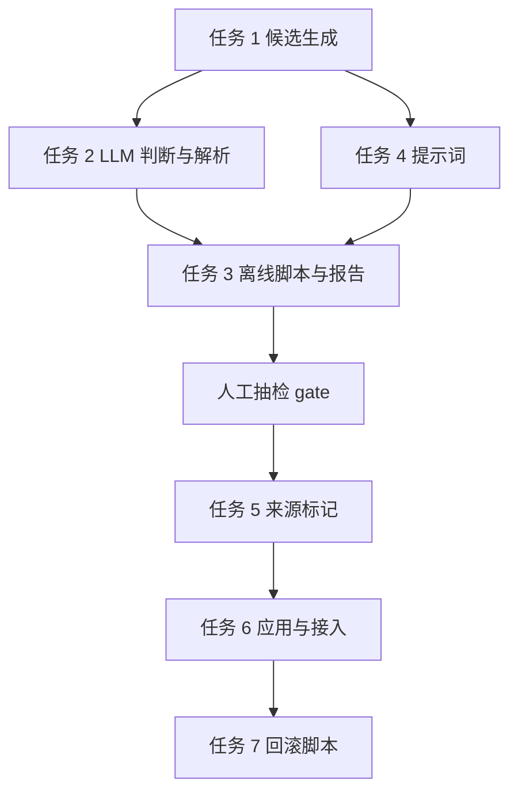

# 记忆分组治理（LLM dry_run 原型）实施计划

**目标：** 在离线 dry_run 中验证 LLM 对活跃记忆组的拆分、合并、修正建议质量，产出可人工判读的报告，不写生产库。
**背景：** 热层 5576 条记忆分布在 4191 组，84.9% 是单条组；写入侧自动分组已因纯度不足回退，日任务压缩摘要还会继续产组。用户 2026-11-08 决定改由日任务引入 LLM 分组治理，第一版先做离线验证。
**架构：** 只读加载活跃节点，生成“多成员组 + 单条组近邻对”候选，批量调用 LLM 输出 keep/split/merge 建议，严格校验后落盘为 jsonl 与报告；应用逻辑留到完整版。
**技术栈：** Python 3.12、现有 `llm/client.achat`、`core/prompt_loader`、SQLite 只读连接、热层 Qdrant 向量（不可用时回退标题 2-gram）。
**计划状态：** 待批准
**依据：** 用户 2026-11-08 的三项选择；`tests/eval/episode_generalize/2026-11-08/grouping_research.md`；`tests/eval/episode_generalize/2026-11-08/generalize_report.md`。

## 非目标

- MVP 不写生产记忆库，不修改任何 `episode_id`。
- MVP 不接入 `run_daily`，不修改写入路径与 recall。
- 不处理调用方显式传入的 `episode_id`；完整版增加来源标记后跳过。
- 不对全部 3559 个单条组逐一判断，只用近邻候选。
- 不引入新依赖，不提交。

## 全局约束

- 生产库只读：SQLite 使用 `mode=ro` 或 `mode=ro&immutable=1`；Qdrant 只读查询。
- 所有输出只写 `tests/eval/group_governance/<YYYY-MM-DD>/`。
- LLM 只经 `llm_client.achat`，单次超时 60 秒，失败重试最多 1 次。
- 串行调用，批量不超过 10 个候选组或 20 个候选对。
- LLM 返回的 id 必须来自输入；未知 id 一律丢弃并计数。
- `episode_id` 不以 `ep_` 开头的组视为疑似显式组，MVP 只列入报告，不生成建议。
- 成员数大于 8 的组单列 `oversized`，MVP 不拆分，仅报告数量。

## 复杂度追踪

无。

## 假设

- 假设 A：本地 LLM 已配置（`llm_client.is_configured()` 为真）。若不成立，报告标 `llm_unavailable`，只输出候选。
- 假设 B：热层向量可通过 `server_state.get_hot_memory()` 读取。若不成立，回退标题字符 2-gram 近邻，并在报告标 `vector_unavailable`。
- 假设 C：历史节点没有来源标记，无法区分显式与自动组。MVP 只输出建议；完整版写入 `episode_source` 后才应用。

## 取舍

| 决策 | 代价 | 什么证据会让我改主意 |
| --- | --- | --- |
| 先离线 dry_run，不接日任务 | 晚一步自动化，但避免错误写入无法评估 | 人工准确率 ≥85% 且扩展净增益 >0 |
| 批量 10 个候选/次 | 单次上下文变长，一次解析失败影响多组 | 解析失败率 >5% 或准确率明显下降 |
| 单条组近邻对上限 200 | 覆盖不全，但日任务成本可控 | 近邻候选人工命中率 >70% 时提高上限 |
| 向量不可用时回退标题 2-gram | 回退召回弱于向量 | 回退结果人工相关率低于 50% |

## 交付分档

| 阶段 | 范围 | 交付标准 |
| --- | --- | --- |
| MVP | 任务 1-4 | 离线报告可生成，人工抽检 50 组可执行 |
| 完整版 | 任务 5-7 | 来源标记、应用、回滚、日任务接入（默认关闭） |
| 增强 | 后续 | 全量单条组、跨项目候选、在线灰度 |

## 存储与迁移

| 场景 | 行为 |
| --- | --- |
| 首次运行 | 创建 `tests/eval/group_governance/<date>/` 与空 jsonl |
| 有旧报告 | 按日期目录隔离，不覆盖；同日重跑覆盖同目录并在报告标 `rerun` |
| 输出解码失败 | 该行跳过并计入 `parse_failed`，不中断整批 |
| 旧版本读到新输出 | 无消费方，仅人工读取 |
| 生产库 | MVP 只读；完整版写 `episode_prev` 与 `governed_at`，由任务 7 恢复 |

## 性能与资源预算

| 项 | 上限 | 超限行为 | 验收基线 |
| --- | --- | --- | --- |
| 候选组/对 | 850 | 截断并记录 `truncated` | 报告列出候选数与截断数 |
| LLM 调用 | 85 次 | 停止，保留已完成结果 | 单次 ≤60 s，总 ≤10 min |
| 解析失败率 | 5% | 报告标 gate 不通过 | 失败样本保留在 jsonl |
| 输出文件 | 5 MB | 停止写入并告警 | 850 行 jsonl 约 1 MB |
| 常驻内存 | 512 MB | 中止 | 5000 条向量约 15 MB |

## 文件结构

| 文件 | 动作 | 职责 |
| --- | --- | --- |
| `src/agent_gateway/services/memory/group_governance.py` | 新建 | 候选生成、LLM 判断、解析与报告数据 |
| `src/agent_gateway/prompts/zh-Hans/govern_groups.md` | 新建 | 中文治理提示词 |
| `src/agent_gateway/prompts/en/govern_groups.md` | 新建 | 英文治理提示词 |
| `scripts/group_governance_eval.py` | 新建 | 离线 dry_run 入口与报告 |
| `tests/test_group_governance.py` | 新建 | 候选、解析、预算、保护测试 |
| `src/agent_gateway/services/mcp/server_memory.py` | 修改 | 完整版：写入 `episode_source` |
| `src/agent_gateway/services/memory/link.py` | 修改 | 完整版：图元数据白名单增加来源字段 |
| `src/agent_gateway/services/memory/consolidate.py` | 修改 | 完整版：日任务新增治理 stage |
| `src/agent_gateway/services/mcp/server.py` | 修改 | 完整版：手动接口支持日任务 `dry_run` |
| `src/agent_gateway/core/config.py` | 修改 | 完整版：治理开关与预算 |

## 依赖图

## 任务

### 任务 1：候选生成

**文件**

- 新建：`src/agent_gateway/services/memory/group_governance.py`
- 测试：`tests/test_group_governance.py`

**接口**

- 消费：`store.list_nodes(layer="hot", status="active", limit=5000, db_path=...)`；热层 `get_hot_memory()`。
- 产出：
  - `load_groups(db_path: str | None = None) -> list[dict]`，元素含 `group_id`、`members`（`id/title/fact/episode_id/generated_by/protected`）。
  - `nearby_single_candidates(groups: list[dict], *, limit: int = 200, hot=None) -> list[dict]`，元素含 `left`、`right`、`score`。
  - `build_candidates(*, db_path=None, single_pair_limit=200, hot=None) -> dict`，返回 `{"groups": [...], "pairs": [...], "truncated": bool}`。

**验收**

- [ ] 排除 `generated_by`、`protected`、非 `active`；组大小只取 2-8，不以 `ep_` 开头的组进 `explicit_suspect`，大于 8 的组进 `oversized`。
- [ ] 单条组只与不同 `episode_id` 的节点配对，每节点最多 2 个候选。
- [ ] 候选总数不超过 850，超限置 `truncated=true`。

**验证**

- 命令：`PYTHONPATH=src .venv/bin/python -m unittest tests.test_group_governance`
- 期望：候选生成相关用例全部通过。

**依赖 / 规模**：无 / M

- [x] 用临时 SQLite 构造 3 组多成员节点、4 个单条节点、1 个系统摘要，写失败测试。
- [x] 运行测试确认失败（ImportError）。
- [x] 实现 `load_groups` 与 `build_candidates`。
- [x] 运行测试确认通过（12 例）。

### 任务 2：LLM 判断与解析

**文件**

- 修改：`src/agent_gateway/services/memory/group_governance.py`
- 测试：`tests/test_group_governance.py`

**接口**

- 消费：任务 1 的候选；`llm_client.achat(prompt, temperature=0.1, timeout=60, disable_thinking=True)`；`prompt_loader.prompt("govern_groups", candidates_text=...)`。
- 产出：`async decide(candidates: dict, *, batch_size: int = 10, llm=llm_client.achat, max_calls: int = 85) -> dict`，返回 `{"decisions": [...], "calls": int, "parse_failed": int, "rejected": dict}`。

**验收**

- [ ] 决策动作仅允许 `keep`、`split`、`merge`；其他值拒绝并计数。
- [ ] `split` 的子组必须覆盖全部成员且互斥；`merge` 只能指向同批次候选。
- [ ] 未知 id、覆盖不全、非 JSON、缺 `decisions` 键均计入 `parse_failed`，不抛异常。

**验证**

- 命令：`PYTHONPATH=src .venv/bin/python -m unittest tests.test_group_governance`
- 期望：解析拒绝路径全部有断言。

**依赖 / 规模**：任务 1 / M

- [x] mock `achat` 返回非法 JSON、未知 id、覆盖不全，写失败测试。
- [x] 实现批量切分与 `parse_decisions`。
- [x] 运行测试确认通过。

### 任务 3：离线脚本与报告

**文件**

- 新建：`scripts/group_governance_eval.py`
- 测试：`tests/test_group_governance.py`

**接口**

- 消费：任务 1 的 `build_candidates`、任务 2 的 `decide`。
- 产出：`suggestions.jsonl`（每行一条决策）、`candidates.jsonl`、`report.md`。

**验收**

- [ ] 报告包含候选数、组数、动作分布、`parse_failed`、调用次数、耗时。
- [ ] 报告附 50 组人工抽检表，列为 `group_id`、`建议`、`依据`、`人工判定`。
- [ ] 同一输入重跑结果稳定；LLM 未配置时仍输出候选与 `llm_unavailable`。

**验证**

- 命令：`PYTHONPATH=src .venv/bin/python scripts/group_governance_eval.py --single-pair-limit 200 --out tests/eval/group_governance/2026-11-08`
- 期望：生成三个文件；`wc -l suggestions.jsonl` 与调用统计一致。

**依赖 / 规模**：任务 1、2、4 / M

- [x] 写 CLI 与报告渲染。
- [x] 用生产库只读跑通：454 组 + 20 对。
- [x] 补测试断言报告字段。

### 任务 4：治理提示词

**文件**

- 新建：`src/agent_gateway/prompts/zh-Hans/govern_groups.md`
- 新建：`src/agent_gateway/prompts/en/govern_groups.md`

**接口**

- 消费：`prompt_loader.prompt("govern_groups", candidates_text=...)`。
- 产出：frontmatter 含 `name`、`placeholders: [candidates_text]`、`json_keys: [decisions]`。

**验收**

- [ ] 提示词要求“不确定时 keep”，只允许输入中的 id。
- [ ] 输出格式为 `{"decisions":[{"group_id","action","groups","merge_with","reason"}]}`。
- [ ] 中英文两份占位符一致，加载不报错。

**验证**

- 命令：`PYTHONPATH=src .venv/bin/python -c "from agent_gateway.core import prompt_loader; print(bool(prompt_loader.prompt('govern_groups', candidates_text='x')))"`
- 期望：输出 `True`。

**依赖 / 规模**：无 / S

- [x] 写中文提示词与 frontmatter。
- [x] 写英文镜像。
- [x] 运行验证命令（输出 `True`）。

### 检查点 A（任务 1-2 后）

- [x] `tests.test_group_governance` 全部通过（12 例）。
- [x] 用临时库生成 10 个候选，解析结果无未知 id。

## 执行记录

| 日期 | 范围 | 证据 |
| --- | --- | --- |
| 2026-11-08 | 任务 1-4 | 12 例通过；生产库只读报告 454 组 + 20 对；LLM 小样本 10 决策、0 解析失败 |
| 2026-11-08 | 质量门 | 全量 613 例、ruff format/check、`GATEWAY_HOME` 临时目录 `--check` 通过 |
| 2026-11-08 | 待办 | 完整 50 条报告未生成：LLM 单批 10 组接近 60 s 超时，batch 5 跑 10 批 17 min 未完成；小样本 10 条链路通过 |
| 2026-11-08 | 偏移 | 离线报告需增量落盘与按批中断；完整人工抽检延后到 backlog `todo-20261108-001` |
| 2026-11-08 | 报告格式 | `render_report` 改为逐候选成员表 + 建议/理由/拆分 + 覆盖率；新增 `--render-only` 免 LLM 重渲染；12 例与全量 613 通过 |
| 2026-11-08 | 缺陷 | 候选文本取图库 `title`（上限 120 字），图库 `metadata.fact` 全空；完整正文在热层 `data`（平均 460.8 字，p95 1229）。修复待 `todo-20261108-002` |
| 2026-11-08 | 截断修复 | 8 处判断输入改完整正文；`link.py` 白名单补 `fact` 并回填 5610 条（99.9%）；备份 `memory_graph.sqlite.bak-20261108225909`；616 例通过 |

### 任务 5：来源标记（完整版）

**文件**

- 修改：`src/agent_gateway/services/mcp/server_memory.py:298-312,315-355,390-422,713-715`
- 修改：`src/agent_gateway/services/memory/link.py:50-77`
- 测试：`tests/test_memory_episode.py`

**接口**

- 产出：metadata 字段 `episode_source`（`explicit`/`auto`/`unknown`）、`episode_prev`、`governed_at`；三者都加入 `link.py` 的 `node_meta` 白名单，避免后续写入丢失。

**验收**

- [ ] 调用方显式传 `episode_id` 时写 `explicit`；继承或新建时写 `auto`。
- [ ] 旧节点读取时缺字段按 `unknown` 处理，不报错。
- [ ] `link.py` 白名单包含 `episode_source`，图库可查。

**验证**

- 命令：`PYTHONPATH=src .venv/bin/python -m unittest tests.test_memory_episode`
- 期望：新增 3 例通过。

**依赖 / 规模**：检查点 B 通过、任务 1 / M

- [ ] 写 explicit/auto/unknown 三条失败测试。
- [ ] 修改 `_build_metadata` 与写入分支。
- [ ] 运行测试确认通过。

### 任务 6：应用与日任务接入（完整版）

**文件**

- 修改：`src/agent_gateway/services/memory/group_governance.py`（新增 `apply_decisions`）
- 修改：`src/agent_gateway/services/memory/consolidate.py:477-497`
- 修改：`src/agent_gateway/services/mcp/server.py:812-834`
- 修改：`src/agent_gateway/core/config.py`
- 测试：`tests/test_memory_consolidate.py`、`tests/test_group_governance.py`

**接口**

- `apply_decisions(decisions: list[dict], *, dry_run: bool, now: datetime, db_path=None) -> dict`。
- `run_daily(..., govern: bool | None = None, dry_run: bool = False) -> dict`，`None` 读配置，返回值增加 `governed`。

**验收**

- [ ] 默认 `memory.governance.enabled=false` 时，日任务行为与当前完全一致。
- [ ] `dry_run=true` 不写图库与热层；`false` 只改 `episode_id`、`episode_source`、`episode_prev`、`governed_at`。
- [ ] `episode_source=explicit` 与 `generated_by=consolidation` 的节点不被修改。

**验证**

- 命令：`PYTHONPATH=src .venv/bin/python -m unittest tests.test_group_governance tests.test_memory_consolidate`
- 期望：新增用例通过，原有用例不回归。

**依赖 / 规模**：检查点 B 通过、任务 2、5 / L

- [ ] 写 dry_run 不落盘与显式组跳过的失败测试。
- [ ] 实现批量更新（图库 `batch_update_metadata` + 热层 `set_payload`）。
- [ ] 接入 `run_daily` 与配置开关。
- [ ] 运行测试确认通过。

### 任务 7：回滚脚本（完整版）

**文件**

- 新建：`scripts/group_governance_rollback.py`
- 测试：`tests/test_group_governance.py`

**接口**

- 消费：`memory_nodes.metadata.episode_prev`、`governed_at`。
- 产出：CLI `--since YYYY-MM-DD [--apply]`，默认 dry_run，打印将恢复的节点数。

**验收**

- [ ] 默认只统计不写；`--apply` 后 `episode_id` 恢复为 `episode_prev`。
- [ ] 无 `episode_prev` 的节点跳过并计数。
- [ ] 恢复后组数与治理前快照一致。

**验证**

- 命令：`PYTHONPATH=src .venv/bin/python scripts/group_governance_rollback.py --since 2026-11-09`
- 期望：dry_run 输出待恢复数量，退出码 0。

**依赖 / 规模**：任务 6 / S

- [ ] 写干跑与恢复测试。
- [ ] 实现脚本并验证。

## 检查点 B（任务 3-4 后）

- [ ] 离线报告生成，候选数与预算一致。
- [ ] 用户抽检 50 组并填写判定。
- [ ] gate 四项同时满足才进入完整版：建议准确率 ≥85%、解析失败率 <5%、模拟单条组占比下降 ≥10 个百分点、recall 扩展净增益 >0。
- [ ] gate 结论写入计划偏移记录；不通过则停在 MVP，保留报告。

## 检查点 C（任务 5-7 后）

- [ ] 全量测试通过。
- [ ] 沙箱内 `dry_run` 不写库。
- [ ] 开启后执行一次小批量应用，再用回滚脚本恢复并比对组分布。

## 未覆盖输入类

| 输入或条件 | 期望行为 | 对应测试任务 |
| --- | --- | --- |
| LLM 未配置 | 跳过判断，报告标 `llm_unavailable` | 任务 3 |
| 热层向量不可用 | 回退标题 2-gram，报告标 `vector_unavailable` | 任务 1 |
| 成员缺标题与事实 | 用内容截断 200 字；全空则跳过 | 任务 1 |
| 单条组无近邻 | 不生成候选 | 任务 1 |
| LLM 返回未知 id 或覆盖不全 | 丢弃该决策并计入 `parse_failed` | 任务 2 |
| 同日重跑 | 覆盖同目录，报告标 `rerun` | 任务 3 |

## 风险与回滚

| 风险 | 影响 | 缓解 | 回滚 |
| --- | --- | --- | --- |
| LLM 建议错误 | 高 | MVP 只输出建议，不写库 | 删除 `tests/eval/group_governance/<date>/`（移到废纸篓） |
| 显式组无法识别 | 中 | MVP 报告单列疑似显式组；完整版按 `episode_source=explicit` 跳过 | 关闭 `memory.governance.enabled` |
| 成本或延迟超预算 | 中 | 候选截断、调用上限、串行 | 降低 `maxLlmCalls` 后重跑 |
| 批量写库部分失败 | 高 | 先写 `episode_prev` 再改 `episode_id`；失败计数不中断 | 运行 `scripts/group_governance_rollback.py --since <日期> --apply` |
| 生产库被读锁 | 低 | SQLite 只读快照；读失败中止 | 复制库到临时目录后重跑 |

## 开放问题

无。范围、落地方式、显式组保护三项已由用户确认；人工抽检在检查点 B 执行。

## 批准记录

- 状态：已批准
- 批准人：用户
- 批准时间：2026-11-08 18:00 CST

## 审查与修复记录

- 2026-11-08 审查发现 5 类缺陷并修复：默认库路径建空库、5000 节点静默截断、回填 `data` 含 `Context:`、Qdrant 独占锁、singles 缺降级标记与显式组隔离；另修批级预算、LLM 输出类型校验、报告截断标注。
- 只读改为 `mode=ro&immutable=1` + 分页；回填改为读取 `mem0_jinazh768` 分片副本。
- 验证：624 例通过，ruff 通过；回填已 apply 1046 条（备份 `memory_graph.sqlite.bak-20261108235634`），fact 覆盖 5332/5332，候选 654→674。

## 日任务集成

- 接入点：`run_daily` 的 `score_relevance` 之后、`sample_relations` 之前。
- 增量：`govern_daily(since=...)` 只保留含 `created_at >= since` 成员的候选；默认窗口 24 小时。
- 应用：split 保留最大组原 id，其余新组；merge 源组并入目标组；写 `episode_prev`/`episode_source`/`governance_run`。
- 预算：`DAILY_MAX_CALLS=12`、`DAILY_BATCH_SIZE=8`；失败只记日志，不影响其余四步。
- 开关：`memory.governanceApply` 默认 true。
- 回滚：`scripts/group_governance_rollback.py --db <path> [--since <iso>] [--apply]`。
- 审查修复：应用时同步 mem0 metadata（检索读 payload，不读图库）、重建 episode 边、回滚先同步 mem0 且只扫 hot、调度器传上次日任务时间、`applied`/`errors` 计数修正；629 例通过。
