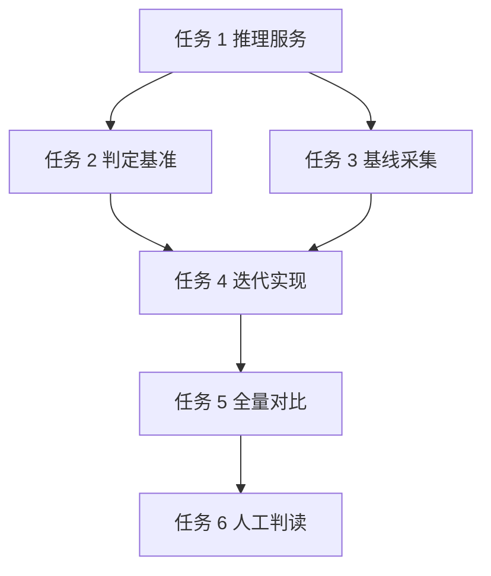

# 本地小模型迭代检索实验实施计划

**目标：** 用 Qwen3-1.7B（Metal GPU）对 recall 结果做事实关联判定与关键词提取，离线验证多轮迭代是否带来净增益。

**背景：** 2026-10-31 在 CPU ONNX 上实测 Qwen3-1.7B 分类 5/9、单次 200–700ms，结论是不适合检索侧；本次换 llama.cpp Metal 常驻服务，延迟与质量都需重测。目标不是替换现有 recall，而是判断值不值得进入 pipeline。

**架构：** `llama-server` 常驻本机 8630，实验脚本从 9001 的 MCP `recall` 取基线，逐条判定与提词后发起第二轮 recall，输出可人工判读的对比报告。线上代码零改动。

**技术栈：** Python 3.12、llama.cpp 0.8.0（brew，Metal）、Qwen3-1.7B Q8_0 GGUF、httpx（复用 `llm/client.py`）。

**计划状态：** 已完成（2026-11-08）

**依据：** 用户 2026-11-08 实验方案；`.agent/lessons.md:103-104`；记忆 `c8a653e0`（1.7B CPU 实测）。

## 非目标

- 不接入线上 recall pipeline，不改 `services/retrieval/` 任何代码。
- 不微调模型，不替换嵌入模型（jina-zh 768）与阈值。
- 不做批量判定与并发优化，首版逐条串行。

## 全局约束

- Python 3.12（`.venv/bin/python`），不新增 pip 依赖。
- 模型固定 `Qwen3-1.7B-Q8_0.gguf`（官方 GGUF 仓只有 Q8_0）；延迟不达标才降级 Q4_K_M。
- 推理必须 `-ngl 99` 全量 offload，关闭 thinking（prompt 加 `/no_think` 并限制 `max_tokens`）。
- 每条模型输出必须是可解析 JSON；解析失败单独计数，不重试超过 1 次。
- 实验数据只写 `tests/eval/iterative/`，不碰生产记忆库与索引。
- 不提交、不推送；删除一律移到废纸篓。

## 复杂度追踪

无。

## 假设

- 假设 brew 版 llama.cpp 带 Metal；若不成立，从 `llama-server` 启动日志确认 backend，退回 CPU 并在报告标注。
- 假设 9001 MCP 服务可作基线数据源；若不可用，改用 `PYTHONPATH=src .venv/bin/python` 直接调 `_build_recall_pipeline`。
- 假设 `queries_gold.jsonl` 的 query 可用于相对对比；该集合已被判定与原始意图不对应，因此只比较「同一 query 下迭代前后的结果」，不做绝对质量结论。

## 取舍

| 决策 | 代价 | 什么证据会让我改主意 |
| --- | --- | --- |
| Q8_0 而非 Q4_K_M | 体积 1.8GB、生成慢约 1.5–2 倍 | 单条判定 p50 > 800ms |
| 逐条判定而非批量 | 10 条结果要 10 次调用 | 解析率 ≥95% 且延迟稳定后，再测批量 |
| 只从强关联结果提取关键词 | 可能漏掉边缘但有用的线索 | 人工判读发现明显漏检 |
| 原 query 始终作为语义锚点 | 第二轮召回更保守、新意有限 | 第二轮零新增相关 |

## 交付分档

| 阶段 | 范围 | 交付标准 |
| --- | --- | --- |
| MVP | 任务 1–3 | 推理服务可用、判定延迟与解析率有数、基线数据落盘 |
| 完整版 | 任务 4–6 | 迭代对比报告 + 30 条人工判读 + 结论 |
| 增强 | 后续 | 批量判定、接入 pipeline 灰度、x 轮自动化调参 |

## 存储与迁移

| 场景 | 行为 |
| --- | --- |
| 首次运行 | 创建 `tests/eval/iterative/2026-11-08/` 与空 jsonl |
| 有旧实验数据 | 按日期目录隔离，不覆盖历史目录 |
| 解码失败 | 该行跳过并计入 `errors`，不中断整批 |
| 旧版本程序写回 | 不涉及，实验输出无消费方 |
| 旧版本读到新数据 | 不涉及，输出只供人工判读 |

## 性能与资源预算

| 项 | 上限 | 超限行为 | 验收基线 |
| --- | --- | --- | --- |
| 单条判定（热态） | 800 ms | 记为 `slow`，不中断 | 20 条中 p50 有数值 |
| 单轮 recall | 2 s | 记 `timeout`，该 query 跳过 | 基线采集成功率 ≥95% |
| llama-server 常驻内存 | 4 GB RSS | 停止服务并报告 | `ps` 实测记录 |
| 全量实验 | 20 min | 中止并保留已完成部分 | 120 条 × 最多 3 轮 |

## 文件结构

| 文件 | 动作 | 职责 |
| --- | --- | --- |
| `scripts/local_llm_serve.sh` | 新建 | 启停 llama-server，固定端口与参数 |
| `scripts/iterative_recall_eval.py` | 新建 | 采集基线、判定基准、迭代检索、出报告 |
| `tests/eval/iterative/2026-11-08/` | 生成 | `baseline.jsonl`、`judge.jsonl`、`iterated.jsonl`、`report.md` |

## 依赖图

## 任务

### 任务 1：推理服务与延迟基准

**文件**

- 新建：`scripts/local_llm_serve.sh`
- 下载：`~/.cache/agent-gateway/models/Qwen3-1.7B-Q8_0.gguf`

**接口**

- 消费：无
- 产出：`http://127.0.0.1:8630/v1/chat/completions`，模型名 `qwen3-1.7b`

**验收**

- [ ] `curl 127.0.0.1:8630/v1/models` 返回 `qwen3-1.7b`
- [ ] 启动日志出现 Metal offload 记录，`-ngl 99` 生效
- [ ] 20 次短输出（≤32 token）延迟 p50/p90 写入报告

**验证**

- 命令：`bash scripts/local_llm_serve.sh start && curl -s 127.0.0.1:8630/v1/models`
- 期望：返回模型列表，日志无 load error

**依赖 / 规模**：无 / S

- [ ] 下载官方 `Qwen3-1.7B-Q8_0.gguf`，校验文件大小约 1.8GB
- [ ] 写启停脚本，端口 8630、`-ngl 99`、`-c 4096`、`--jinja`
- [ ] 启动并确认 Metal backend
- [ ] 跑 20 次短输出，记录 p50/p90

### 任务 2：事实关联判定基准

**文件**

- 修改：`scripts/iterative_recall_eval.py`（`judge` 子命令）

**接口**

- 消费：`llm.client.chat(prompt, target=LLMTarget(...), extra_body={"response_format": ...})`
- 产出：`judge(row: dict) -> dict`，字段 `related: bool`、`fact: str`、`elapsed_ms: int`、`parse_ok: bool`

**验收**

- [ ] 30 条样本 JSON 解析率 ≥95%
- [ ] 每条输出含 `related` 与 `fact`，无 markdown 包裹
- [ ] p50 延迟有具体数值

**验证**

- 命令：`.venv/bin/python scripts/iterative_recall_eval.py judge --limit 30`
- 期望：`tests/eval/iterative/2026-11-08/judge.jsonl` 30 行，`parse_ok` 占比打印

**依赖 / 规模**：任务 1 / S

- [ ] 定 prompt：只判「结果是否包含能直接回答 query 的事实」，关键词重合但事实无关判 false
- [ ] 用 llama-server 的 JSON schema 约束输出 `{"related": bool, "fact": string}`
- [ ] 跑 30 条，统计解析率与延迟
- [ ] 输出样本供人工看 5 条

### 任务 3：基线采集

**文件**

- 修改：`scripts/iterative_recall_eval.py`（`baseline` 子命令）

**接口**

- 消费：MCP 9001 `tools/call recall`，参数 `keywords`、`query`、`limit=10`
- 产出：`baseline.jsonl`，每行 `{query_id, keywords, query, results:[{id, score, content}]}`

**验收**

- [ ] 120 条 query 成功采集，失败率 <5%
- [ ] 每条保留完整 top10 内容，供后续判定
- [ ] 采集耗时与单次 latency 写入报告

**验证**

- 命令：`.venv/bin/python scripts/iterative_recall_eval.py baseline --sample 120`
- 期望：打印成功/失败数，文件行数 120

**依赖 / 规模**：任务 1 / M

- [ ] 从 `tests/eval/datasets/queries_gold.jsonl` 分层抽 120 条（cjk/latin/mixed）
- [ ] 复用 `scripts/eval_retrieval.py` 的 MCP 调用方式
- [ ] 落盘 jsonl，失败行带 `error`

### 任务 4：迭代检索

**文件**

- 修改：`scripts/iterative_recall_eval.py`（`iterate` 子命令）

**接口**

- 消费：任务 2 的 `judge`、任务 3 的基线
- 产出：`iterated.jsonl`，每行 `{query_id, rounds:[{keywords, new_ids, related_ids, elapsed_ms}], merged:[...]}`

**验收**

- [ ] 每轮只从 `related=true` 结果提取关键词，最多 5 个
- [ ] 原 query 始终作为 `query` 参数，关键词随轮次扩展
- [ ] 无新增相关或达到 3 轮即停止
- [ ] 合并去重后条数 ≤10

**验证**

- 命令：`.venv/bin/python scripts/iterative_recall_eval.py iterate --limit 20`
- 期望：20 行输出，每行轮次数 1–3

**依赖 / 规模**：任务 2、3 / M

- [ ] 实现 `extract_keywords(texts) -> list[str]`
- [ ] 实现 `iterate(row) -> dict`
- [ ] 先跑 20 条看轮次分布与新增条数

### 任务 5：全量对比与报告

**文件**

- 修改：`scripts/iterative_recall_eval.py`（`report` 子命令）
- 生成：`tests/eval/iterative/2026-11-08/report.md`

**接口**

- 消费：`baseline.jsonl`、`iterated.jsonl`
- 产出：报告含质量表与延迟表

**验收**

- [ ] 报告列出 baseline vs 迭代版：新增强关联、新增噪声、无结果救活数
- [ ] 延迟给出 p50/p90 与模型调用次数
- [ ] 报告里每个数字能追到 jsonl 行

**验证**

- 命令：`.venv/bin/python scripts/iterative_recall_eval.py report`
- 期望：生成 `report.md`，含 4 张表

**依赖 / 规模**：任务 4 / S

- [ ] 写聚合函数，统计新增 related / 新增 irrelevant
- [ ] 生成报告表格

### 任务 6：人工判读

**文件**

- 修改：`tests/eval/iterative/2026-11-08/report.md`（追加判读节）

**接口**

- 消费：任务 5 报告
- 产出：30 条抽样判读表与结论

**验收**

- [ ] 抽 30 条（按新增条数分高/中/低三档）逐条标「有关/无关/不确定」
- [ ] 给出模型判定与人工判定一致率
- [ ] 结论明确写「接入 / 不接入 / 换模型再测」

**验证**

- 命令：无自动化，人工填表
- 期望：报告新增判读节，无空行

**依赖 / 规模**：任务 5 / S

- [ ] 抽 30 条并导出到报告
- [ ] 人工标注并计算一致率
- [ ] 写结论

## 检查点

### 检查点 A（任务 1–3 后）

- [ ] llama-server 可用且延迟有数
- [ ] 判定解析率 ≥95%
- [ ] 120 条基线落盘

### 检查点 B（任务 4–6 后）

- [ ] 对比报告生成
- [ ] 30 条人工判读完成
- [ ] 结论可决策

## 未覆盖输入类

| 输入或条件 | 期望行为 | 对应测试任务 |
| --- | --- | --- |
| query 为空或只有停用词 | 跳过该条并计数 | 任务 3 |
| 结果 content 为空 | 判 false，不调用模型 | 任务 2 |
| 模型输出非 JSON | 重试 1 次，仍失败记 `parse_ok=false` | 任务 2 |
| MCP recall 超时 | 该 query 记 `timeout`，继续下一条 | 任务 3 |

## 风险与回滚

| 风险 | 影响 | 缓解 | 回滚 |
| --- | --- | --- | --- |
| 模型下载失败或极慢 | 任务 1 阻塞 | 设 `HF_ENDPOINT=https://hf-mirror.com` 重试 | 删除半成品文件后重下 |
| Metal 未启用 | 延迟数据失真 | 启动日志确认 backend | 加 `-ngl 0` 记录 CPU 基线 |
| 1.7B 判定质量不足 | 实验结论为否定 | 人工判读一致率兜底 | 保留报告，不接入 |
| llama-server 占内存 | 影响其他服务 | 实验结束 `bash scripts/local_llm_serve.sh stop` | 结束进程并确认端口释放 |

## 开放问题

无。

## 批准记录

- 状态：已批准并执行完成
- 批准人：用户
- 批准时间：2026-11-08

## 执行结果与偏移

| 日期 | 变更 | 原因 | 影响 |
| --- | --- | --- | --- |
| 2026-11-08 | 判定 prompt 从 v1 改到 v2：限制 fact 不超过 50 字、false 时为空串 | v1 的 fact 过长被 max_tokens 截断，解析失败 3.7%，且模型复读示例文本 | 新增 `rejudge` 子命令；932 条基线重判后解析率 99.89% |
| 2026-11-08 | 基线样本 120 条，迭代样本 20 条（原计划迭代 20 条不变） | 判定单条 0.45–0.5 s，120 条全量迭代超 20 分钟预算 | 报告以 20 条为质量样本，120 条只做基线分布 |

结论：不接入默认 recall 路径；保留脚本与报告。详见 `tests/eval/iterative/2026-11-08/report.md`。
