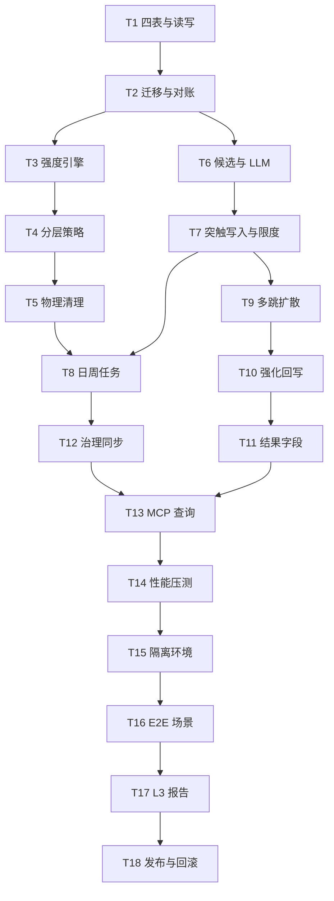

# 记忆神经网 v2（组实体 / 动态突触 / 多跳联想 / 分层降级）实施计划

**目标：** 把记忆组织成可解释的神经网：神经元是组实体，突触带动态强度，召回沿突触多跳扩散，强弱记忆按分层策略归档与清理。
**背景：** 用户 2026-11-10 在 v1 组间关联上继续升级：要求组实体、动态强度、关联/解绑/越组关联、联想检索、多层降级与真实库 E2E。v1 的静态单跳方案已不足以表达“突触大记忆强、突触小记忆弱”。
**架构：** 新增 `neurons`、`neuron_members`、`synapses`、`memory_activation` 四张表；现有 `episode_id` 1:1 迁移为神经元；召回用扩散激活（depth≤3、beam≤5）沿突触传播并回写强化；日任务衰减、周任务分层归档与物理清理。
**技术栈：** Python 3.12、SQLite（WAL）、Qdrant（mem0 热层 + 冷层）、现有 `llm/client.achat`、`prompt_loader`、检索管线。
**计划状态：** 已批准（2026-11-10）
**依据：** 用户 2026-11-10 三项拍板；v1 计划 `../2026-11-10-memory-neuron/plan.md`（已废弃）；`.agent/status.md`；`services/memory/{store,graph,link,consolidate,retention,group_governance}.py`；`services/retrieval/{types,pipeline,arms/recall}.py`；`scripts/episode_sandbox.py`。

## 用户已拍板

- 旧计划重写为 v2，v1 标记 superseded，保留作历史。
- 归档期满允许**直接物理删除**，覆盖仓库“删除移到废纸篓”守则；删除不可恢复，靠 E2E 与部署前全库备份兜底。
- 多层降级机制**默认开启**，不采用 dry_run 上线。

## 非目标

- 不改变 embedding 模型与现有召回三臂结构（技术决定：先复用已验证的 dense/lexical 管线，只加联想臂）。
- 不把冷层摘要重新拆回热层记忆（技术决定：冷层已有 `derived_from` 溯源链）。
- 不让 LLM 直接写突触强度（用户选择：质心余弦候选 + LLM 复核关系，权重由公式合并）。
- 不新增外部依赖（仓库约束）。
- 不做跨设备同步（技术决定：本轮只处理本机记忆网）。

## 全局约束

- 允许破坏性变更：单一真相是 `neuron_members`（归属）与 `memory_activation`（强度/分层）；`episode_id` 降为兼容投影，写入时派生，读取以网络表为准。需要时可重建表，先备份。
- `memory_nodes`/`memory_edges` 现有列与语义保持不变；新字段进新表，不改 `link.py` 的 metadata 白名单。
- 所有自动判定输入用完整 `fact`；截断必须命名预算并标 `truncated`（`CLAUDE.md` 常驻约束第 14 条）。
- 强化与衰减必须幂等可重放：同一 `now` 重复执行结果一致。
- 物理删除只经 `purge_expired` 单一入口；调用前必须存在当次部署的全库备份。
- 新配置同时进 `_YAML_FALLBACKS` 与 `contracts/env.json`；宿主两个注入点同步（utility 仓）。
- 提交与部署需用户明确授权。

## 复杂度追踪

| 违反项 | 为什么必须 | 更简单方案为何不行 |
|---|---|---|
| “删除可恢复：删除文件或数据优先移到废纸篓” | 用户明确要求归档期满物理删除，控制磁盘膨胀 | 只软删除会让库无限增长，违背“记忆膨胀/磁盘”目标；用户已接受不可恢复 |

## 假设

- 假设 A：真实库可整体复制（`GATEWAY_HOME` + `QDRANT_PATH`），副本可独立启动 MCP。
- 假设 B：热层向量可通过 `get_hot_memory().vector_store.client` 批量读取；不可用时联想检索降级为纯图游走并标 `vector_unavailable`。
- 假设 C：`episode_id` 覆盖绝大多数组；无 `episode_id` 的记忆迁移为 `solo:<memory_id>` 单例神经元。
- 假设 D：E2E 用参数化模板生成合成记忆，不依赖任何个人记忆文本，断言针对不变量。

## 取舍

| 决策 | 代价 | 什么证据会让我改主意 |
|---|---|---|
| 神经元独立表，不复用 `memory_nodes` | 多一张表与同步逻辑 | 需要记忆与神经元共用生命周期时再合并 |
| 突触无向存储（`min/max` 排序） | 方向性关系表达弱 | 出现明确因果方向需求时加 `directed` |
| 扩散激活 depth≤3、beam≤5 | 超长链联想覆盖不到 | 评测显示 3 跳召回净增益仍为正且延迟允许时加深 |
| 分层用 `tier` 新字段，不复用 hot/cold | 多一个维度要同步 | 需要把存储层与生命周期合并时再统一 |
| 物理删除默认开启 | 误删不可恢复 | 出现一次误删事故即改为回收站保留 30 天 |

## 交付分档

| 阶段 | 范围 | 交付标准 |
|---|---|---|
| 阶段一 数据与生命周期 | T1-T5 | 迁移可重复、强度可衰减、分层与清理单测通过 |
| 阶段二 网络与联想 | T6-T11 | 突触构建、多跳召回、强化回写与路径输出可用 |
| 阶段三 治理/查询/资源 | T12-T14 | 治理同步、MCP 查询、10 倍数据压测通过 |
| 阶段四 E2E 与发布 | T15-T18 | 真实库副本端到端通过，L3 报告可人工验收 |

## 存储与迁移

| 场景 | 行为 |
|---|---|
| 首次运行 | `connect()` 建四张新表；`network_meta` 无记录时视为未迁移 |
| 有旧图库 | 现有表不动；迁移脚本按 `episode_id` 建神经元与成员，幂等可重跑 |
| 迁移中断 | `network_meta.migrated_at` 为空则下次续跑；已迁移条目按主键跳过 |
| 旧版本读到新库 | 旧代码不认识新表，忽略；`episode_id` 与 `memory_edges` 行为不变 |
| 新版本读到旧库 | 未迁移时联想检索走旧路径；迁移后启用神经元 |
| 幽灵成员 | 成员表允许 `memory_id` 已不存在；周任务对账删除，并重算 `member_count` |
| 物理删除 | `purge_expired` 从 SQLite 四表、mem0 热层、冷层 Qdrant 同步删除；不可恢复，部署前必须全库备份 |

## 性能与资源预算

| 项 | 上限 | 超限行为 | 验收基线 |
|---|---|---|---|
| 单次召回扩散 | 50 神经元 / 8 边每神经元 / 5 成员每次 | 截断并标 `truncated` | 新增 p95 ≤300 ms |
| 日衰减 | 5000 行/事务，≤2 min | 分批续跑 | 1 万节点 ≤2 min |
| 周分层与清理 | ≤5 min | 分批续跑 | 1 万节点 ≤5 min |
| 突触度数 | 每神经元 ≤20 | 保留权重前 20，其余归档 | 单神经元查询 ≤10 ms |
| 突触表 | ≤神经元数 × 20 | 停止写入并告警 | 5 千神经元 ≤10 万行 |
| 激活表 | 单行 ≤512 B | 超限拒绝写入 | 5 万行 ≤25 MB |
| 联想检索内存 | 峰值 ≤200 MB | 中止并回退旧路径 | 无全量向量加载 |
| 10 倍数据 | 5 万记忆 / 5 千神经元 | 分页与索引兜底 | p95 不超过基线 2 倍 |

## 文件结构

| 文件 | 动作 | 职责 |
|---|---|---|
| `src/agent_gateway/services/memory/network.py` | 新建 | 神经元/成员/突触/激活的读写与统计 |
| `src/agent_gateway/services/memory/strength.py` | 新建 | 衰减、强化、解绑与分层判定 |
| `src/agent_gateway/services/memory/lifecycle.py` | 新建 | 分层归档、弱信号识别、物理清理 |
| `src/agent_gateway/services/memory/network_build.py` | 新建 | 质心候选、LLM 复核、突触写入 |
| `src/agent_gateway/services/retrieval/arms/associative.py` | 新建 | 多跳扩散激活与路径 |
| `src/agent_gateway/prompts/{zh-Hans,en}/neuron_link.md` | 新建 | 突触关系判定提示词 |
| `scripts/memory_network_migrate.py` | 新建 | 旧库迁移与对账 |
| `scripts/memory_network_rollback.py` | 新建 | 关闭开关、导出网络、可选删表 |
| `scripts/memory_network_bench.py` | 新建 | 10 倍数据与延迟压测 |
| `scripts/memory_network_e2e.py` | 新建 | 真实库副本隔离 E2E |
| `tests/test_memory_network.py` | 新建 | 存储、迁移、强度、分层、清理 |
| `tests/test_associative_recall.py` | 新建 | 多跳、路径、强化、开关 |
| `src/agent_gateway/services/memory/store.py` | 修改 `SCHEMA`（25-53） | 四张新表与索引 |
| `src/agent_gateway/core/config.py` | 修改 | 网络开关与阈值 getter |
| `src/agent_gateway/services/memory/consolidate.py` | 修改 `run_daily`/`run_weekly` | 衰减、刷新、分层、清理 |
| `src/agent_gateway/services/memory/group_governance.py` | 修改 | split/merge 同步神经元与突触 |
| `src/agent_gateway/services/retrieval/arms/recall.py` | 修改 `expand_episodes` | 接入联想臂 |
| `src/agent_gateway/services/retrieval/types.py` | 修改 | 结果暴露 `path`/`hops`/`neuron_id` |
| `src/agent_gateway/services/mcp/server_memory.py` | 修改 recall handler | 召回后强化回写 |
| `src/agent_gateway/services/mcp/server_memory_graph.py` | 修改 | `edge=synapse/associative` |
| `src/agent_gateway/services/mcp/server_tool_schema.py` | 修改 | 枚举与描述 |
| `src/agent_gateway/services/mcp/server.py` | 修改 `/health` | 网络统计 |
| `src/agent_gateway/locales/{en,zh-Hans}.json` | 修改 | 新参数与状态文案 |

## 依赖图

## 任务索引

- T1 神经元/成员/突触/激活四表与读写（M）
- T2 `episode_id` 迁移与对账（M）
- T3 动态强度引擎（M）
- T4 分层与弱信号识别（M）
- T5 物理清理（M）
- T6 质心候选与 LLM 复核（M）
- T7 突触写入、连边与限度（M）
- T8 日/周任务接入（M）
- T9 多跳扩散激活（L，拆为 T9a 种子与传播、T9b 成员打分与路径）
- T10 召回强化回写（S）
- T11 结果字段与分层惩罚（S）
- T12 分组治理同步（M）
- T13 MCP 查询与健康统计（M）
- T14 性能与 10 倍数据压测（M）
- T15 隔离环境与真实库副本（M）
- T16 E2E 场景与不变量断言（L，拆为 T16a 生命周期、T16b 联想与治理）
- T17 L3 报告与人工验收（S）
- T18 发布、契约与回滚（M）

完整规格、接口、验收与步骤见同目录 `tasks.md`。

## 检查点

### 检查点 A（T1-T5 后）

- 迁移在真实库副本上可重复执行，计数对账一致。
- 强度衰减/强化幂等；分层与弱信号判定有单测。
- 物理清理只在副本上验证，真实库尚未开启。

### 检查点 B（T6-T11 后）

- 合成链 A→B→C 可从模糊种子到达目标，路径权重单调递减。
- 召回开关关闭时结果与当前完全一致；开启后 p95 增量 ≤300 ms。
- 强化回写只影响被命中的记忆与路径突触。

### 检查点 C（T12-T14 后）

- 治理 split/merge 后神经元成员与突触一致。
- 10 倍数据压测通过；无全量向量加载。
- `memory_graph edge=synapse/associative` 返回可解释路径。

### 检查点 D（T15-T18 后）

- 真实库副本 E2E 全场景通过，生产库哈希前后一致。
- 物理删除后四表、热层、冷层均无残留。
- L3 报告含命令输出、路径样例、分层迁移表与误删检查。

## 未覆盖输入类

| 输入或条件 | 期望行为 | 对应任务 |
|---|---|---|
| 记忆无 `episode_id` | 迁移为 `solo:<id>` 单例神经元 | T2 |
| 神经元无成员 | 周任务删除空神经元及其突触 | T5 |
| 突触端点被删除 | 同步删除突触 | T5 |
| 向量不可用 | 联想只走图游走并标 `vector_unavailable` | T9 |
| 查询命中 archived | 默认不返回；`include_archived` 时降权 0.6 | T11 |
| 受保护记忆 | 永不归档/清理 | T4 |
| 同一 `now` 重放 | 衰减与分层结果一致 | T3/T4 |
| 物理删除中途失败 | 记录已删 id，下次重跑幂等跳过 | T5 |

## 风险与回滚

| 风险 | 影响 | 缓解 | 回滚 |
|---|---|---|---|
| 物理删除误删真实记忆 | 不可恢复 | 部署前全库备份；E2E 覆盖保护与边界；清理日志记 id | 从备份恢复 `memory_graph.sqlite` 与 Qdrant 目录 |
| 多跳联想放大错误 | 召回噪声 | 激活地板 0.15、深度 3、LLM 突触复核 | `MEMORY_NEURON_ENABLED=false` 并重启 |
| 迁移中断或半写 | 神经元与成员不一致 | 幂等迁移 + `network_meta` 断点 + 对账 | 重跑迁移脚本 `--apply` |
| 突触爆炸 | 磁盘与延迟上升 | 度数上限 20、日衰减、周解绑 | `MEMORY_NEURON_BUILD=false`，保留只读 |
| 治理与神经元不同步 | 组边界错乱 | `episode_id` 仍是真相；治理后同步并断言 | 从治理前备份恢复 |
| 新配置未进宿主契约 | 生产不生效 | 导出 `contracts/env.json` 并核对 | 改回 `_YAML_FALLBACKS` 与宿主注入点 |
| 日/周任务超时 | 阻塞调度 | 分批与预算；超时续跑 | `MEMORY_NEURON_MAINTENANCE=false` |

## 开放问题

- 无。物理删除与默认开启已由用户明确拍板；其余为 agent 技术决定，已写入取舍表。

## 批准记录

- 状态：已批准
- 用户已拍板：v2 重写、允许物理删除、降级默认开启、允许破坏性变更且结构以单一真相为准
- 批准人：用户
- 批准时间：2026-11-10
