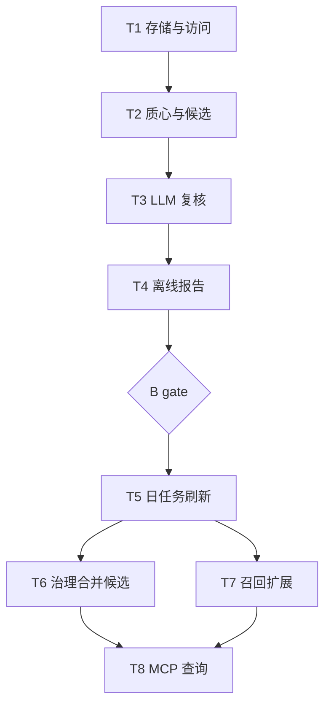

# 记忆神经单元（组间关联）实施计划

**目标：** 以 episode 组为神经单元，计算并持久化组与组之间的关联强度，接入召回扩展、分组治理合并候选与 MCP 图查询。
**背景：** 用户 2026-11-10 提出（`~/Documents/selfdata/notes/个人折腾.md` 第 21 行）。现状只有组内权重恒 1.0 的 episode clique，组间无边；热层 85% 的组只有 1 条记忆，组内扩展对多数记忆无效。组间软关联可在不合并组的前提下提升可达性。
**架构：** 新增 `memory_group_edges` 表；组内成员向量质心余弦生成候选，LLM 复核强度；日任务增量刷新；召回按强度折扣展开关联组成员；治理把高强度组对作为 merge 候选。
**技术栈：** Python 3.12、SQLite（WAL）、Qdrant（mem0 热层）、现有 `llm/client.achat`、`core/prompt_loader`。
**计划状态：** 已废弃（superseded by `.agent/plans/2026-11-10-memory-neuron-v2/plan.md`）
**依据：** 用户 2026-11-10 三项选择；`.agent/status.md` 记忆分组治理条目；`services/memory/{store,graph,link,group_governance}.py`；`services/retrieval/arms/recall.py:474-706`；`.agent/plans/2026-11-08-group-governance.md`。

## 非目标

- 不物化 group 节点，组键继续用 `episode_id`（技术决定：召回、治理、存储均以 episode_id 为键，物化节点需改生命周期，收益未验证）。
- 不处理冷层组关联（技术决定：冷层有 `derived_from` 链且数量少，本轮只做热层）。
- 不改写入侧自动分组策略（代码与实验证明：结构信号无法替代显式组键，见记忆 `1cf99aab`、`3efd4261`）。
- 不自动合并组：组对只作为治理候选，merge 仍由 LLM 决策并写 `episode_prev`（用户选择的是“合并候选”，不是自动合并）。
- 不新增依赖（仓库约束）。

## 全局约束

- 生产库只读验证：离线脚本用 `store.readonly_connect`（`mode=ro&immutable=1`）。
- LLM 只经 `llm_client.achat`，`temperature=0.1`、`timeout=60`、`disable_thinking=True`，失败重试 1 次。
- 组键规则：`ep_` 前缀为自动组，可作锚点、可被合并；非 `ep_` 显式组只作目标、只展示、不合并。
- 自动判定输入用完整 `fact`；截断必须命名预算并标 `truncated`（`CLAUDE.md` 常驻约束第 14 条）。
- 新配置同时进 `config.py` 的 `_YAML_FALLBACKS` 与契约导出；宿主两个注入点同步（utility 仓）。
- 提交需用户明确授权。

## 复杂度追踪

无。

## 假设

- 假设 A：热层 Qdrant 可批量取成员向量；不可用时离线报告标 `vector_unavailable`，不生成候选。
- 假设 B：`2026-11-08-group-governance.md` 的 37 个未勾选项是过期记录；代码已实现 `episode_source`/`episode_prev`（`group_governance.py:540-620`、`consolidate.py:483-503`）。若勾选状态代表真实未完成项，先补完再执行本计划。
- 假设 C：85% 单条组限制组间收益，故候选允许「多成员自动组 ↔ 单条组」配对，用软关联替代合并。

## 取舍

| 决策 | 代价 | 什么证据会让我改主意 |
|---|---|---|
| 组间软关联而非合并 | 组身份仍碎片化，查询需多跳 | 抽检 50 对准确率 <80% 或召回净增益 ≤0 |
| 质心余弦候选 + LLM 复核 | 多一次 LLM 成本；质心掩盖组内离群成员 | Top200 对 LLM 接受率 <40% 时改为成员级双向匹配 |
| 新增独立表而非复用 `memory_edges` | 多一套读写函数 | 需要组节点级联遍历时改为组节点 |
| 召回开关默认关闭，gate 后开启 | 上线需二次操作 | 检查点 B 通过后直接改默认值 |

## 交付分档

| 阶段 | 范围 | 交付标准 |
|---|---|---|
| MVP | T1-T4 | 离线只读报告可生成；50 对人工抽检可判读；不写生产库 |
| 完整版 | T5-T8 | 日任务增量写入、召回（开关）、治理合并候选、MCP 查询全部可用 |
| 增强 | E1-E3 | 组内权重、动态强度、冷层关联、组节点实体化 |

## 存储与迁移

| 场景 | 行为 |
|---|---|
| 首次运行 | `connect()` 执行 `CREATE TABLE IF NOT EXISTS`，得到空表 |
| 有旧图库 | 无该表时自动创建；空关联不改变任何行为 |
| 行解码失败 | metadata 置空并 `logger.warning`，不删行 |
| 旧版本读到新库 | 旧代码不认识该表，忽略；节点/边读写不受影响 |
| 新版本读到旧库 | 自动建表；开关关闭时不查询 |
| 组被治理合并或删除 | 下次 `prune_group_links` 删除端点不存在的行 |
| 回滚 | 关 `MEMORY_NEURON_LINKS=false` 并重启；清数据先 `cp memory_graph.sqlite memory_graph.sqlite.bak-<ts>`，再 `DELETE FROM memory_group_edges;` |

## 性能与资源预算

| 项 | 上限 | 超限行为 | 验收基线 |
|---|---|---|---|
| 离线候选 | 2000 对 / 60 s | 截断并记 `truncated` | 850 组级查询 ≤60 s |
| 离线 LLM | 200 对 / 20 次调用 / 20 min | 停止并保留已完成 | 单次 ≤60 s |
| 日增量 LLM | 100 对 / 10 次调用 / 10 min | 停止，下次续跑 | 日任务总时长 ≤15 min |
| 关联表 | 5000 行 / 2 MB | 停止写入并告警 | 单行 ≤300 B |
| 召回扩展 | 每 seed 3 组 × 2 条，总计 18 条 | 截断 | 新增 p95 ≤150 ms |
| 内存 | 850 质心 × 768 × 4 B ≈ 2.6 MB | 分页计算 | 峰值 ≤100 MB |

## 文件结构

| 文件 | 动作 | 职责 |
|---|---|---|
| `src/agent_gateway/services/memory/neuron.py` | 新建 | 组质心、候选、LLM 复核、关联读写、刷新 |
| `src/agent_gateway/prompts/zh-Hans/neuron_link.md` | 新建 | 中文组间关系判定提示词 |
| `src/agent_gateway/prompts/en/neuron_link.md` | 新建 | 英文镜像 |
| `scripts/neuron_links_eval.py` | 新建 | 离线只读评估与报告 |
| `tests/test_neuron_links.py` | 新建 | 存储、质心、候选、LLM 解析、刷新 |
| `tests/test_recall_neuron_links.py` | 新建 | 召回扩展开关、阈值、上限、过滤 |
| `src/agent_gateway/services/memory/store.py` | 修改 `SCHEMA`（25-53） | 新增 `memory_group_edges` 表与索引 |
| `src/agent_gateway/core/config.py` | 修改 `_YAML_FALLBACKS`（44-64）与 getter 区 | 4 个开关 getter |
| `src/agent_gateway/services/memory/consolidate.py` | 修改 `run_daily`（478-505） | 治理后刷新关联 |
| `src/agent_gateway/services/retrieval/arms/recall.py` | 修改 `expand_episodes`（474-500）与 `_expand_edges` 附近 | 组间关联扩展 |
| `src/agent_gateway/services/memory/group_governance.py` | 修改候选、解析、应用区 | group_pair 候选与合并 |
| `src/agent_gateway/prompts/{zh-Hans,en}/govern_groups.md` | 修改 | 组对合并判定口径 |
| `src/agent_gateway/services/mcp/server_memory_graph.py` | 修改 `handle_memory_graph`（103-143） | `edge=group` 查询 |
| `src/agent_gateway/services/mcp/server_tool_schema.py` | 修改（483-519） | edge 枚举加 `group` |
| `src/agent_gateway/locales/{en,zh-Hans}.json` | 修改 | 参数描述补充组间关联 |

## 依赖图

## 任务索引

- T1 存储与访问层（S）
- T2 组质心与候选生成（M）
- T3 LLM 复核与解析（M）
- T4 离线评估脚本与报告（M）
- T5 日任务增量刷新（M）
- T6 治理合并候选（M）
- T7 召回扩展（M）
- T8 MCP 图查询（S）

完整规格、接口、验收与步骤见同目录 `tasks.md`。

## 检查点

### 检查点 A（T1-T3 后）

- 单测通过；离线候选生成只读跑通；无生产写入。

### 检查点 B（T4 后，人工 gate）

- 50 对抽检准确率 ≥80%；LLM 接受率 ≥40%；Top20 合并候选人工认可 ≥12 对。
- 未达标则停在 MVP，保留报告，不进入 T5。

### 检查点 C（T5-T7 后）

- 沙箱 dry_run 不落盘；开关开启后召回净增益 >0，新增 p95 ≤150 ms；关闭开关结果与当前完全一致。

### 检查点 D（T8 后）

- MCP `memory_graph edge=group` 返回组成员与关联；显式组不参与合并。

## 未覆盖输入类

| 输入或条件 | 期望行为 | 对应任务 |
|---|---|---|
| 组无向量（Qdrant 缺失） | 跳过该组并计数 | T2 |
| 组只有 1 条记忆 | 可作目标，不作锚点 | T2 |
| 组大于 8 条 | 不参与关联（沿用治理上限） | T2 |
| 显式组（非 `ep_`） | 只展示，不合并 | T2/T6 |
| LLM 返回未知 group id | 丢弃并计 `parse_failed` | T3 |
| 关联端点组已不存在 | prune 删除该行 | T5 |
| 召回开关关闭 | 结果与当前完全一致 | T7 |
| 节点 archived/superseded | 不进入扩展 | T7 |

## 风险与回滚

| 风险 | 影响 | 缓解 | 回滚 |
|---|---|---|---|
| 85% 单条组导致收益不足 | 召回扩展空转 | 允许锚点↔单条组配对；gate 量化净增益 | `MEMORY_NEURON_LINKS=false` 并重启 MCP |
| 质心把宽泛主题连成高权重 | 错误扩展 | LLM 复核 + 权重阈值 0.62 | 先备份，再 `DELETE FROM memory_group_edges;` |
| 召回延迟上升 | p95 超预算 | 批量 retrieve、每 seed 上限 3 组 | 开关关闭 |
| 治理误合并 | 组边界变坏 | 仅 `ep_` 自动组、LLM 决策、写 `episode_prev` | `scripts/group_governance_rollback.py --apply` |
| 新配置未进宿主契约 | 生产不生效 | 导出 `contracts/env.json` 并核对 | 改回 `_YAML_FALLBACKS` 与宿主注入点 |
| 日任务超时 | 治理与摘要被拖慢 | LLM 预算 10 次/天 | `MEMORY_NEURON_REFRESH=false` |

## 开放问题

- 无。三项用户选择已定；组节点实体化列入增强档。

## 批准记录

- 状态：已废弃
- 原因：用户 2026-11-10 要求升级为组实体、动态突触、多跳关联检索、多层降级与真实库 E2E，v2 重写。
- 批准人：用户（v1 不再执行）
- 批准时间：2026-11-10
