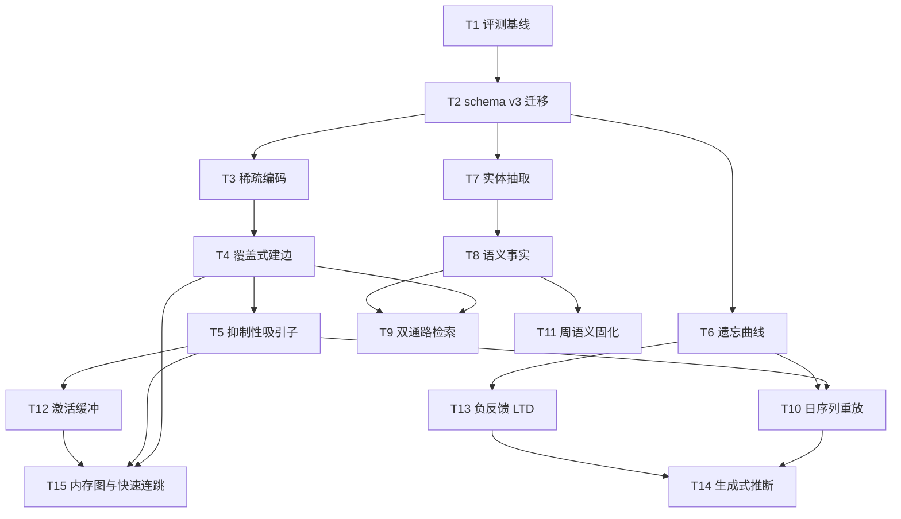

# 记忆体 v3：类脑记忆架构实施计划

**目标：** 把记忆体从「分组 + 静态加权图 + 单向 BFS」升级为「稀疏编码 → 抑制性吸引子提取 → 序列重放巩固 → 情景/语义双层」的类脑结构。
**背景：** 当前实现是图检索，不是记忆动力学。生产 4268 个神经元里 85.2% 是单成员组，被锚点条件 `2 <= len(members) <= 8` 排除在建边之外（`network_build.py:414`）；突触时间跨度中位 10 天、1 年以上 0 条；冷层 1093 条不进网络。结果是「近期相似」能连上，「跨时期的同一个人/同一件事」连不上——用户验证案例（人物 → 偏好 → 食物）在结构上无路可走。
**架构：** 三层记忆（情景 E / 语义 C / 图式 S）+ 两个动力学（DG 式稀疏编码 + CA3 式抑制吸引子提取）+ 一个离线循环（SWR 式序列重放与语义固化）+ 按稳定性而非固定半衰期的遗忘曲线 + CSR 内存图的快慢两段式检索（recall 慢找起点，`memory_expand` 快连跳）。
**技术栈：** Python 3.12、numpy（已在 `memory` extra）、SQLite、Qdrant local。**不引入 scipy 等新依赖**，吸引子用邻接表 + numpy 实现。
**计划状态：** 已批准
**依据：** 用户 2026-11-11 指示「只考虑最优架构、合理性，允许破坏性变更，不在乎复杂度」；`CLAUDE.md` 常驻约束；`src/agent_gateway/services/memory/`、`src/agent_gateway/services/retrieval/`；认知神经科学公开资料见「神经科学依据」。

## 神经科学依据

这些不是类比修辞，每条都对应一个具体机制。

| 机制 | 事实来源 | 对应设计 |
| --- | --- | --- |
| 互补学习系统（CLS）：海马快速学稀疏情景，皮层慢速学重叠语义，避免灾难性干扰 | McClelland, McNaughton & O'Reilly 1995 | E 层快速写入 + C 层慢速统计，两层分离 |
| 模式分离：齿状回用稀疏编码让相似经历正交化 | 齿状回颗粒细胞稀疏放电；“Pattern separation”研究 | 稀疏码 + 上下文键，相似记忆不合并 |
| 模式完成：CA3 递归侧支作吸引子，部分线索恢复整体 | Hopfield 1982；现代 Hopfield（Krotov & Hopfield 2016） | 抑制性吸引子迭代，替代单向 BFS |
| 扩散激活：激活沿边按权重衰减、超阈值才继续传播 | Collins & Loftus 1975 | 保留现有 `spread` 作为初始激发，吸附加在其后 |
| 突触巩固 / 系统巩固 / 再巩固；LTP 与 LTD | Memories consolidation 综述；LTP 文献 | 快慢双权重、STDP 式有符号更新、提取后不稳定窗口 |
| 睡眠重放：慢波睡眠中序列重放驱动皮层巩固 | Wilson & McNaughton 1994；SWR 综述 | 日序列重放、周语义固化 |
| 间隔效应与遗忘曲线：可提取性随间隔与稳定性变化 | Ebbinghaus；FSRS 开源算法 | FSRS-lite 的 stability / difficulty / retrievability |

工程侧的可复用参考：FSRS（MIT）给出可直接落地的 S/D/R 更新式，比抽象隐喻更可验证。

## 非目标

- 不替换 embedding 模型，不改 Qdrant 集合结构与既有阈值标定流程（用户未要求，改动会牵动全部检索评测）。
- 不引入 GPU、图数据库或新的向量库（改动面与回滚成本远超收益）。
- 不做多用户共享记忆或跨设备同步（不是本仓职责）。
- 不在本计划内改 utility Swift 侧；新配置项由 T2 一次性导出，宿主侧同步属于发布任务。
- 不新增除 `memory_expand` 以外的 MCP 工具；负反馈复用 `supersedes` 与矛盾检测（`memory_expand` 由用户 2026-11-11 批准）。

## 全局约束

- 自动化判断输入必须是原始正文，禁止 `title` / `snippet`（`CLAUDE.md` 常驻约束 14）。截断必须命名预算并标 `truncated`。
- 配置唯一来源 `agent-gateway.yaml`；新键同时进 `core/config.py` 的 `_YAML_FALLBACKS` 与 `contracts/env.json`（约束 8、9）。
- 所有写库操作走 `store.connect()`；只读分析走 `store.readonly_connect()`。
- 异步路径中任何 SQLite / numpy 批量计算必须 `await asyncio.to_thread(...)`，禁止阻塞事件循环（v2 已踩过，`daily` 曾出现 8.7 秒心跳）。
- 新机制默认开启（用户 2026-11-11 决定）；护栏是预算上限、低初始权重与单行回退开关，不是关闭。开关关闭时行为必须与当前逐位一致。
- 删除一律移到废纸篓；迁移前必须备份，回滚必须给出可执行命令。
- 测试命令固定为 `PYTHONPATH=src python -m unittest discover -s tests -t .`；格式与静态检查 `ruff format --check src tests scripts`、`ruff check src tests scripts`。

## 复杂度追踪

无。改动只在 `agent-gateway` 能力层内，不触碰仓边界与依赖白名单；新增机制全部由配置开关控制。

## 假设

- 假设 A：重放运行在 MCP 进程内（与现有 `consolidation_scheduler` 同构），因此 Qdrant local 单实例锁不构成新问题。若不成立，改为独立进程 + 向量库只读副本（`memory_network_backfill.py` 已有 rsync 副本先例）。
- 假设 B：embedding 维度为 768（jina-v2-base-zh）。若换模型，按新维度与固定种子重建投影矩阵并重算稀疏码；旧码作废重算，不做跨维度兼容。
- 假设 C：每日重放 ≤ 40 次 LLM 调用、每周 ≤ 200 次在用户可接受范围内（用户 2026-11-11 确认）。
- 假设 D：生产记忆数据最早为 2026-06，仅 5 个月、6758 条活跃记忆。跨年联想无法用现有数据验收，验收边界是「从今天的记忆跳到 5 个月前的记忆」；架构本身不依赖数据年限。

有误现在纠正；否则按此继续。

## 取舍

| 决策 | 代价 | 什么证据会让我改主意 |
| --- | --- | --- |
| 建边判据 = 0.5×cosine + 0.5×稀疏 Jaccard | 多一列 BLOB、需要一次性回填；稀疏码不能直接用于 Qdrant 检索，只能做二次判定 | 稀疏重叠与人工判定一致率 < 70% 时退回纯 cosine |
| 吸引子取代 `spread` 作为默认提取 | 迭代 8 轮 × 活跃边，最坏 30–60 ms；可能过平滑，把远距离高权节点拉进前排 | 固定评测集 NDCG@10 下降 > 3% 时降级为「spread 初值 + 单轮补全」 |
| FSRS-lite 取代全局 30/90 天半衰期 | 每条记忆与突触各多 2 个状态列；迁移期需要初始化 | 归档误判率（人工抽检）> 10% 时保留固定半衰期 |
| 实体抽取并入矛盾检测的同一次 LLM 调用 | 单次 prompt 变长，解析失败率上升；耦合两个职责 | 解析失败率 > 5% 时拆为独立异步任务（成本 +1 次/写入） |
| 生成式推断默认开启，但只写 `inferred` 边、初始权重 ≤ 0.35、不进主检索排序 | 低权重边仍占存储与聚合，需要审核队列兜底 | 推断边采纳率 < 30% 或出现污染时降为仅人工触发 |
| 只在 E 层做重放，S 层由图式聚类后置生成 | S 层能力延后到增强档 | 若语义层单独就能显著提升跨期联想，提前拆出 |

## 交付分档

| 阶段 | 范围 | 交付标准 |
| --- | --- | --- |
| MVP | T1–T4 | 评测基线可复现；schema v3 可迁移可回滚；稀疏码覆盖全部活跃记忆；单成员组进入建边，孤立率显著下降且联想命中率不低于基线 |
| 完整版 | T5–T13、T15 | 吸引子、遗忘曲线、实体/语义双层、双通路检索、日序列重放、周语义固化、激活缓冲、负反馈、内存图快连跳全部实现且开关独立；全量测试与 ruff 通过 |
| 增强 | T14 | 生成式推断与审核队列；图式层留给后续计划，不在本计划内 |

## 架构

### 数据流

```text
写入 → E 层（神经元 + 稀疏码 + 上下文键）
         ↓ 抽取（同一次 LLM 调用）
       C 层（实体 / 事实 / 支持与矛盾计数）

查询 → 软种子（向量，既有 soft_seeds）
         ↓
       稀疏码门控（模式分离：同主题不同上下文不互相激发）
         ↓
       spread（既有，负责初始激发）
         ↓
       吸引子迭代（模式完成 + k-WTA 抑制）
         ↓
       分级打分（相关度 × 可提取性 R × 层级）
         ↓
       结果 + 激活写回（activation_buffer）
```

### 关键算法

1. **稀疏编码（T3）**：固定种子随机投影 `R ∈ R^{2048×768}`，`x = topk(R·e, 64)` 置 1（3.1% 稀疏）；上下文键 `hash(episode_id|source|time_bucket)` 映射到 2048 空间取 16 位，与 `x` 取并集。相似度用 Jaccard，存储在 `neurons.sparse_code`。
2. **建边（T4）**：`candidate_pairs` 去掉锚点成员数限制（现 `network_build.py:414`），所有有 centroid 的神经元都做近邻；最终分 `0.5*cosine + 0.5*jaccard`，LLM 复核保持不变；仍受 `PAIR_LIMIT` / `LLM_PAIRS` 预算约束，分批回填。
3. **吸引子（T5）**：`A_{t+1} = normalize(α·A_t + β·W·A_t + γ·seed)`，保留前 k 个（k=32，k-WTA），`α=0.35, β=0.55, γ=0.10`，迭代 10 轮或 `‖ΔA‖₁ < 0.01` 停止。`W` 带符号：`polarity=+1` 相加，`-1` 相减。
   - **淘汰用相对阈值**：每轮只保留 `> 0.1 × 本轮最大激活` 的节点，不用绝对地板。现状每跳乘 0.5625、地板 0.15，第 4 跳必断；相对阈值让激活随整体水位下降，链不因绝对数值归零而断。
   - **锚点重激发**：到达高重要性节点（`importance ≥ 8` 或度 ≥ 20）时激活回冲为 `max(current, 0.6)`，对应「想到妈妈，整片相关记忆重新点亮」。这是 5 跳以上仍能前进的关键。
   - 绝对地板仍保留一个下限（默认 0.02），只用于终止噪声传播，不用于截断主链。
4. **STDP（T5 内置）**：共激活时按记忆时间差 `Δt`（天）更新——`Δt>0` 增强 `0.20·exp(-Δt/7)`，`Δt<0` 减弱 `0.10·exp(Δt/7)`，与现有 `coactivate` 的 0.20 同量级。
5. **可提取性（T6）**：`R = exp(ln(0.9)·t/S)`，`t` 为距上次激活天数，`S` 为 stability。成功回忆时 `S' = S·(1 + 0.8·(1-R))`（间隔效应）；`S` 初值 `3 + 12·importance/10` 天，上限 3650。归档判据 `R < 0.3` 且空闲超过 `archive_days`。
6. **序列重放（T10）**：按 `importance × (1-R) × 未巩固度` 采样 40 个种子；每个种子沿出边加权随机游走 3–5 跳，得到 5 条序列；LLM 逐序列判定「强化路径 / 抽语义 / 提出新推断」。路径边 `+0.05` 封顶 1.0。
7. **激活缓冲（T12）**：每次 recall 后写回激活神经元，`activation *= 0.9^(分钟/5)`，TTL 30 分钟，行数上限 200，超出按激活值裁剪。
8. **内存图与快速连跳（T15）**：CSR 常驻内存，单跳 O(度) 微秒级；`memory_expand(anchor, hops=2, limit=20)` 只做图游走，不查库、不调 LLM。recall 负责慢检索找起点，expand 负责一次一跳地走下去，10 跳 < 10 ms。

### 权重语义（v3 定义，覆盖 v2 的隐式约定）

| 字段 | 含义 | 谁写 |
| --- | --- | --- |
| `synapses.base_weight` | 慢权重，巩固与重放写入 | T10、T11 |
| `synapses.weight` | 快权重，使用与 STDP 更新，实际检索用 | T5、T13 |
| `synapses.polarity` | +1 兴奋 / -1 抑制 | T5、T13 |
| `synapses.stability` | 该边的稳定性（天），决定衰减速度 | T6、T10 |
| `memory_activation.strength` | 记忆快强度 | 既有 |
| `memory_activation.stability` | 记忆稳定性（天） | T6 |

## 数据模型 v3

`SCHEMA_VERSION` 由 1 提到 3（`store.py:26`），DDL 只增不改名。

| 表 | 变更 | 说明 |
| --- | --- | --- |
| `neurons` | 增 `kind TEXT DEFAULT 'episodic'`、`sparse_code BLOB`、`context_key TEXT`、`specificity REAL DEFAULT 0` | kind ∈ episodic/semantic/schema |
| `synapses` | 增 `polarity INTEGER DEFAULT 1`、`stability REAL DEFAULT 90`、`kind TEXT DEFAULT 'assoc'`、`inferred INTEGER DEFAULT 0` | kind ∈ assoc/temporal/inhibit/inferred |
| `memory_activation` | 增 `stability REAL DEFAULT 30`、`difficulty REAL DEFAULT 5`、`unstable_until TEXT` | 再巩固窗口 |
| `entities` | 新建：`entity_id TEXT PK, name TEXT UNIQUE, type TEXT, aliases TEXT, metadata TEXT` | C 层实体 |
| `entity_mentions` | 新建：`entity_id, memory_id, role, confidence, PRIMARY KEY(entity_id, memory_id, role)` | 实体出现位置 |
| `memory_edges` | 增 `valid_from TEXT`、`valid_to TEXT`、`supports INTEGER DEFAULT 1`、`contradicts INTEGER DEFAULT 0` | 事实的时间与证据计数 |
| `activation_buffer` | 新建：`neuron_id TEXT PK, activation REAL, updated_at TEXT` | 工作记忆 |
| `replay_runs` | 新建：`run_id TEXT PK, kind TEXT, started_at, ended_at, sampled INTEGER, reinforced INTEGER, inferred INTEGER, promoted INTEGER, cost_tokens INTEGER` | 重放审计 |

索引：`neurons(kind)`、`synapses(kind, polarity)`、`entities(name)`、`memory_edges(from_id, to_id, type)`（已有 UNIQUE 覆盖）、`activation_buffer(updated_at)`。

新列一律不设 `NOT NULL`：`_import` 按动态列写入，旧导出包缺的键会传 `None`，`NOT NULL` 会直接失败。读取端用 `COALESCE(polarity, 1)`、`COALESCE(stability, 90)` 补默认。

## 存储与迁移

| 场景 | 行为 |
| --- | --- |
| 首次运行（无数据文件） | `store.connect()` 建全量 v3 表；`SCHEMA_VERSION=3` 写入 `PRAGMA user_version` |
| 有旧格式数据（v2，user_version=1） | 迁移脚本先 `sqlite3 .backup` 到 `memory_graph.v2-<YYYYmmddHHMMSS>.sqlite`，再 `ALTER TABLE ... ADD COLUMN`（仅增列，SQLite 常数时间），最后把 `user_version` 置 3；旧表数据零改写 |
| 数据文件解码失败 | 迁移脚本捕获 `sqlite3.DatabaseError`，把文件改名 `.corrupt-<ts>` 并退出非零；不自动重建（重建会丢记忆），由用户决定从备份恢复 |
| 旧版本程序写回 | 旧代码按显式列名 INSERT/UPDATE，新列取默认值，不会写坏；旧代码 `SELECT *` 多出的列被忽略。风险点：旧版 `rollback --drop-network` 会删新表——迁移脚本在 `network_meta` 写 `schema_version=3`，回滚脚本检测到 3 时要求 `--force` |
| 旧版本读到新数据 | 旧版 recall 不受影响（只读 `memory_nodes` 与向量库）；旧版 `memory_graph` 工具会多读到 `activation_buffer`/`entities` 之外的已知表，未知表被忽略。恢复命令：`cp <backup> ~/.config/utility/memory_graph.sqlite` 并重启 MCP |
| 导出（网络级） | `memory_network_rollback.py` 的 `TABLES` 增加 4 张新表；导出 JSON 顶层加 `schema_version`；`_export` 的缺表硬失败改为跳过并输出 `missing_tables`（`rollback.py:69-71`） |
| 导出（整库） | utility `ConfigArchive` 整库 `backup(to:)` 不改；manifest 增加 `memorySchemaVersion` |
| 导入（旧包进新库） | `ConfigArchive.swift:221-225` 改为只拒绝「incoming 多出的表」：旧包表少则放行，缺列由 `COALESCE` 兜底；`activation_buffer` 导入时清空（工作记忆不跨设备） |
| 导入（新包进旧库） | 表名差集非空，拒绝并提示升级 App；不尝试降级写入 |
| 降级 | `python scripts/memory_brain_migrate.py --rollback --db <path>`：从最近备份整库替换（不做列删除，SQLite 3.35+ 虽支持 DROP COLUMN 但无法恢复数据）；执行前校验备份存在与 mtime |

## 性能与资源预算

| 项 | 上限 | 超限行为 | 验收基线 |
| --- | --- | --- | --- |
| 稀疏码生成 | 全部活跃记忆一次回填 20 分钟 | 按 2000 条分批，失败批次记录并继续 | 4268 神经元回填 < 20 分钟，缺失率 0 |
| 单次吸引子提取 | 8 轮、k=32、活跃边 ≤ 2000 | 达到轮数上限直接返回当前激活，标 `truncated` | 5k 神经元 / 100k 边下 p95 < 150 ms |
| recall 端到端 | p95 < 300 ms（本地） | 超时降级为 spread 单轮结果 | 固定快照 100 条查询 p95 |
| 日重放 | 20 分钟、40 次 LLM 调用 | 达到任一项即收尾，剩余种子顺延到明日 | `replay_runs` 记录耗时与调用数 |
| 周语义固化 | 60 分钟、200 次调用 | 同上，按优先级截断 | 同上 |
| 激活缓冲 | 200 行、TTL 30 分钟 | 按激活值裁剪最旧行 | 行数稳定 ≤ 200 |
| 数据库增长 | 相对 v2 ≤ 2 倍 | 超出时停止推断边写入并告警 | 迁移后与 30 天后各测一次 |
| 内存图（CSR） | 200 万边约 18 MB | 超过 200 万边按时间分片：常驻最近 2 年，更早按需加载并记 `graph_partitioned` | 20 万节点 / 160 万边 bench 内存 < 25 MB |
| 单次 expand | 10 跳 < 10 ms | 达到跳数或节点预算即返回，标 `budget_exhausted` | bench 20 万节点下 p95 < 10 ms |

## 验证策略：抽样与全量

VM 端到端用分层抽样，生产首跑用全量。抽样必须覆盖全部时间跨度，不能只取最近一批。

### 抽样规则

- 分层键：月份 × 有边/无边 × 成员数档（1 / 2–8 / 9+）。
- 每层最少 15 个；2026-06 的 42 个神经元全取（最老的一批，孤立率 97.6%，最能暴露问题）。
- 固定种子 `20261111`，同一库重复抽样结果一致。
- 目标 400 个神经元（约 9.4%），对应成员记忆约 1000 条；另补抽 400 条未归入任何神经元的记忆（2490 条中的抽样），覆盖「无组」形态。

### 哪些必须全量算

零 LLM 成本的统计一律全量：孤立率、连通分量、直径、度数分布、跨月时间跨度。抽样的孤立率必然失真，不能用于验收。

### 哪些用抽样

需要 LLM 的：实体抽取、建边复核、重放。检索评测是「抽样查询 + 全量库」——查询可以抽样，库不能抽样，否则命中不到真实分布。

### 两次运行的规模

| 维度 | Lume VM | 生产首跑 |
| --- | --- | --- |
| 神经元 | 400 | 4268 |
| 记忆（实体抽取） | 约 1000 | 6758 |
| 建边候选对 | 约 1500 | 约 1.5 万 |
| LLM 调用 | 约 270 | 约 2200 |
| 预计耗时 | < 10 分钟 | 4–5 小时 |

生产跑批按锚点分批、可中断，每批独立事务；老记忆批次先跑。

## 文件结构

| 文件 | 动作 | 职责 |
| --- | --- | --- |
| `src/agent_gateway/services/memory/store.py` | 修改 | schema v3 DDL 与版本门 |
| `src/agent_gateway/services/memory/sparse.py` | 新建 | 稀疏编码、上下文键、Jaccard |
| `src/agent_gateway/services/memory/attractor.py` | 新建 | 带符号吸引子迭代与 k-WTA |
| `src/agent_gateway/services/memory/forgetting.py` | 新建 | FSRS-lite 的 S/D/R 更新与分层判据 |
| `src/agent_gateway/services/memory/entities.py` | 新建 | 实体/事实解析、置信度合并、时间线 |
| `src/agent_gateway/services/memory/replay.py` | 新建 | 序列采样、游走、LLM 判定、写入 |
| `src/agent_gateway/services/memory/graph_index.py` | 新建 | CSR 内存图、增量更新、多跳游走 |
| `src/agent_gateway/services/mcp/server_memory.py` | 修改 | 注册 `memory_expand` 工具 |
| utility `Sources/Core/Archive/ConfigArchive.swift` | 修改 | 导入表名比较方向与 `memorySchemaVersion` |
| `src/agent_gateway/services/memory/network_build.py` | 修改 | 放开锚点限制、稀疏复合打分 |
| `src/agent_gateway/services/memory/strength.py` | 修改 | STDP、可提取性、LTD、缓冲写回 |
| `src/agent_gateway/services/memory/consolidate.py` | 修改 | 日/周任务接入重放与语义固化 |
| `src/agent_gateway/services/memory/link.py` | 修改 | 写入时触发实体抽取 |
| `src/agent_gateway/services/retrieval/arms/associative.py` | 修改 | spread 后接吸引子，读激活缓冲 |
| `src/agent_gateway/services/retrieval/pipeline.py` 及新臂 | 修改/新建 | 语义优先通路 Stage |
| `src/agent_gateway/core/config.py` | 修改 | 新开关与预算键 |
| `src/agent_gateway/prompts/{zh-Hans,en}/{entity_extract,replay_sequence}.md` | 新建 | 提示词 |
| `scripts/memory_brain_migrate.py` | 新建 | 迁移与回滚 |
| `scripts/memory_brain_backfill.py` | 新建 | 稀疏码与实体回填 |
| `scripts/memory_network_bench.py` | 修改 | 增加 `--profile v3` |

## 依赖图



## 任务索引

详细步骤、接口、验收与验证命令见 `tasks.md`。

**MVP**

| 编号 | 任务 | 依赖 | 规模 |
| --- | --- | --- | --- |
| T1 | 评测基线固化 | 无 | S |
| T2 | schema v3 迁移与回滚 | T1 | M |
| T3 | 稀疏编码与回填 | T2 | M |
| T4 | 覆盖式建边（单成员组进网） | T3 | M |

**完整版**

| 编号 | 任务 | 依赖 | 规模 |
| --- | --- | --- | --- |
| T5 | 抑制性吸引子提取 | T4 | L |
| T6 | 遗忘曲线与分层 | T2 | M |
| T7 | 实体抽取与 mentions | T2 | M |
| T8 | 语义事实与时间线 | T7 | M |
| T9 | 双通路检索 | T4、T8 | M |
| T10 | 日序列重放 | T5、T6 | L |
| T11 | 周语义固化与 gist 压缩 | T8 | M |
| T12 | 激活缓冲与启动效应 | T5 | S |
| T13 | 负反馈 LTD | T6 | S |
| T15 | 内存图与快速连跳 | T4、T5、T12 | M |

**增强**

| 编号 | 任务 | 依赖 | 规模 |
| --- | --- | --- | --- |
| T14 | 生成式推断与审核 | T10、T13 | M |

## 检查点

### 检查点 A（T1–T4 后，MVP）

- [x] 全量 `unittest` 与 ruff 通过
- [x] 迁移脚本在生产库副本上幂等：连续执行两次，第二次 `changes=0`
- [x] 回滚脚本从备份恢复成功，`PRAGMA user_version` 回到 1
- [x] 稀疏码覆盖率 100%（活跃记忆），孤立神经元比例相对 v2 下降 ≥ 40%
- [ ] 固定探针集上 recall@10 不低于基线（允许 −1% 方差），联想三元组命中不降

### 检查点 B（T5–T9 后）

- [ ] 吸引子开关关闭时，v2 行为逐位一致（100 条固定查询 ids 完全一致）
- [ ] 开启后 p95 < 150 ms 且 NDCG@10 下降 ≤ 3%
- [ ] 实体抽取解析失败率 ≤ 5%，`entities` 与 `entity_mentions` 非空
- [ ] 双通路检索在固定探针上 MRR 提升 ≥ 5%（相对基线）

### 检查点 C（T10–T13、T15 后）

- [ ] 连续 7 天日重放无超时、无阻塞事件循环（heartbeat max < 500 ms）
- [ ] 重放产生的新边中，人工抽检 30 条，合格率 ≥ 80%
- [ ] 激活缓冲行数稳定 ≤ 200，跨会话可观察
- [ ] 归档误判率（抽检 50 条被归档记忆）≤ 10%
- [x] 从今天的记忆出发，5 跳内能到达 5 个月前的记忆（真实数据验证，替代「十年」用例）
- [x] `memory_expand` 10 跳 p95 < 10 ms，全程无 SQL、无 LLM 调用
- [x] VM 抽样覆盖 2026-06 至 2026-11 每个月、有边与无边两种形态；2026-06 全取
- [x] 孤立率、连通分量、直径用全量数据计算，不用抽样值

### 检查点 D（T14 后）

- [x] 生成式推断边全部带 `inferred=1` 与 `replay_runs` 审计行
- [x] 审核队列可列出、可采纳、可撤销；14 天未采纳自动撤销有测试覆盖

## 执行记录（2026-11-11，Lume VM 真实数据）

**实测快照**（库副本 `/tmp/gh/memory_graph.sqlite`，4217 neurons，2026-06 至 2026-11）

| 指标 | 建边前 | 最终 |
| --- | --- | --- |
| 活跃边 | 4 | 14534（assoc 14495 + bridge 39） |
| 孤立率 | 99.81% | 8.37%（353，均为无质心或余弦不足的单点） |
| 连通分量 | — | 1（3864 个可连节点） |
| 直径 / 平均度 | — | 17 / 6.89 |
| 5 跳可达（120 点抽样） | — | 中位 1986，p90 2785 |
| BFS 5 跳 / `expand` 5 跳 p50 | — | 1.06 ms / 1.0 ms |
| 吸引子（单种子，10 轮） | — | 32 ms，激活 200（`MAX_ACTIVE` 上限） |

- 跨月路径示例：`ep_20260629_0001`（yjzt-wms iOS 离线打包）→ 3 跳 → `ep_20260924_1972`（UIScene 迁移审查）。
- 稀疏回填 4211/4217（6 条无质心）；上下文编码后 v3 候选 18883 对、写入 16486 条。
- LLM 建边复核实跑：4 次调用、0 解析失败、34 条新边。
- 日重放实跑：4 次调用、强化 11 条、1 次失败；累计预算生效（当日已用 8 次时再请求 4 次 → `daily_budget`）。
- 实体回填抽样 20 条：96 entities / 102 mentions / 92 facts；`SemanticArm` 对实体名命中 1 条记忆。
- 推断边生命周期：写入 0.35 / `inferred=1` / 元数据带 run_id → 审核采纳后 0.6 / `assoc`。
- VM 全量测试 814 通过（3 skipped）。

**实现偏移（相对原计划，均有实测依据）**

1. **边权重用原始余弦**：v3 复合分只用于候选排序。实测复合分中位 0.445，若沿用 0.62 门槛会滤掉约 79% 的正确边。
2. **质心回退**：生产副本的 Qdrant 存储为空（热集合 20 KB），建边回退到 `neurons.centroid`，并在热路径缺质心时用持久化质心补齐；维度不一致的向量不混算。
3. **桥接边（用户 2026-11-11 决策）**：每个非主分量补 1 条最高余弦边，`kind='bridge'`，权重=余弦，不经过写入阈值；本次 39 条，连通分量 40 → 1。
4. **`truncated` → `budget_exhausted`**：遵循用户纠偏，新代码不再用 `truncated` 表示预算耗尽。
5. **`sparse_floor` 默认保持 0.0**：实测 Jaccard 中位 0.082，计划文本的 0.10 会滤掉过半候选；该项待用户复核后再调。
6. **v3 锚点覆盖全部成员组**：`memory_network_backfill.py --pair-mode v3` 不再只取 2–8 成员的组；每日巩固显式传入 `pair_mode` / `sparse_floor`。
7. **CSR 扩展**：`GraphIndex` 增加 `synapse_id` 与 `neighbors()`，`spread` 与吸引子改走 CSR，吸引子耗时从 ~100 ms 降到 ~32 ms；回退 SQL 路径保留。
8. **语义层接线**：矛盾检测提示词同时产出 entities/facts，写入后落库；`memory_brain_backfill.py --entities` 支持回填。
9. **日预算累计**：`run_replay` 扣减当日已用调用数，手动再触发不会突破 40 次/天。
10. **GraphIndex 缓存改 30 秒 TTL**：此前缓存键是整库 mtime，激活缓冲每次召回都写库，导致每次召回全量重建 CSR；现在 30 秒内复用，边更新最迟 30 秒可见。
11. **邻居语义对齐**：`GraphIndex.neighbors` 按出/入两个方向各取 `limit`，排序与 `synapses_of_many` 一致，并补 parity 测试。
12. **冷层语义 id**：`point_id` 先解析为 `cold:` 节点 id 再写 mentions；无相似带时单独跑一次实体抽取，覆盖新颖记忆。
13. **回填写入正文**：实体回填取 `metadata.fact` 全文，不再用截断标题。
14. **重放异常安全**：`replay_runs` 的调用数在 `finally` 落库，异常中断也不会回退成全额预算。
15. **缓存按 TTL 强制刷新**：不再用整库 mtime 做命中条件（WAL 下主文件 mtime 可能不变），30 秒到期必重建，边更新最迟 30 秒可见。
16. **冷层 id 查询异步化**：`json_extract` 反查放线程池并加 `json_valid` 过滤，坏 metadata 不再拖垮整条查询。
17. **冷层无相似带也抽取**：冷写入 `band` 为空时同样跑一次实体抽取，与热路径一致。
18. **矛盾检查改有界队列**：固定 5 个 worker 消费，`remember_batch` 不再静默丢弃检查任务，队列满才告警丢弃。
19. **日预算用真实日期**：预算桶固定按 `datetime.now()` 记账，`now` 只影响业务语义，手动入口无法换日期绕过上限。
20. **邻居顺序确定**：`synapses_of_many` 显式按方向与权重排序，CSR 与 SQL 路径结果逐条对齐。
21. **冷层向量接线**：`group_centroids` 支持 `cold_loader` 从 `COLD_COLLECTION` 按 `metadata.point_id` 取向量；热层为空时切到质心候选路径，不再误走空向量库。VM 用两个合成冷点验证 cold↔cold 建边（余弦 0.981，写入 1 条）。
22. **utility 导入单测**：抽出 `ConfigArchive.checkSchema`，新增 2 例 Swift 测试（incoming 为子集通过、多出表抛 `schemaMismatch`），`swift test --filter ArchiveSchemaTests` 通过。
23. **7 天重放模拟**：`now` 逐日推进，每天 2 次真实 LLM；7 天 0 失败、0 超时，事件循环 heartbeat 最大 68.8 ms（p95 18.3 ms），日预算累计记账正常。
24. **已知缺口**：冷层向量与热层嵌入维度不同（VM 中冷 384 维、热 768 维），只能冷↔冷建边，跨层无法直接比较；回退候选仍是 O(N²·d)，20 万组规模需近似检索，生产应保持 Qdrant 可用。


## 未覆盖输入类

| 输入或条件 | 期望行为 | 对应任务 |
| --- | --- | --- |
| 空库 / 全新安装 | 建表成功，稀疏码回填 0 条且不报错 | T2、T3 |
| 向量库锁被占用 | 建边与重放降级为跳过，返回 `vector_unavailable`，不写脏数据 | T4、T10 |
| embedding 维度与投影矩阵不一致 | 启动时报错并提示重建稀疏码，不静默裁剪 | T3 |
| 实体抽取返回非法 JSON | 记 `parse_failed`，跳过并且不写半条事实 | T7、T8 |
| 同一（主语，谓词）多值冲突 | 以 `valid_from` 最新为准，旧值写 `valid_to`，冲突计数 +1 | T8 |
| 重放中 LLM 超时 | 该序列跳过并计入 `failed`，不影响其他序列 | T10 |
| 记忆正文超过 120k 字符 | 按 `PROMPT_PAIR_CHARS` 已有的分片预算处理，标 `truncated` | T10 |
| 时区缺失或 naive 时间戳 | 统一按本地时区补齐（复用 `_as_datetime`） | T6 |

## 风险与回滚

| 风险 | 影响 | 缓解 | 回滚 |
| --- | --- | --- | --- |
| 迁移改坏生产库 | 高 | 先备份；只增列不改列；在副本上验证幂等 | `cp <backup> ~/.config/utility/memory_graph.sqlite && launchctl kickstart -k gui/$(id -u)/<mcp>` 或重启 MCP 宿主 |
| 孤立率下降但误连增加 | 高 | LLM 复核 + 人工抽检 30 条；`MEMORY_BRAIN_PAIR_MODE` 默认 `v3` | 改 `memory.brain.pairMode: v2` 并重建突触（`scripts/memory_network_rollback.py --import-network <export>`） |
| 吸引子拖慢 recall | 中 | 8 轮上限 + 活跃边上限 + 超时降级 | `memory.brain.attractor: false`，立即回到 spread |
| 实体抽取成本翻倍 | 中 | 复用同一次调用；解析失败率监控 | `memory.brain.entityExtract: false` |
| 重放写出幻觉关联 | 高 | 默认关闭推断；推断边带 `inferred=1`；审核队列；14 天自动撤销 | `memory.brain.infer: false` + `UPDATE synapses SET status='archived' WHERE inferred=1` |
| 激活缓冲污染检索 | 低 | TTL 30 分钟、上限 200、开关独立 | `memory.brain.buffer: false`；`DELETE FROM activation_buffer` |
| 旧版工具误删新表 | 中 | 回滚脚本检测 `schema_version=3` 要求 `--force` | 从备份整库恢复 |
| 升级后旧备份导不进来 | 高 | `ConfigArchive` 只拒绝 incoming 多出的表；manifest 带 `memorySchemaVersion`；旧包缺列由 `COALESCE` 兜底 | 用旧版 App 打开旧包导出为整库 sqlite，再 `cp` 到 `~/.config/utility/memory_graph.sqlite` |

新机制默认开启（用户 2026-11-11 决定）。生成式推断能力开启，但只写低权重 `inferred` 边且不参与主检索排序；风险控制靠预算、审核队列与单行回退开关，不靠默认关闭。

## 已决事项（用户 2026-11-11）

- 日重放预算 40 次 LLM 调用 / 20 分钟：接受。
- 语义事实与情景记忆冲突时：情景优先并标注来源。
- MVP 先离线，验收必须在 Lume VM 内跑真实 LLM。
- 新机制默认开启，护栏是预算上限与单行回退开关。
- 新增 `memory_expand` 工具作为快连跳入口。
- 导出导入：只拒绝 incoming 多出的表，旧包必须能导入新库。

无待定项。

## 批准记录

- 状态：已批准
- 批准人：用户
- 批准时间：2026-11-11

## 生产执行记录（2026-11-12，全量真实库）

环境：`~/.config/utility/memory_graph.sqlite`，4301 neurons / 6800 memory_nodes；
`QDRANT_PATH=~/Documents/selfdata/database/qdrant_data`，`EMBEDDER_MODEL=jinaai/jina-embeddings-v2-base-zh`（768）。

| 阶段 | 结果 |
| --- | --- |
| 迁移 v1→v3 | `PRAGMA user_version=3`，自动备份 `memory_graph.v1-20261111221847.sqlite` |
| 稀疏回填 | 4301/4301 |
| 建边第 1 轮（LLM 复核 200/批） | 写边 1498、调用 361、桥 266；孤立率 51.62%、平均度 1.23 |
| 建边第 2 轮（高置信自动接受） | 写边 10615、调用 232、桥 17；活跃边 10396、孤立率 21.46%、平均度 4.83、1 个连通分量、直径 18 |

**缺陷 1（已修复）：LLM 复核吞掉未复核候选**
`review_pairs` 只取每批排序前 200 对，其余候选全部丢弃，0.62 写入门槛从未生效。
改为：`cosine >= 0.62` 直接写入，LLM 只复核 0.56–0.62 灰带（每批仍上限 200）；补两个单测，819 测试通过，wheel 已更新生产 venv。

**缺陷 2（严重，处理中）：嵌入空间未对齐**
现役 `embedderModel=jinaai/jina-embeddings-v2-base-zh`（768，冷集合 `knowledge_base_jinazh768` 1113 点）；
3479 个 `neurons.centroid` 仍是旧默认 MiniLM 384 维，822 个组已换成 768 维冷向量，两套不可互比。
768 组仅 218 条边、584 个孤立，是孤立率无法回到 VM 水位（8.37%）的主因。
处理：新增 `scripts/memory_centroids.py`，用 768 模型按成员文本重算全部质心（先备份），再重建边；
建边入口新增混维告警。教训已写入 `.agent/lessons.md`。

其余待办：实体全量回填（batch 16 / 并发 6）、质心重算后的第 3 轮建边与拓扑评估、重启 Utility.app 验证 MCP 与代理。

**策略范围修正（用户 2026-11-12）**：高置信自动接受只是全量回填的临时策略。
第 3 轮建边跑完后，回滚 `build_synapse_candidates` 的 pair 分流与对应测试，恢复「只写 LLM 复核结果」；
不保留 `--accept-confident` 参数，wheel 同步回滚后重装生产 venv。已写入的边保留。

**最终结果（2026-11-12）**

| 项 | 结果 |
| --- | --- |
| 质心统一 | 4301/4301 全部 768 维（jina-embeddings-v2-base-zh），备份 `memory_graph.sqlite.pre-centroids-20261112114334` |
| 第 3 轮建边 | 候选 19105、写边 16634、LLM 调用 275、桥 9 |
| 生产拓扑 | 活跃边 21682、孤立率 4.77%（205）、平均度 10.08、连通分量 1、直径 15、degree_p95 23 |
| 5 跳扩展 | `GraphIndex.expand` 访问 500（预算上限）耗时 0.76 ms |
| 实体回填 | 20,078 entities / 47,584 mentions / 92,389 facts；活跃记忆有实体覆盖 6829 中 6678（97.8%） |
| 回滚 | 自动接受 pair 分流与测试已回滚，818→819 测试通过；wheel 重装，生产 venv 确认无 `confident` 逻辑 |

**实体抽取缺陷（已修复）**：LLM 会返回不存在的记忆 id，`extract_batch` 未校验直接落库，产生 1416 条孤儿 mentions（今日产生、不影响召回）。
修复为只保留输入 id，并补 `test_extract_batch_drops_unknown_ids`。孤儿 rows 暂保留，待用户决定是否清理。

**运行态**：launchd App 重启后新 MCP/代理子进程已换新 wheel；`/health` 正常。

## 清理、补全、验证与审查（2026-11-12 下午）

- 清理：删除 1416 条孤儿 `entity_mentions`（引用不存在记忆），及 81 个无提及且无 fact 引用的实体；备份 `memory_graph.sqlite.pre-cleanup-20261112144141`。
- 补全：对无实体记忆小批（2 条/批、并发 3）补抽，活跃记忆实体覆盖 6833 中 6805（99.6%），剩余 28 条为极短片段。
- 稀疏码重建：质心统一到 768 后，`--sparse --force` 重算 4301 条；否则 v3 的 Jaccard 混入旧 384 空间噪声。
- 最终校验：`PRAGMA integrity_check=ok`；活跃边 21682、孤立率 4.77%、1 个连通分量、直径 15、平均度 10.08。
- 端到端：MCP `recall` 命中本轮记忆（L3）；`memory_graph` associative 返回 2 跳激活路径与真实 synapse 权重（synapse_id 7968 / 3986 等，L3）。
- 运行态：App 与 MCP/代理已重启并加载新 wheel；`/health` 正常。

**独立审查（新上下文子 agent，821 测试全绿）**：13 条发现，已修复并补测试 6 条——
备份改 `VACUUM INTO` 并校验（原 `shutil.copy2` 在 WAL 下可能丢数据）；
`review_pairs` 改为按当前 batch 查 pair_id（防 LLM 串批）；
SQL 回退补 `json_valid`；
`group_centroids` 单批 retrieve 失败改 `continue`；
实体 aliases 空值不再覆盖历史、非列表丢弃；
daily 在 `llm_skipped` 时显式告警。
未修复（已在审查报告列为设计取舍，待用户定夺）：facts 并发读改写的 `contradicts` 假阳性与 evidence 幂等、hot 源未过滤非活跃、polarity/confidence 丢字段、bridge 归档后不复活、混维候选整批查询降级。

## 审查遗留修复（2026-11-12 傍晚，用户批准）

1. facts 读改写事务化：`store_facts` 用 `BEGIN IMMEDIATE` 包住整批；`merge_fact` 记录 `metadata.evidence`（上限 50），同 evidence 重复返回 `duplicate`，不再虚增 supports。
2. bridge 复活：`write_bridges` 改 `ON CONFLICT DO UPDATE ... WHERE synapses.status!='active'`，归档桥可在下次桥接时恢复；同对活动边写入仍返回 0，保持幂等。
3. 混维保护：批量 query 失败时降级为逐请求查询，单维失败不再拖垮整批 50 个 anchor。
4. hot 数据源与 `memory_nodes.status='active'` 求交集，非活跃记忆不再写实体/facts。
5. polarity/confidence 落 `memory_edges.metadata`，不再解析后丢弃。
新增测试 8 条，826 全绿；wheel 重装并重启 App（期间发现探活复用正在退出的旧进程，需等端口清空再启动）。

## 两仓文档/契约同步（2026-11-12）

- prompts 副本：`contradiction.md` 对齐，新增 `entity_extract.md`、`replay_sequence.md`，两仓目录 `diff -rq` 一致。
- 契约：`Sources/Gateway/{env,entries,graph}.json` 与 gateway `contracts/` 相同，`check-gateway-entries.py` 通过。
- 文档：utility 新增 `.claude/docs/architecture/memory-brain.md`，CLAUDE.md 挂表并加入质心/建边/桥接/提示词不变量；`llm-and-prompts.md` 模板清单改为以目录为准。
- gateway：README 中英文补充 v3 建边/吸引子/重放与 `memory.brain` 配置、质心同源约束；CLAUDE.md 增加提示词副本同步要求。

## 生产配置同步与重装（2026-11-12）

- 宿主配置支持：`MCPConfig.brain`（`BrainConfig`）解码 `mcp.brain`，`GatewayConfigWriter` 写入
  `memory.brain`；默认模板补全 7 个键；`ConfigDefaultsTests` 增加覆盖测试，`swift test` 全绿。
- 重新打包 1.2.12：包内补齐 `entity_extract.md`、`replay_sequence.md` 与更新后的 `contradiction.md`；
  `Sources/Gateway` 契约与 prompts 重新导出。
- 安装：旧 1.2.11 移入废纸篓，新包复制到 `/Applications`，签名校验通过；启动后
  `agent-gateway.yaml` 已出现 `memory.brain`（v3/0.0/true×5），`/health` 正常。
- 清理：结束所有旧实例与孤儿 MCP/代理/图索引进程，当前仅剩 App + MCP + 代理三个进程。
- 生产审计：integrity ok、质心全 768、稀疏码 4301、孤儿 mentions 0、无实体记忆 28、
  活跃边 21682。
- 注意：App 重启存在「探活命中正在退出的旧 MCP」竞态，必须先等 9001 无监听再启动。
