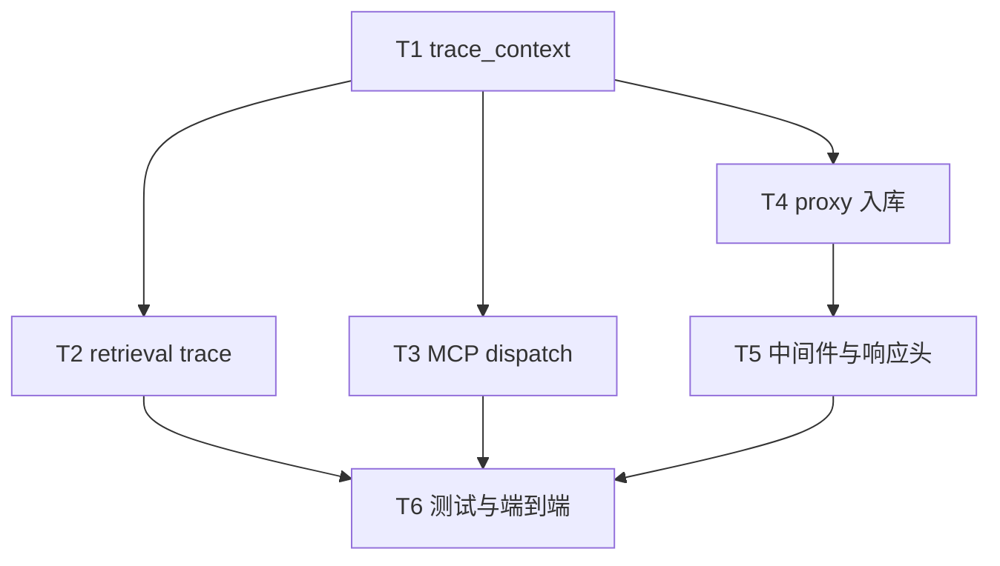

# trace_id 贯穿 MCP 与代理链路 实施计划

**目标：** 同一次 MCP 工具调用内的日志与检索记录共用 trace_id；代理每个请求生成并在 `api_usage`、`gateway_log` 与响应头中留下 trace_id。
**背景：** 当前 `tool_call` 日志无请求标识，检索 trace 与 web 工具各自生成 ID；代理两张表无任何请求 ID，排障只能靠时间对齐。
**架构：** 新增 `core/trace_context.py`（15 行 contextvar）；`_dispatch_tool` 生成并绑定，日志与 `_record_web_trace` 读取；代理中间件生成绑定，入库函数读取；两段链路不自动 join。
**技术栈：** Python 3.12、mcp 2.3.0、aiohttp、sqlite3
**计划状态：** 待批准
**依据：** 用户 2026-11-20 要求；`services/mcp/server.py:263`、`services/retrieval/trace.py:35`、`services/proxy/token_proxy.py:46`、`services/proxy/usage_db.py:248`、`services/proxy/usage_record.py:155`

## 非目标

- 不接入 OpenTelemetry（用户未定，依据：本次只要求贯穿三段日志）。
- 不做 proxy 与 MCP 的自动 join（两条独立连接，无可靠公共键）。
- 不改客户端；Claude Code 不传 trace_id 时服务端自生成。
- 不改工具返回结构（trace_id 只进日志与 retrieval_trace）。

## 全局约束

- 新增列可空，旧数据 `NULL`，读取方不得假设非空。
- `tool_call` 日志保留 `name=`/`ok=`/`elapsed_ms=` 前缀，trace_id 追加在末尾。
- trace_id 格式沿用 `rt_%Y%m%d_%H%M%S_%6hex`（`retrieval/trace.py:35`）。
- 代理与 MCP 均不得因 trace 失败影响主流程。

## 复杂度追踪

无。

## 假设

- 假设 A：`asyncio.to_thread` 会复制 contextvars；若不成立，`websearch` 内读不到 trace_id，改为显式传参。
- 假设 B：`ALTER TABLE ADD COLUMN` 在 SQLite 对可空列安全；若不成立，退回删表重建（不采用）。
- 假设 C：现有客户端忽略未知响应头；若不成立，`X-Trace-Id` 仅写日志不发头。

## 取舍

| 决策 | 代价 | 什么证据会让我改主意 |
|---|---|---|
| 新建 core/trace_context.py 而不是复用 retrieval.trace | 多一个 15 行模块 | 若 proxy 引入 retrieval 依赖可接受，则合并 |
| 代理与 MCP 各自生成 ID、不做 join | 跨段仍需人工按时间关联 | 若客户端支持传 trace_id，则升级为端到端贯穿 |
| 只加日志与表列，不改工具返回 | 模型看不到 trace_id | 若排障要求模型能引用 trace_id，再注入返回 |

## 交付分档

| 阶段 | 范围 | 交付标准 |
|---|---|---|
| MVP | T1-T4 | MCP 日志带 trace_id；代理两表有 trace_id 列与响应头 |
| 完整版 | T1-T5 | 新增单测与端到端脚本通过 |
| 增强 | 后续 | 客户端传 trace_id、OTel 导出 |

## 存储与迁移

| 场景 | 行为 |
|---|---|
| 首次运行 | `init_db()` 建表时包含 `trace_id TEXT` |
| 有旧格式数据 | `PRAGMA table_info` 检测后 `ALTER TABLE ADD COLUMN trace_id TEXT` |
| 数据文件解码失败 | 不涉及，SQLite 由现有逻辑处理 |
| 旧版本程序写回 | 旧代码 INSERT 不含该列，新列留 `NULL` |
| 旧版本读到新数据 | 旧代码 SELECT 指定列，忽略多余列；回滚保留 `NULL` 列即可 |

## 性能与资源预算

| 项 | 上限 | 超限行为 | 验收基线 |
|---|---|---|---|
| trace 生成 | 50 µs | 不适用 | 单次工具调用新增开销 < 1 ms |
| 日志行长度 | 不超过现有 200 字符 | 不适用 | 现有 grep 前缀仍匹配 |

## 文件结构

| 文件 | 动作 | 职责 |
|---|---|---|
| `src/agent_gateway/core/trace_context.py` | 新建 | 请求级 trace_id 的 contextvar |
| `src/agent_gateway/services/retrieval/trace.py` | 修改 | `record()` 缺失时补当前 trace_id |
| `src/agent_gateway/services/mcp/server.py` | 修改 | 工具分发绑定并记录 trace_id |
| `src/agent_gateway/services/proxy/usage_db.py` | 修改 | 建表/迁移与 `gateway_log` 写入 |
| `src/agent_gateway/services/proxy/usage_record.py` | 修改 | `api_usage` 写入带 trace_id |
| `src/agent_gateway/services/proxy/token_proxy.py` | 修改 | 中间件生成、绑定、响应头 |
| `tests/test_trace_context.py` | 新建 | 绑定/重置/缺省与代理入库断言 |

## 依赖图

## 任务

### 任务 1：trace_context

**文件**

- 新建：`src/agent_gateway/core/trace_context.py`
- 测试：`tests/test_trace_context.py`

**接口**

- 产出：`bind(trace_id: str) -> Token`、`reset(token) -> None`、`current() -> str`

**验收**

- [ ] 无绑定时 `current()` 返回空字符串
- [ ] 绑定后同线程读取一致，`reset` 后恢复为空
- [ ] 在 `asyncio.to_thread` 中仍可读到（假设 A 验证）

**验证**

- 命令：`.venv/bin/python -m pytest tests/test_trace_context.py -q`
- 期望：`3 passed`

**依赖 / 规模**：无 / S

- [ ] 步骤 1：写测试，断言三项行为
- [ ] 步骤 2：运行，确认失败
- [ ] 步骤 3：实现模块
- [ ] 步骤 4：运行，确认通过

### 任务 2：retrieval trace 复用当前 ID

**文件**

- 修改：`src/agent_gateway/services/retrieval/trace.py:74-76`（`record` 入口）
- 测试：`tests/test_trace_context.py`

**接口**

- 消费：`trace_context.current() -> str`
- 产出：`record(payload)` 输出行带 `trace_id`

**验收**

- [ ] 已绑定 trace_id 时，`record` 不新生成
- [ ] 未绑定时保持现有行为

**验证**

- 命令：`.venv/bin/python -m pytest tests/test_trace_context.py -q`
- 期望：PASS

**依赖 / 规模**：T1 / S

- [ ] 步骤 1：补测试
- [ ] 步骤 2：实现 `payload.setdefault("trace_id", current())`
- [ ] 步骤 3：运行

### 任务 3：MCP 工具分发

**文件**

- 修改：`src/agent_gateway/services/mcp/server.py:263-277`（`_dispatch_tool`）、`:565-569`（`_record_web_trace`）
- 测试：`tests/test_trace_context.py`

**接口**

- 消费：`trace_context.bind/reset/current`
- 产出：日志行 `tool_call name=<n> ok=<b> elapsed_ms=<n> trace_id=<id>`

**验收**

- [x] 每次工具调用日志带 trace_id
- [x] `_record_web_trace` 与日志同一 ID
- [x] 异常路径（工具抛错）仍重置 context

**验证**

- 命令：`.venv/bin/python -m pytest tests/test_web_trace.py tests/test_trace_context.py -q`
- 期望：PASS

**依赖 / 规模**：T1 / M

- [x] 步骤 1：改写 `_dispatch_tool`
- [x] 步骤 2：`_record_web_trace` 改为 `current_or_new()`
- [x] 步骤 3：运行测试

### 任务 4：代理入库带 trace_id

**文件**

- 修改：`src/agent_gateway/services/proxy/usage_db.py:71-86`（建表与迁移）、`:248-285`（`record_gateway_log`）
- 修改：`src/agent_gateway/services/proxy/usage_record.py:155-190`（INSERT）
- 测试：`tests/test_trace_context.py`

**接口**

- 消费：`trace_context.current()`
- 产出：两表 `trace_id` 列

**验收**

- [x] 旧库启动后自动加列
- [x] 新写入行 trace_id 非空（中间件绑定时）
- [x] 旧行保持 `NULL`，读取不报错

**验证**

- 命令：`.venv/bin/python -m pytest tests/test_token_proxy.py tests/test_trace_context.py -q`
- 期望：PASS

**依赖 / 规模**：T1 / M

- [x] 步骤 1：建表语句加列 + 迁移
- [x] 步骤 2：两处 INSERT 加字段
- [x] 步骤 3：运行测试

### 任务 5：代理中间件

**文件**

- 修改：`src/agent_gateway/services/proxy/token_proxy.py:46-89`

**接口**

- 产出：响应头 `X-Trace-Id`
- 消费：`trace_context.new_id()` 生成；`_forward` 在 `prepare()` 前写头，`HTTPException` 在 `raise` 前写头

**验收**

- [x] 每个请求生成新 ID 并绑定
- [x] 响应头与 `gateway_log`/`api_usage` 一致
- [x] 异常路径同样带 ID

**验证**

- 命令：`.venv/bin/python -m pytest tests/test_token_proxy.py -q`
- 期望：PASS

**依赖 / 规模**：T4 / S

- [x] 步骤 1：中间件生成与重置
- [x] 步骤 2：写响应头
- [ ] 步骤 3：运行测试

### 任务 6：端到端与真实任务

**文件**

- 新建：`tests/eval/trace_id/2026-11-20/run.sh`
- 证据：同目录 `evidence/`

**验收**

- [x] 本机：MCP 工具调用日志与 retrieval trace 同 ID
- [x] 本机：代理请求响应头与 `api_usage.trace_id` 一致
- [x] Lume `utility-env` 内真实任务跑通，证据回传（见 `evidence/2026-11-20.md`）

**验证**

- 命令：`bash tests/eval/trace_id/2026-11-20/run.sh`
- 期望：末行 `RESULT PASS`

**依赖 / 规模**：T2、T3、T5 / M

- [x] 步骤 1：写本机脚本
- [x] 步骤 2：跑通
- [x] 步骤 3：VM 内复跑

## 检查点

### 检查点 A（任务 1-5 后）

- [x] 全部相关测试通过
- [x] `ruff check` 通过
- [x] 旧库启动无迁移错误

## 未覆盖输入类

| 输入或条件 | 期望行为 | 对应测试任务 |
|---|---|---|
| 未绑定 trace 的工具调用 | 自生成，不报错 | T3 |
| 旧库无 trace_id 列 | 自动迁移 | T4 |
| 工具抛异常 | 日志带 ID 且 context 重置 | T3 |

## 风险与回滚

| 风险 | 影响 | 缓解 | 回滚 |
|---|---|---|---|
| ALTER 失败 | 中 | 先备份 `data.sqlite` 到废纸篓 | `sqlite3` 删列需重建表，改用备份恢复 |
| contextvar 泄漏到下一请求 | 中 | `finally` 必重置 | 去掉绑定，仅保留日志参数 |
| 日志格式影响 grep | 低 | 前缀不变、字段追加末尾 | 删除 trace_id 字段 |

## 开放问题

- 无。

## 批准记录

- 状态：已批准（用户 2026-11-20 明确要求实施并做 VM 端到端）
- 批准人：用户
- 批准时间：2026-11-20
