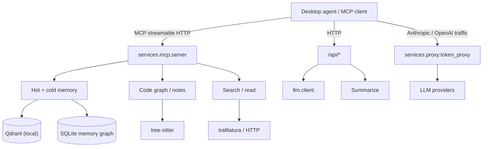

# agent-gateway

English | [简体中文](README.zh.md)

[](https://github.com/yuanyxh/agent-gateway/actions/workflows/ci.yml)
[](https://www.python.org/downloads/)
[](LICENSE)

A self-hosted AI capability layer for desktop agents. It provides the parts an agent
needs beyond the model itself — durable memory, code intelligence, web access and a
model gateway — behind MCP and plain HTTP.

The package runs as a standalone Python service or as a subprocess of a larger host.
It does not depend on a desktop framework, and hosts integrate through MCP tools,
HTTP endpoints and JSON contracts instead of importing internals.

> Status: 0.1.0. The public surface is usable, but interfaces may still change
> between minor releases.

## Features

### Durable memory

- **Two-tier storage.** The hot layer keeps raw facts in mem0 backed by an embedded
  Qdrant collection. The cold layer indexes consolidated knowledge in a separate
  collection. Both share one embedder and one local vector store.
- **Write-time hygiene.** Near-duplicate facts are deduplicated, contradictory
  memories are checked, and facts from the same episode are grouped so related
  context can be recalled together.
- **Lifecycle control.** Memories move through active, superseded, archived and
  deleted states. Important entries can be protected, and superseded versions stay
  traceable instead of being overwritten.
- **Memory graph.** A SQLite graph records version chains, episode membership,
  derivation, contradictions, related entries and mentions, and exposes them through
  `memory_graph`.
- **Bounded growth.** Scheduled jobs archive stale entries, consolidate summaries and
  fold summary budgets, so the hot layer does not grow without limit.

### Retrieval

- Three retrieval arms — dense hot memory, dense cold memory and lexical project
  notes — are fused and gated by a single pipeline.
- Relevance floors are calibrated per embedding model and can be re-calibrated when
  the model changes.
- Responses carry a status (`ok` / `weak_match` / `no_match`) and trace metadata, so
  callers can tell an empty result from a weak one.

### Project intelligence

- A resident tree-sitter indexer builds a per-project symbol and call graph for
  Python, Swift, JavaScript/TypeScript/TSX, Java, Kotlin, Objective-C and Vue.
- `project_lookup` returns definitions with one-hop caller context.
- `project_impact` walks callers or callees to show what a change touches.
- `project_notes` searches project Markdown by meaning, using hybrid semantic,
  keyword and path ranking with de-duplication.

### Web access

- `websearch_engine` queries configurable search engines, including Bing,
  DuckDuckGo, Brave, Sogou, 360, Baidu and Marginalia. Google can be plugged in
  through an external command provider.
- `read_url` converts pages to Markdown with trafilatura, falls back to a lighter
  converter for short or empty pages, and discards boilerplate.
- Search caching, per-engine rate limits and optional top-page fetching are built in.

### Model gateway

- The token proxy accepts Anthropic- and OpenAI-shaped traffic on `/v1/*`, with
  `/open/*` and `/raw/*` aliases for compatibility and transparent forwarding.
- Requests are routed by exact model name across multiple providers; the upstream
  model can be remapped.
- Streaming responses, `gzip`/`deflate`/`br`/`zstd` decoding, SSE usage extraction
  and per-request accounting are handled in one place.
- Optional request/response rewrites include tool-output compaction, repeated skill
  de-duplication and a per-request annotation of what was rewritten.
- Usage is stored in SQLite and exposed through `/usage/summary`, `/usage/tools` and
  `/usage/layers`.

### Local-first operation

- `config.yaml` is the single configuration source; environment variables override
  individual values.
- Vector data, caches, logs and SQLite databases stay under `GATEWAY_HOME` and
  `GATEWAY_CACHE`.
- No hosted control plane and no telemetry. The embedding model is downloaded once
  and then served from the local cache.

## Architecture



| Module | Path | Responsibility |
| --- | --- | --- |
| CLI | `src/agent_gateway/cli/` | `agent-gateway` entry, service supervision, contract export |
| Core | `src/agent_gateway/core/` | Config, paths, logging, ports, prompts, l10n |
| LLM | `src/agent_gateway/llm/` | One exit point for model calls |
| MCP | `src/agent_gateway/services/mcp/` | MCP server, REST routes, memory tools, project tools |
| Memory | `src/agent_gateway/services/memory/` | Memory graph, links, retention, consolidation |
| Retrieval | `src/agent_gateway/services/retrieval/` | Pipeline, fusion, gating, calibration, tracing |
| Graph | `src/agent_gateway/services/graph/` | tree-sitter indexer, resolvers, language parsers |
| Search | `src/agent_gateway/services/search/` | Search engine registry and execution |
| Read / fetch | `src/agent_gateway/services/read/`, `fetch/`, `markdown/` | Page retrieval and Markdown conversion |
| Proxy | `src/agent_gateway/services/proxy/` | Token proxy, provider routing, usage accounting |
| Summarize | `src/agent_gateway/services/summarize/` | Memory summarization pipeline |
| Knowledge | `src/agent_gateway/services/knowledge/` | Knowledge card refill job |
| Scanner | `src/agent_gateway/scanner/` | AST symbol extractor and JS helper |

## Requirements

- Python 3.12 or newer.
- A local directory for Qdrant data and the embedding model cache.
- Optional: Node.js 18+ only if you use the JavaScript/Vue branch of the legacy AST
  scanner. The graph indexer is pure Python.

## Install

From source:

```bash
git clone https://github.com/yuanyxh/agent-gateway.git
cd agent-gateway
python -m venv .venv
. .venv/bin/activate
pip install -e ".[proxy,memory,server]"
```

Extras are additive; install the ones for the features you use:

| Extra | Installs |
| --- | --- |
| `server` | MCP server, HTTP layer, page extraction |
| `memory` | mem0, fastembed, numpy, Qdrant client |
| `proxy` | aiohttp and Brotli/zstd decoders |

Build a wheel for distribution:

```bash
python -m build
```

The wheel includes prompts, locale files and the `ast-js` helper, so a host can
install it into an isolated environment without copying source files.

## Quick start

Create a configuration root:

```bash
mkdir -p ~/.config/agent-gateway
export GATEWAY_HOME="$HOME/.config/agent-gateway"
```

Write `~/.config/agent-gateway/config.yaml`:

```yaml
mcp:
  enabled: true
  qdrantPath: ~/.config/agent-gateway/data/qdrant
  embedderModel: sentence-transformers/all-MiniLM-L6-v2
  knowledgeBasePath: ~/notes

modelProxy:
  enabled: false
```

Check the environment and start the MCP service:

```bash
agent-gateway --check
agent-gateway --serve --service mcp
```

The first start downloads the embedding model into the cache. The service listens on
`http://127.0.0.1:9001`; point an MCP client at the streamable HTTP endpoint:

```json
{
  "mcpServers": {
    "agent-gateway": {
      "url": "http://127.0.0.1:9001/mcp"
    }
  }
}
```

`/health` reports liveness. If `mcp.port` is `0`, the CLI probes for a free port and
records it under `GATEWAY_HOME/runtime/`.

### Enable the model gateway

Add one or more providers and start the proxy:

```yaml
modelProxy:
  enabled: true
  providers:
    - name: anthropic
      url: https://api.anthropic.com
      apiFormat: anthropic
      apiKey: "your-key"
      models: [claude-sonnet-5-5]
```

```bash
agent-gateway --serve --service proxy
```

Point the client's base URL at `http://127.0.0.1:8613`. Provider URLs are base URLs
without the protocol path; the proxy appends `v1/messages` or
`v1/chat/completions` according to the client and provider formats.

## MCP tools

| Tool | Purpose |
| --- | --- |
| `remember` | Write one fact with context, type, sources, importance and lifecycle links |
| `remember_batch` | Write several facts in one call |
| `recall` | Search hot memory, cold knowledge and project notes |
| `catch_up` | Read recent memories since a number of days, with pagination |
| `forget` | Delete a memory or knowledge point |
| `set_memory_processed` | Set or clear processing bits on memories |
| `memory_get` | Read one memory by id, including archived entries |
| `memory_graph` | Follow version, episode, derivation, dispute or mention edges |
| `project_lookup` | Find a symbol or file definition with one-hop callers |
| `project_impact` | Walk callers or callees to estimate change impact |
| `project_notes` | Search project Markdown by meaning and keywords |
| `websearch_engine` | Search the web and optionally fetch top pages |
| `read_url` | Convert a page to Markdown |
| `tool_resource` | Load a packaged reference or script when instructed |

Skills found under `<notes>/MCP/Skills` are also exposed as zero-argument tools.

## HTTP API

The MCP service exposes generic REST capabilities on the same port:

| Method | Path | Purpose |
| --- | --- | --- |
| `GET` | `/health` | Liveness |
| `POST` | `/api/summarize` | Summarize text with an instruction |
| `POST` | `/api/read` | Fetch a URL as Markdown |
| `POST` | `/api/llm/chat` | Run one LLM turn |
| `POST` | `/api/memory/add_knowledge` | Add a cold-layer knowledge entry |
| `GET` | `/api/memories/recent` | List recent memories |
| `POST` | `/api/memories/processed` | Update memory processing state |
| `POST` | `/api/memories/status` | Set lifecycle status |
| `POST` | `/api/project/notes/prewarm` | Pre-index a project's notes |
| `POST` | `/api/consolidation/run` | Run consolidation, optionally dry-run |
| `GET` | `/api/retrieval/stats` | Retrieval counters |
| `POST` | `/api/retrieval/rebuild` | Rebuild a vector index |
| `GET` | `/api/retrieval/rebuild/status` | Rebuild progress |
| `POST` | `/api/retrieval/diagnose` | Diagnose retrieval for a query |
| `POST` | `/api/retrieval/calibrate` | Calibrate relevance floors |

The token proxy adds:

| Method | Path | Purpose |
| --- | --- | --- |
| Any | `/v1/{path}` | Anthropic/OpenAI-compatible forwarding |
| Any | `/open/{path}` | Legacy alias |
| Any | `/raw/{path}` | Transparent forwarding without rewrites |
| `GET` | `/health` | Liveness |
| `GET` | `/usage/summary` | Token usage summary |
| `GET` | `/usage/tools` | Per-tool call counts |
| `GET` | `/usage/layers` | Request-level usage records |

## Configuration

`agent-gateway` reads `$GATEWAY_HOME/config.yaml` unless `GATEWAY_CONFIG` points to
another file. An environment variable always wins over the YAML value; the YAML
value wins over the built-in default.

| Variable | Purpose |
| --- | --- |
| `GATEWAY_HOME` | State root; defaults to `~/.config/agent-gateway` |
| `GATEWAY_CONFIG` | Explicit config file |
| `GATEWAY_CACHE` | Cache root; defaults to `~/.cache/agent-gateway` |
| `UTILITY_DATA_DIR` | Legacy alias for the state root |
| `MCP_PORT`, `MODEL_PROXY_PORT` | Service ports |
| `QDRANT_PATH`, `FASTEMBED_CACHE_PATH`, `EMBEDDER_MODEL` | Vector storage and embedder |
| `AI_API_KEY`, `AI_LLM_TIMEOUT`, `SUMMARY_MODEL`, `SUMMARY_API_URL` | Model access |
| `RETRIEVAL_TRACE`, `RETRIEVAL_TRACE_DAYS` | Retrieval tracing |
| `GATEWAY_SEARCH_ENGINES`, `GATEWAY_SEARCH_ORDER`, `GATEWAY_SEARCH_PROVIDERS` | Search overrides |

Main `config.yaml` sections:

| Section | Contents |
| --- | --- |
| `ai` | API key, base URL, model, timeout |
| `mcp` | Enable switch, port, storage paths, embedder, notes, memory limits |
| `modelProxy` | Enable switch, port, providers, output filter, skill dedup |
| `search` | Engine list, order, per-engine endpoints and rate limits |
| `knowledge` | Topics, pool target, failure streak, retention |
| `general` | Language, log size and rotation |

`contracts/env.json` is generated from the implementation and lists every
environment variable the package reads. `contracts/entries.json` lists the module
entry points a host can start. Consumers can validate against these files instead of
scanning source across repositories.

## Development

```bash
pip install -e ".[proxy,memory,server]"
pip install ruff build

ruff format --check src tests scripts
ruff check src tests scripts
PYTHONPATH=src python -m unittest discover -s tests -t .
python -m build
agent-gateway --check
```

The same commands run in GitHub Actions. Enable the local hooks once:

```bash
git config core.hooksPath .githooks
```

`pre-commit` runs formatting and lint checks; `commit-msg` enforces
`type(scope): summary`.

## Project layout

```text
src/agent_gateway/     package source
  cli/                 command line and contract export
  core/                config, paths, logging, lifecycle constants
  llm/                 single model-call exit point
  services/            MCP, memory, retrieval, graph, search, read, proxy, summarize
  scanner/             AST symbol extractor and JS helper
  prompts/             prompt templates per language
  locales/             UI strings per language
contracts/             generated JSON contracts for host integration
scripts/               maintenance and evaluation scripts
tests/                 unittest suite
```

## Contributing

Issues and pull requests are welcome. Keep changes focused, add tests for behavior
changes, and run the development commands above before opening a pull request.

## License

MIT. See [LICENSE](LICENSE).
