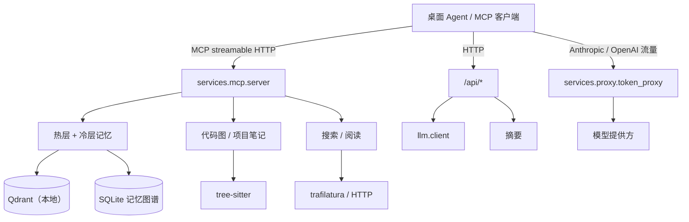

# agent-gateway

[English](README.md) | 简体中文

[](https://github.com/yuanyxh/agent-gateway/actions/workflows/ci.yml)
[](https://www.python.org/downloads/)
[](LICENSE)

面向桌面 Agent 的自托管 AI 能力层。它提供模型之外 Agent 需要的能力——持久记忆、
代码理解、网页访问与模型网关——并统一封装为 MCP 与 HTTP 接口。

本包既可以作为独立的 Python 服务运行，也可以作为大型宿主的子进程运行。它不依赖
特定桌面框架；宿主通过 MCP 工具、HTTP 端点与 JSON 契约接入，而不是导入内部实现。

> 状态：0.1.0。公开接口已可用，但在次版本之间仍可能调整。

## 特性

### 持久记忆

- **两层存储。** 热层用 mem0 保存原始事实，底层是内嵌的 Qdrant 集合；冷层在独立
  集合中索引整理后的知识。两层共用同一个嵌入模型与本地向量库。
- **写入时治理。** 近似重复的事实会去重，矛盾记忆会检查，同一段经历中的事实按
  episode 分组，召回时可以带出相关上下文。
- **生命周期。** 记忆在 active、superseded、archived、deleted 之间流转；重要条目
  可以保护，被取代的版本保留追溯链而不是直接覆盖。
- **记忆图谱。** SQLite 图记录版本链、episode 归属、派生关系、矛盾、关联与提及，
  并通过 `memory_graph` 查询。
- **有界增长。** 定时任务归档过期条目、整合摘要并按预算折叠，避免热层无限增长。
- **关联网络。** episode 分组成为神经元，神经元之间以带权突触相连：每日向量近邻加
  LLM 审查建边，写入权重用原始余弦（0.62 门槛），稀疏码参与候选排序。检索可沿最强
  路径做吸引子扩散，同批召回会强化突触，夜间重放生成低权重推断边（14 天未采纳撤销）；
  每周任务把神经元归入 active、warm、archive、trash 并按时限物理清理。

### 检索

- 稠密热层、稠密冷层与词法项目笔记三路检索，由同一条管线融合与门控。
- 相关性下限按嵌入模型标定，更换模型后可以重新标定。
- 返回值带有状态（`ok` / `weak_match` / `no_match`）与追踪信息，调用方可以区分
  “没有结果”与“只有弱相关结果”。

### 项目理解

- 常驻的 tree-sitter 索引器为每个项目建立符号与调用图，支持 Python、Swift、
  JavaScript/TypeScript/TSX、Java、Kotlin、Objective-C 与 Vue。
- `project_lookup` 返回定义以及一跳调用方上下文。
- `project_impact` 沿调用方或被调用方遍历，展示改动会影响哪些位置。
- `project_notes` 按语义检索项目 Markdown，并结合关键词与路径排序、去重。

### 网页访问

- `websearch_engine` 查询可配置的搜索引擎，内置 Bing、DuckDuckGo、Brave、搜狗、
  360、百度与 Marginalia；Google 可以通过外部命令提供方接入。
- `read_url` 用 trafilatura 把页面转成 Markdown；短页面或空页面退回轻量转换器，
  并丢弃模板噪声。
- 内置搜索缓存、按引擎限速与可选的首页抓取。

### 模型网关

- token 代理在 `/v1/*` 上接收 Anthropic 与 OpenAI 两种协议的流量，并提供 `/open/*`
  兼容入口与 `/raw/*` 透明转发入口。
- 按模型名精确路由到多个提供方，并支持改写上游模型名。
- 流式响应、`gzip`/`deflate`/`br`/`zstd` 解码、SSE 用量提取与逐请求记录集中在
  一处处理。
- 可选的请求/响应改写包括工具输出压缩、重复工具输出去重，以及逐请求说明本轮改写
  了什么。
- 用量写入 SQLite，并通过 `/usage/summary`、`/usage/tools`、`/usage/layers` 查询。

### 本地优先

- `agent-gateway.yaml` 是唯一配置源，环境变量可以覆盖单项配置。
- 向量数据、缓存、日志与 SQLite 数据库都位于 `GATEWAY_HOME` 与 `GATEWAY_CACHE`
  下。
- 不依赖托管控制面，也不上报遥测。嵌入模型首次下载后由本地缓存提供。

## 架构



| 模块 | 路径 | 职责 |
| --- | --- | --- |
| CLI | `src/agent_gateway/cli/` | `agent-gateway` 入口、服务托管、契约导出 |
| Core | `src/agent_gateway/core/` | 配置、路径、日志、端口、提示词、国际化 |
| LLM | `src/agent_gateway/llm/` | 模型调用的唯一出口 |
| MCP | `src/agent_gateway/services/mcp/` | MCP 服务、REST 路由、记忆与项目工具 |
| Memory | `src/agent_gateway/services/memory/` | 记忆图谱、关联、保留与整合 |
| Retrieval | `src/agent_gateway/services/retrieval/` | 检索管线、融合、门控、标定与追踪 |
| Graph | `src/agent_gateway/services/graph/` | tree-sitter 索引器、解析器与符号解析 |
| Search | `src/agent_gateway/services/search/` | 搜索引擎注册与执行 |
| Read / fetch | `src/agent_gateway/services/read/`、`fetch/`、`markdown/` | 页面抓取与 Markdown 转换 |
| Proxy | `src/agent_gateway/services/proxy/` | token 代理、提供方路由、用量统计 |
| Summarize | `src/agent_gateway/services/summarize/` | 记忆摘要管线 |
| Knowledge | `src/agent_gateway/services/knowledge/` | 知识卡片补充任务 |
| Scanner | `src/agent_gateway/scanner/` | AST 符号提取器与 JS 辅助脚本 |

## 环境要求

- Python 3.12 或更高版本。
- 用于 Qdrant 数据与嵌入模型缓存的本地目录。
- 可选：仅当使用旧版 AST 扫描器的 JavaScript/Vue 分支时需要 Node.js 18+。
  图索引器是纯 Python 实现。

## 安装

从源码安装：

```bash
git clone https://github.com/yuanyxh/agent-gateway.git
cd agent-gateway
python -m venv .venv
. .venv/bin/activate
pip install -e ".[proxy,memory,server]"
```

可选依赖按需叠加，安装你要用的能力对应的 extra：

| extra | 安装内容 |
| --- | --- |
| `server` | MCP 服务、HTTP 层、页面提取 |
| `memory` | mem0、fastembed、numpy、Qdrant 客户端 |
| `proxy` | aiohttp 与 Brotli/zstd 解码器 |

构建可分发的 wheel：

```bash
python -m build
```

wheel 内含提示词、语言包与 `ast-js` 辅助脚本，宿主可以直接安装到隔离环境，无需
复制源码。

## 快速开始

创建配置根目录：

```bash
mkdir -p ~/.config/agent-gateway
export GATEWAY_HOME="$HOME/.config/agent-gateway"
```

写入 `~/.config/agent-gateway/agent-gateway.yaml`：

```yaml
server:
  mcp:
    enabled: true
  proxy:
    enabled: false

memory:
  qdrantPath: ~/.config/agent-gateway/data/qdrant
  embedder:
    model: sentence-transformers/all-MiniLM-L6-v2

notes:
  dir: ~/notes
```

检查环境并启动 MCP 服务：

```bash
agent-gateway --check
agent-gateway --serve --service mcp
```

首次启动会把嵌入模型下载到缓存。服务监听 `http://127.0.0.1:9001`，把 MCP 客户端
指向 streamable HTTP 端点：

```json
{
  "mcpServers": {
    "agent-gateway": {
      "url": "http://127.0.0.1:9001/mcp"
    }
  }
}
```

`/health` 返回存活状态。若 `server.mcp.port` 为 `0`，CLI 会探测空闲端口，并把结果记录到
`GATEWAY_HOME/runtime/`。

### 启用模型网关

添加一个或多个提供方并启动代理：

```yaml
server:
  proxy:
    enabled: true
    providers:
      - name: anthropic
      url: https://api.anthropic.com
      apiFormat: anthropic
      apiKey: "your-key"
      models: [claude-sonnet-5-5]
```

```bash
agent-gateway --serve --service proxy
```

把客户端的 base URL 指向 `http://127.0.0.1:8613`。提供方 `url` 只写基础地址，不带
协议路径；代理会根据客户端与提供方格式追加 `v1/messages` 或
`v1/chat/completions`。

## MCP 工具

| 工具 | 用途 |
| --- | --- |
| `remember` | 写入一条事实，可带上下文、类型、来源、重要度与生命周期关联 |
| `remember_batch` | 一次写入多条事实 |
| `recall` | 检索热层记忆、冷层知识与项目笔记 |
| `catch_up` | 读取最近若干天的记忆，支持分页 |
| `forget` | 删除一条记忆或知识条目 |
| `set_memory_processed` | 设置或清除记忆的处理位 |
| `memory_get` | 按 id 读取单条记忆，包括归档条目 |
| `memory_graph` | 沿版本、episode、派生、矛盾或提及边遍历 |
| `project_lookup` | 查找符号或文件定义，并返回一跳调用方 |
| `project_impact` | 遍历调用方或被调用方，评估改动影响 |
| `project_notes` | 按语义与关键词检索项目 Markdown |
| `websearch_engine` | 搜索网页，可选抓取首页内容 |
| `read_url` | 把页面转换为 Markdown |
| `tool_resource` | 在收到指令时加载包内参考文件或脚本 |

`<笔记目录>/MCP/Skills` 下的 skill 也会以无参数工具的形式暴露。

## HTTP API

MCP 服务在同一端口提供通用 REST 能力：

| 方法 | 路径 | 用途 |
| --- | --- | --- |
| `GET` | `/health` | 存活检查 |
| `POST` | `/api/summarize` | 按指令总结文本 |
| `POST` | `/api/read` | 抓取 URL 并返回 Markdown |
| `POST` | `/api/llm/chat` | 执行一次模型对话 |
| `POST` | `/api/memory/add_knowledge` | 写入冷层知识 |
| `GET` | `/api/memories/recent` | 列出最近记忆 |
| `POST` | `/api/memories/processed` | 更新记忆处理状态 |
| `POST` | `/api/memories/status` | 设置生命周期状态 |
| `POST` | `/api/project/notes/prewarm` | 预热项目笔记索引 |
| `POST` | `/api/consolidation/run` | 执行整合，可 dry-run |
| `GET` | `/api/retrieval/stats` | 检索统计 |
| `POST` | `/api/retrieval/rebuild` | 重建向量索引 |
| `GET` | `/api/retrieval/rebuild/status` | 重建进度 |
| `POST` | `/api/retrieval/diagnose` | 诊断指定查询的检索结果 |
| `POST` | `/api/retrieval/calibrate` | 标定相关性下限 |

token 代理额外提供：

| 方法 | 路径 | 用途 |
| --- | --- | --- |
| 任意 | `/v1/{path}` | Anthropic/OpenAI 兼容转发 |
| 任意 | `/open/{path}` | 兼容旧配置的别名 |
| 任意 | `/raw/{path}` | 不做内容改写的透明转发 |
| `GET` | `/health` | 存活检查 |
| `GET` | `/usage/summary` | token 用量汇总 |
| `GET` | `/usage/tools` | 按工具统计调用次数 |
| `GET` | `/usage/layers` | 请求级用量记录 |

## 配置

除非 `GATEWAY_CONFIG` 指向其他文件，`agent-gateway` 读取
`$GATEWAY_HOME/agent-gateway.yaml`。环境变量始终优先于 YAML，YAML 优先于内置默认值。
旧宿主的 `config.yaml` 形状会翻译成新结构并保留一个发布周期
（`GATEWAY_CONFIG_FORMAT=legacy` 可强制走适配器）。

| 环境变量 | 用途 |
| --- | --- |
| `GATEWAY_HOME` | 状态根目录，默认 `~/.config/agent-gateway` |
| `GATEWAY_CONFIG` | 显式指定配置文件 |
| `GATEWAY_CACHE` | 缓存根目录，默认 `~/.cache/agent-gateway` |
| `GATEWAY_PROJECT_DIR` | 项目内状态目录名，默认 `.agent-gateway` |
| `GATEWAY_LANG`、`GATEWAY_LOG_MAX_SIZE`、`GATEWAY_LOG_BACKUP_COUNT` | 语言与日志轮转 |
| `MCP_PORT`、`MODEL_PROXY_PORT` | 服务端口 |
| `QDRANT_PATH`、`FASTEMBED_CACHE_PATH`、`EMBEDDER_MODEL` | 向量存储与嵌入模型 |
| `AI_API_KEY`、`AI_LLM_TIMEOUT`、`SUMMARY_MODEL`、`SUMMARY_API_URL` | 模型访问 |
| `RETRIEVAL_TRACE`、`RETRIEVAL_TRACE_DAYS` | 检索追踪 |
| `GATEWAY_SEARCH_*` | 搜索引擎列表、顺序、提供方与运行时限制 |

`UTILITY_DATA_DIR`、`UTILITY_LANG`、`UTILITY_LOG_*` 与 `UTILITY_USER_ID` 作为
已弃用别名保留一个发布周期。

`agent-gateway.yaml` 的主要配置段：

| 配置段 | 内容 |
| --- | --- |
| `llm` | API key、base URL、模型、超时 |
| `language`、`logging` | 界面/提示词语言与日志轮转 |
| `server.mcp`、`server.proxy` | 启用开关、端口、提供方、输出过滤、工具输出去重 |
| `memory`、`notes` | Qdrant、嵌入模型、记忆上限、笔记路径与规则 |
| `search` | 引擎列表、顺序、各引擎端点与限速 |
| `knowledge`、`summary`、`graph` | 产品模块与项目图配置 |

`memory.neuron` 配置关联网络：`enabled`、`build`、`maintenance` 开关，扩散
`maxDepth` / `beam` / `activationFloor`，分层保留 `archiveDays` / `trashDays`，
每日建边 `llmPairs`，以及并行审查批次 `reviewConcurrency`。

`memory.brain` 是网关原生键（`pairMode` 默认 v3、`sparseFloor`、`attractor`、
`forgetting`、`buffer`、`replay`、`semantic`），宿主会把 `mcp.brain` 写入 `agent-gateway.yaml`，
改用户 `config.yaml` 后重启生效。
`neurons.centroid` 必须与现役 `EMBEDDER_MODEL` 同源同维：换模型后用
`scripts/memory_centroids.py` 重算质心，再 `memory_brain_backfill.py --sparse --force`
重算稀疏码；跨模型的余弦不可比较。

`contracts/env.json` 从实现生成，列出本包读取的全部环境变量；
`contracts/entries.json` 列出宿主可以启动的模块入口。消费方可以基于这些文件校验，
而不是跨仓扫描源码。

## 开发

```bash
pip install -e ".[proxy,memory,server]"
pip install ruff build

ruff format --check src tests scripts
ruff check src tests scripts
PYTHONPATH=src python -m unittest discover -s tests -t .
python -m build
agent-gateway --check
```

GitHub Actions 执行同一组命令。本地钩子只需启用一次：

```bash
git config core.hooksPath .githooks
```

`pre-commit` 执行格式化与静态检查；`commit-msg` 校验
`类型(范围): 摘要` 格式。

## 项目结构

```text
src/agent_gateway/     包源码
  cli/                 命令行与契约导出
  core/                配置、路径、日志、生命周期常量
  llm/                 模型调用的唯一出口
  services/            MCP、记忆、检索、图、搜索、阅读、代理、摘要
  scanner/             AST 符号提取器与 JS 辅助脚本
  prompts/             分语言提示词模板
  locales/             分语言界面文案
contracts/             供宿主集成的生成式 JSON 契约
scripts/               维护与评测脚本
tests/                 unittest 测试集
```

## 参与贡献

欢迎提交 Issue 与 Pull Request。改动保持聚焦，行为变更补充测试，并在提交前运行
上面的开发命令。

## 许可证

MIT，见 [LICENSE](LICENSE)。
